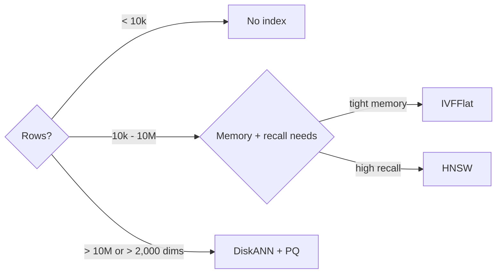

## What this covers

A decision guide for vector indexes on Azure Database for PostgreSQL: when no index is fine, when to use IVFFlat, HNSW or Azure's DiskANN (`pg_diskann`), how to size each index's parameters for the dataset, how to build and rebuild without downtime, and how to check that indexes are used. The mechanics of IVFFlat and HNSW are in [Perform fast vector similarity search](/study/develop-ai-solutions-with-azure-database-for-postgresql/perform-fast-vector-similarity-search).

**Exam weight:** Develop AI solutions by using Azure data management services (30–35%)

**Skills measured**

- "Implement indexing strategies, including optimizing query latency and reducing pgvector compute overhead"

## Key concepts

### Do you need an index?

| Rows | Index benefit |
| --- | --- |
| < 10,000 | Little; exact scan is often fast enough |
| 10k – 100k | Noticeable latency gain |
| 100k – 1M | Usually required for interactive use |
| > 1M | Essential |

Skip the index when filters always shrink the candidate set to a few thousand rows first, when you need guaranteed exact results, or when data churns so fast that maintenance costs more than it saves.

### IVFFlat sizing

- `lists`: about `rows / 1000` up to 1M rows; 4,000–10,000 for 1M–10M; `sqrt(rows)` beyond. For 2M rows, start around 1,500–2,000.
- `ivfflat.probes`: start at `sqrt(lists)` (for 1,000 lists, roughly 30) and tune for recall.
- Pros: fast build, small, probes tunable at runtime. Cons: needs training data, recall ceiling below HNSW, rebuild when data drifts.

### HNSW sizing

- `m` 16 default; 32 for higher recall. Memory and build time rise with `m`.
- `ef_construction` ≥ `2 × m`; `4 × m` or more for quality. It affects build time and graph quality, not query time.
- `hnsw.ef_search` 40 default; 100–200 for high recall; must be ≥ `LIMIT`.
- Size is about 1.5× the vector data at `m = 16`. Changing `m`/`ef_construction` means a rebuild.
- Pros: best recall/latency, works from an empty table, no training. Cons: memory-hungry, slower builds (HNSW 1M rows is tens of minutes, 10M rows hours).

### DiskANN (`pg_diskann`, Azure only)

Microsoft's graph index, designed to keep high recall at very large scale without needing the whole graph in RAM.

- Allow-list `pg_diskann` in `azure.extensions`, then `CREATE EXTENSION pg_diskann CASCADE;` (pulls in `vector`).
- Index method `diskann` with the same opclasses (`vector_cosine_ops`, `vector_l2_ops`, `vector_ip_ops`).
- Build parameters: `max_neighbors` (default 32), `l_value_ib` (build search list, default 100), `product_quantized` (default false).
- Query parameters: `diskann.l_value_is` (default 100), `diskann.iterative_search` (`relaxed_order` default, `strict_order`, `off`).
- Product quantization compresses vectors so more fit in memory, is recommended above about 1M rows, and lets DiskANN index up to **16,000 dimensions**. Pair it with a re-rank query (fetch about 50 by approximate distance, then re-order by exact distance).
- Guidance: < 1M rows `max_neighbors` 32; 1–50M rows 64 + PQ; > 50M rows 96 + PQ.

### Choosing

| Situation | Index |
| --- | --- |
| Small table or tiny filtered subsets | None (exact) |
| Memory tight, bulk reloads, 90–95% recall OK | IVFFlat |
| Read-heavy, 99% recall, memory available | HNSW |
| Tens of millions+ vectors or > 2,000 dims on Azure | DiskANN (with PQ) |
| Dev/test fast iteration | IVFFlat |

### Building safely

- `CREATE INDEX` blocks writes; `CREATE INDEX CONCURRENTLY` doesn't (slower, can't run in a transaction).
- `REINDEX INDEX CONCURRENTLY` rebuilds in place without blocking writes. For IVFFlat this recomputes centroids; for HNSW and DiskANN it rebuilds the graph.
- Speed up builds: `maintenance_work_mem`, `max_parallel_maintenance_workers`, and temporarily scaling compute up.
- Monitor with `pg_stat_progress_create_index`; confirm usage with `pg_stat_user_indexes.idx_scan`.

## How it works



## Hands-on

### Azure portal

1. **Server parameters > azure.extensions**: select **VECTOR** and **PG_DISKANN**, **Save**.
2. Temporarily scale **Compute + storage** up before a large index build, then scale back.
3. Watch **CPU percent** and **Memory percent** during the build.

### Azure CLI

```bash
az postgres flexible-server parameter set -g <resource-group> --server-name <server-name> \
  --name azure.extensions --value vector,pg_diskann
```

```sql
-- IVFFlat for cosine
CREATE INDEX ON products USING ivfflat (embedding vector_cosine_ops) WITH (lists = 1000);
SET ivfflat.probes = 30;

-- HNSW without blocking writes
CREATE INDEX CONCURRENTLY idx_products_embedding
ON products USING hnsw (embedding vector_cosine_ops) WITH (m = 16, ef_construction = 64);
SET hnsw.ef_search = 100;

-- DiskANN with product quantization
CREATE EXTENSION IF NOT EXISTS pg_diskann CASCADE;
SET maintenance_work_mem = '8GB';
CREATE INDEX idx_products_diskann ON products USING diskann (embedding vector_cosine_ops)
WITH (max_neighbors = 64, l_value_ib = 100, product_quantized = true);

-- Re-rank PQ results with exact distances
SELECT id FROM (
    SELECT id, embedding <=> $1 AS distance FROM products
    ORDER BY embedding <=> $1 LIMIT 50
) t ORDER BY t.distance LIMIT 10;

-- Health checks
SELECT phase, blocks_total, blocks_done, tuples_total, tuples_done FROM pg_stat_progress_create_index;
SELECT indexrelname, idx_scan, pg_size_pretty(pg_relation_size(indexrelid)) AS size
FROM pg_stat_user_indexes WHERE relname = 'products';
REINDEX INDEX CONCURRENTLY idx_products_embedding;
```

### Python

```python
import math
import psycopg

def suggest_ivfflat(conn: psycopg.Connection, table: str = "products") -> dict:
    rows = conn.execute(f"SELECT count(*) FROM {table}").fetchone()[0]  # trusted table name only
    lists = max(1, rows // 1000) if rows <= 1_000_000 else int(math.sqrt(rows))
    return {"rows": rows, "lists": lists, "probes": max(1, int(math.sqrt(lists)))}
```

## Exam traps

| Requirement | Answer |
| --- | --- |
| Highest recall, ample RAM | HNSW |
| Lowest memory, quick rebuilds | IVFFlat |
| 100M+ vectors on Azure Database for PostgreSQL | DiskANN with product quantization |
| 3,072-dim `vector` index | DiskANN with PQ, or `halfvec` + HNSW |
| Rebuild without write downtime | `CREATE INDEX CONCURRENTLY` / `REINDEX ... CONCURRENTLY` |
| Raise recall without rebuild | `ef_search` / `probes` / `diskann.l_value_is` |

> [!WARNING]
> **Exam trap:** DiskANN is an Azure Database for PostgreSQL feature (`pg_diskann`), not part of open-source pgvector, and still needs allow-listing.

> [!WARNING]
> **Exam trap:** `ef_construction` doesn't change query speed; `hnsw.ef_search` does.

> [!TIP]
> IVF = "Inverted File" = buckets; HNSW = layered graph; DiskANN = graph built to scale past RAM.

> [!NOTE]
> The two Azure docs pages disagree on DiskANN's `l_value_ib` default (100 on the DiskANN page, 50 on the pgvector performance page). Set it explicitly.

## Quick review

- Under 10k rows, an exact scan is usually enough.
- IVFFlat `lists` ≈ rows/1000 (≤1M) or sqrt(rows); `probes` ≈ sqrt(lists).
- HNSW `m` 16, `ef_construction` ≥ 2×m, `ef_search` ≥ LIMIT.
- DiskANN: `max_neighbors`, `l_value_ib`, `product_quantized`; up to 16,000 dims with PQ.
- `CONCURRENTLY` keeps writes flowing during builds.
- Check `pg_stat_user_indexes` to confirm indexes are used.

## Practice

[Practice: indexing questions](/practice/pg-indexing)

## Official references

- [AI-200 study guide](https://learn.microsoft.com/en-us/credentials/certifications/resources/study-guides/ai-200)
- [Unit: Choose and configure vector indexes](https://learn.microsoft.com/en-us/training/modules/optimize-vector-search-azure-database-postgresql/3-choose-configure-vector-indexes)
- [Enable and use DiskANN](https://learn.microsoft.com/en-us/azure/postgresql/extensions/how-to-use-pgdiskann)
- [Optimize performance when using pgvector](https://learn.microsoft.com/en-us/azure/postgresql/extensions/how-to-optimize-performance-pgvector)
- [Microsoft Learn](https://learn.microsoft.com/)
