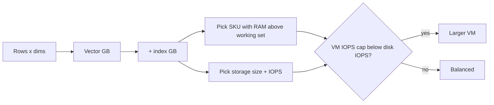

## What this covers

How to choose and change the compute SKU, memory and storage of an Azure Database for PostgreSQL flexible server so a vector workload has enough RAM for its indexes, enough CPU for distance calculations and enough IOPS for the rest. It also covers the storage behaviours the exam likes to test: storage can only grow, autogrow, the read-only threshold, and the fact that both the VM and the disk cap IOPS.

**Exam weight:** Develop AI solutions by using Azure data management services (30–35%)

**Skills measured**

- "Configure compute, memory, and storage resources to support vector workloads"

## Key concepts

### Size from the vector index outward

1. **Vector data** ≈ `dims × 4 bytes × rows` (`halfvec`: × 2 bytes). 1,536 dims × 2M rows ≈ 12 GB.
2. **Index** ≈ +50–100% for HNSW (1.5–2× vector data in total), less for IVFFlat. DiskANN with product quantization keeps a compressed copy in memory.
3. **RAM target**: the hot index plus working set should fit in memory with headroom. The module suggests RAM at least 1.5× the vector index for 1–10M vectors.
4. **vCores**: concurrency × per-query CPU. Sustained CPU above about 70% at peak means scale up.

### Compute SKUs

| Tier | Series | Memory | Example SKUs | Notes |
| --- | --- | --- | --- | --- |
| Burstable | B | B1ms 2 GiB … B20ms 80 GiB | Standard_B2s | CPU credits; when they run out the server is throttled to baseline. Not for production. No PgBouncer. |
| General Purpose | Dds/Dads v4–v6 | 4 GiB per vCore | Standard_D4ds_v5 (16 GiB) | Balanced. |
| Memory Optimized | Eds/Eads v4–v6 | ~6.75–9.5 GiB per vCore | Standard_E8ds_v5 (64 GiB) | Best for in-memory HNSW. |

vCores can be scaled up or down. The change needs a short restart, so connections drop and apps must retry. You can scale up temporarily for a big index build or backfill and scale down after.

### VM limits on IOPS

Every SKU has a maximum IOPS and throughput, for example D4ds_v5 about 6,400 IOPS and 145 MiB/s, E8ds_v5 about 12,800 IOPS. A fast disk can't exceed the VM's cap, so a small VM on a large disk is still IO-bound. Check **Disk IOPS consumed percentage** and **Storage IO percent**.

### Storage options

| | Premium SSD | Premium SSD v2 |
| --- | --- | --- |
| Max size | 32 TiB | 64 TiB |
| Max IOPS | 20,000 | 80,000 |
| Max throughput | 900 MB/s | 1,200 MB/s |
| IOPS model | Fixed by disk size (e.g. 128 GiB ≈ 500 baseline, burst to 3,500) | Set IOPS and throughput independently; 3,000 IOPS and 125 MB/s included |
| Resize granularity | Fixed sizes | 1 GiB steps |
| Storage autogrow | Supported | Check current docs/region support |

Premium SSD v2 is usually the better price/performance choice for IO-heavy vector work, because you can buy IOPS without buying capacity.

### Storage rules the exam tests

- **Storage only scales up**, never down. Over-provisioning is permanent until you migrate.
- At **95% used, or less than 5 GiB free**, the server switches to **read-only**. Writes fail; backups and WAL archiving can suffer.
- **Storage autogrow** (Premium SSD) grows the disk before it fills.
- Alert on `storage_percent`, and include index size and WAL in the plan. A new HNSW index on a large table can add gigabytes at once.

### Memory-related parameters

`shared_buffers` is set per SKU and changes when you resize. `maintenance_work_mem` should be raised for index builds. `work_mem` should be set per session. See [Tune PostgreSQL for pgvector](/study/develop-ai-solutions-with-azure-database-for-postgresql/tune-postgresql-for-pgvector).

## How it works



## Hands-on

### Azure portal

1. Server, **Compute + storage**.
2. Select **Compute tier** (Memory Optimized for large vector indexes) and **Compute size**.
3. Choose **Storage type** (Premium SSD v2 for tunable IOPS), set size, IOPS and throughput.
4. For Premium SSD, enable **Storage Auto-growth**.
5. **Save**, then create an alert on **Storage percent > 80**.

### Azure CLI

```bash
# Scale compute (short restart)
az postgres flexible-server update -g <resource-group> -n <server-name> \
  --tier MemoryOptimized --sku-name Standard_E8ds_v5

# Grow storage (cannot shrink later) and turn on autogrow (Premium SSD)
az postgres flexible-server update -g <resource-group> -n <server-name> \
  --storage-size 512 --storage-auto-grow Enabled

# Premium SSD v2: tune IOPS and throughput independently
az postgres flexible-server update -g <resource-group> -n <server-name> \
  --iops 12000 --throughput 500

az postgres flexible-server show -g <resource-group> -n <server-name> \
  --query "{sku:sku.name, tier:sku.tier, storage:storage}"
```

```sql
-- Measure before sizing
SELECT pg_size_pretty(pg_total_relation_size('document_chunks')) AS total,
       pg_size_pretty(pg_indexes_size('document_chunks'))        AS indexes;
SHOW shared_buffers;
```

### Python

```python
def recommend_sku(rows: int, dims: int, half: bool = False, hnsw_factor: float = 2.0) -> dict:
    """Rough sizing helper: RAM >= 1.5x (vectors + HNSW)."""
    vec_gb = rows * dims * (2 if half else 4) / 1024**3
    working_gb = vec_gb * hnsw_factor
    ram_needed = working_gb * 1.5
    # Memory Optimized v5: 8 GiB per vCore
    vcores = next(v for v in (2, 4, 8, 16, 20, 32, 48, 64, 96) if v * 8 >= ram_needed)
    return {"vector_gb": round(vec_gb, 1), "ram_target_gb": round(ram_needed, 1),
            "suggested": f"Standard_E{vcores}ds_v5"}

print(recommend_sku(2_000_000, 1536))
```

## Exam traps

| Requirement | Choice |
| --- | --- |
| HNSW index must stay in RAM | Memory Optimized tier |
| High IOPS without buying terabytes | Premium SSD v2 with provisioned IOPS |
| Disk nearly full, prevent outage | Storage autogrow / scale storage up + alert |
| Reduce over-provisioned storage | Not possible in place: migrate or restore to a smaller server |
| IO-bound despite fast disk | Bigger VM (VM IOPS cap) |
| Dev/test cost | Burstable (not for production) |

> [!WARNING]
> **Exam trap:** Storage can't be scaled down. "Reduce storage from 1 TiB to 256 GiB" isn't an in-place operation.

> [!WARNING]
> **Exam trap:** At 95% storage usage the server becomes read-only. Inserts of new embeddings start failing even though reads work.

> [!TIP]
> RAM for the index, vCores for concurrency, disk for IOPS. Check all three caps.

> [!NOTE]
> Burstable servers can become unresponsive when CPU credits run out. Watch the **CPU Credits Remaining** metric.

## Quick review

- Vector GB = dims × 4 × rows; HNSW roughly doubles the total.
- General Purpose 4 GiB per vCore; Memory Optimized about 6.75–9.5 GiB per vCore.
- Compute scales up and down with a short restart; storage only scales up.
- Premium SSD v2: up to 80,000 IOPS and 1,200 MB/s, tuned separately from size.
- VM SKUs cap IOPS regardless of disk.
- Read-only at 95% storage or under 5 GiB free; enable autogrow and alerts.

## Practice

[Practice: compute, memory and storage questions](/practice/pg-compute)

## Official references

- [AI-200 study guide](https://learn.microsoft.com/en-us/credentials/certifications/resources/study-guides/ai-200)
- [Compute options](https://learn.microsoft.com/en-us/azure/postgresql/compute-storage/concepts-compute)
- [Storage options](https://learn.microsoft.com/en-us/azure/postgresql/compute-storage/concepts-storage)
- [Unit: Scale for high-volume workloads](https://learn.microsoft.com/en-us/training/modules/optimize-vector-search-azure-database-postgresql/5-scale-high-volume-workloads)
