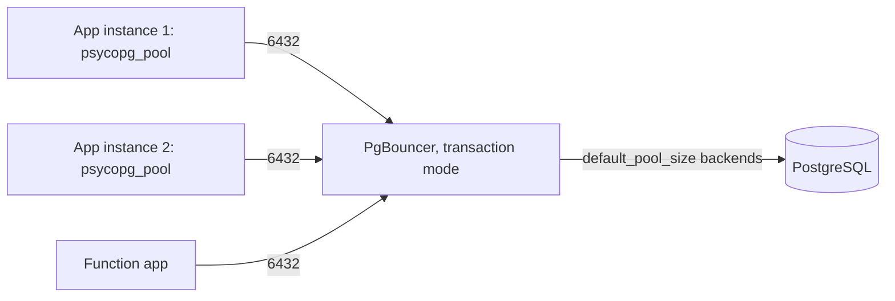

## What this covers

How to get high throughput and low latency from Azure Database for PostgreSQL when many app instances run vector queries: what a new connection costs, the per-SKU connection limits, the built-in PgBouncer pooler and its modes, application-side pools (psycopg_pool, Npgsql), per-query session settings that are safe with pooling, batching, async I/O, and resilience (retries, timeouts, pool exhaustion).

**Exam weight:** Develop AI solutions by using Azure data management services (30–35%)

**Skills measured**

- "Implement connection optimization to improve throughput and minimize latency"

## Key concepts

### What a connection costs

Opening a connection means a TCP handshake, TLS negotiation, authentication (password or Entra token), forking a backend process and initializing the session. That's about 50–200 ms, often more than the vector query itself. Each backend also holds memory. Connect-per-request designs waste time and hit limits during spikes.

### Connection limits

`max_connections` depends on the SKU. Examples: B1ms 50, B2s 429, D2 (2 vCores) 859, D4 / E2 1,718, D8 / E4 3,437, 16+ vCores (MO) 5,000. Azure reserves a few connections for replication and monitoring. Exceeding the limit gives `FATAL: remaining connection slots are reserved` or `too many clients` errors.

### Built-in PgBouncer

- Runs on the server VM. Enable it with `pgbouncer.enabled = true` (no restart), connect to the **same host on port 6432**. General Purpose and Memory Optimized only, **not Burstable**.
- Supports Microsoft Entra authentication. After an HA failover it restarts on the new primary, so the connection string stays the same.
- Key parameters (Azure defaults): `pgbouncer.pool_mode` = `transaction`, `pgbouncer.default_pool_size` = 50 server connections per user/database pair, `pgbouncer.max_client_conn` = 5,000, `pgbouncer.min_pool_size` = 0, `pgbouncer.query_wait_timeout` = 120 s, `pgbouncer.server_idle_timeout` = 600 s, `pgbouncer.max_prepared_statements` = 0.
- Metrics need `metrics.pgbouncer_diagnostics = on`. The admin console (database `pgbouncer`) is opened to users listed in `pgbouncer.stats_users`.

| Pool mode | Server connection held for | Reduction | Caveats |
| --- | --- | --- | --- |
| session | Whole client session | Low | Everything works |
| **transaction** | One transaction | High | `SET` doesn't stick, advisory locks/`LISTEN`/`NOTIFY` break, named prepared statements need `max_prepared_statements > 0` |
| statement | One statement | Highest | No multi-statement transactions |

For vector search, transaction mode is the usual choice.

### Application-side pools

- **psycopg_pool** `ConnectionPool(min_size, max_size, max_idle, max_lifetime)` and `AsyncConnectionPool`. `with pool.connection()` always returns the connection, even on error.
- **Npgsql** pools by default. Tune with `Minimum Pool Size`, `Maximum Pool Size`, `Connection Idle Lifetime`, `Connection Lifetime`. Each distinct connection string gets its own pool.
- **Sizing**: `max_size` per instance ≈ (server connections you can afford) ÷ (number of app instances), with headroom. For example, 10 instances and 1,000 usable connections gives about 100 each, or less if PgBouncer's `default_pool_size` is the real bottleneck.
- Recycle connections every 30–60 minutes (`max_lifetime`). With Entra auth, each new connection needs a fresh token.
- App pool + PgBouncer together: the app pool removes connect latency, PgBouncer multiplexes many app pools onto few backends.

### Pool-safe session settings

Use `SET LOCAL` inside a transaction for `work_mem`, `hnsw.ef_search`, `ivfflat.probes`, `hnsw.iterative_scan`. It resets at commit or rollback, so the next borrower doesn't inherit it.

### Fewer round trips

- `WHERE id = ANY(%s)` with a list instead of N single-row queries.
- `COPY` for bulk embedding loads (hundreds of thousands of rows per second versus thousands for single inserts).
- `AsyncConnectionPool` + `asyncio.gather` to run several independent searches concurrently.

### Resilience

- Retry `OperationalError` with exponential backoff plus jitter (`2**attempt + random()`), capped attempts.
- `connect_timeout` (for example 10 s) and `statement_timeout` (for example 30 s, lower for interactive).
- Pool exhaustion: catch `psycopg_pool.PoolTimeout` and return a clear "busy, retry" error; scale when it's frequent.
- Restarts (scaling, failover) drop all connections, including PgBouncer's. Pools reconnect; apps must retry.

## How it works



## Hands-on

### Azure portal

1. **Server parameters**: set `pgbouncer.enabled` = `true`, **Save**. Leave the blade and reopen it to see the other `pgbouncer.*` settings.
2. Adjust `pgbouncer.default_pool_size`, `pgbouncer.max_client_conn`, `pgbouncer.pool_mode`.
3. Set `metrics.pgbouncer_diagnostics` = `on`; chart **Waiting client connections** and **Active connections**.

### Azure CLI

```bash
az postgres flexible-server parameter set -g <resource-group> --server-name <server-name> \
  --name pgbouncer.enabled --value true
az postgres flexible-server parameter set -g <resource-group> --server-name <server-name> \
  --name pgbouncer.default_pool_size --value 40
az postgres flexible-server parameter set -g <resource-group> --server-name <server-name> \
  --name metrics.pgbouncer_diagnostics --value on
az postgres flexible-server parameter show -g <resource-group> --server-name <server-name> \
  --name max_connections --query value
```

```sql
-- PgBouncer admin console (port 6432, database pgbouncer, user in pgbouncer.stats_users)
SHOW POOLS;
SHOW STATS;
-- Server side: who is connected
SELECT state, count(*) FROM pg_stat_activity GROUP BY state;
```

### Python

```python
import asyncio, random, time
import psycopg
from psycopg_pool import ConnectionPool, AsyncConnectionPool, PoolTimeout

CONNINFO = ("host=<server-name>.postgres.database.azure.com port=6432 dbname=appdb "
            "user=<app-identity-name> sslmode=require connect_timeout=10")

pool = ConnectionPool(
    CONNINFO,
    min_size=5, max_size=20, max_idle=300, max_lifetime=3600,
    kwargs={"prepare_threshold": None,                       # PgBouncer transaction mode
            "options": "-c statement_timeout=30000"},
    # connection_class=EntraConnection  -> fresh token per connection (see Integrate SDKs page)
)

def search_similar_products(query_embedding, limit=10, ef_search=100):
    for attempt in range(4):
        try:
            with pool.connection(timeout=5) as conn, conn.transaction():
                conn.execute(f"SET LOCAL hnsw.ef_search = {int(ef_search)}")
                return conn.execute(
                    "SELECT id, name, embedding <=> %s AS distance FROM products "
                    "ORDER BY embedding <=> %s LIMIT %s",
                    (query_embedding, query_embedding, limit)).fetchall()
        except PoolTimeout:
            return {"error": "Service temporarily busy, please retry"}
        except psycopg.OperationalError:
            if attempt == 3:
                raise
            time.sleep(2 ** attempt + random.uniform(0, 1))

def get_embeddings(ids: list[int]):
    with pool.connection() as conn:
        return conn.execute("SELECT id, embedding FROM products WHERE id = ANY(%s)", (ids,)).fetchall()

async def multi_search(apool: AsyncConnectionPool, vectors):
    async def one(v):
        async with apool.connection() as conn:
            cur = await conn.execute(
                "SELECT id FROM products ORDER BY embedding <=> %s LIMIT 5", (v,))
            return await cur.fetchall()
    return await asyncio.gather(*(one(v) for v in vectors))
```

```csharp
// Npgsql: pooling is on by default; tune via the connection string
var cs = "Host=<server-name>.postgres.database.azure.com;Port=6432;Database=appdb;" +
         "Username=<app-identity-name>;SSL Mode=Require;" +
         "Minimum Pool Size=5;Maximum Pool Size=20;Connection Idle Lifetime=300;Connection Lifetime=3600";
```

## Exam traps

| Symptom / need | Answer |
| --- | --- |
| Thousands of short-lived connections from Functions | Built-in PgBouncer on 6432, transaction mode |
| `too many clients` during spikes | Pooling (app pool + PgBouncer), size pools by instance count |
| PgBouncer option missing | Server is Burstable; move to GP/MO |
| `SET hnsw.ef_search` "randomly" not applied | Transaction pooling; use `SET LOCAL` |
| Prepared statement errors via PgBouncer | `pgbouncer.max_prepared_statements > 0` or disable client auto-prepare |
| Many sequential lookups | `= ANY(array)` batching or async gather |

> [!WARNING]
> **Exam trap:** In transaction mode, session state (`SET`, temp tables, `LISTEN/NOTIFY`, advisory locks) doesn't survive between transactions.

> [!WARNING]
> **Exam trap:** PgBouncer listens on **6432**; connecting to 5432 bypasses it entirely.

> [!TIP]
> App pool saves connect time; PgBouncer saves server backends. Use both at scale.

> [!NOTE]
> Built-in PgBouncer is single-threaded. For extreme connection churn, run several PgBouncer (or PgCat) instances on VMs behind a load balancer.

## Quick review

- New connections cost 50–200 ms and server memory.
- `max_connections` scales with SKU (B1ms 50 up to 5,000).
- PgBouncer: port 6432, GP/MO only, default transaction mode, `default_pool_size` 50, `max_client_conn` 5,000.
- `SET LOCAL` for per-query tuning under pooling.
- Pool max ≈ usable connections ÷ app instances; recycle hourly.
- Retry `OperationalError` with backoff + jitter; handle `PoolTimeout` gracefully.

## Practice

[Practice: connection optimization questions](/practice/pg-connections)

## Official references

- [AI-200 study guide](https://learn.microsoft.com/en-us/credentials/certifications/resources/study-guides/ai-200)
- [Unit: Connection optimization](https://learn.microsoft.com/en-us/training/modules/optimize-vector-search-azure-database-postgresql/6-connection-optimization)
- [PgBouncer in flexible server](https://learn.microsoft.com/en-us/azure/postgresql/connectivity/concepts-pgbouncer)
- [psycopg 3 documentation](https://www.psycopg.org/psycopg3/docs/)
- [Microsoft Learn](https://learn.microsoft.com/)
