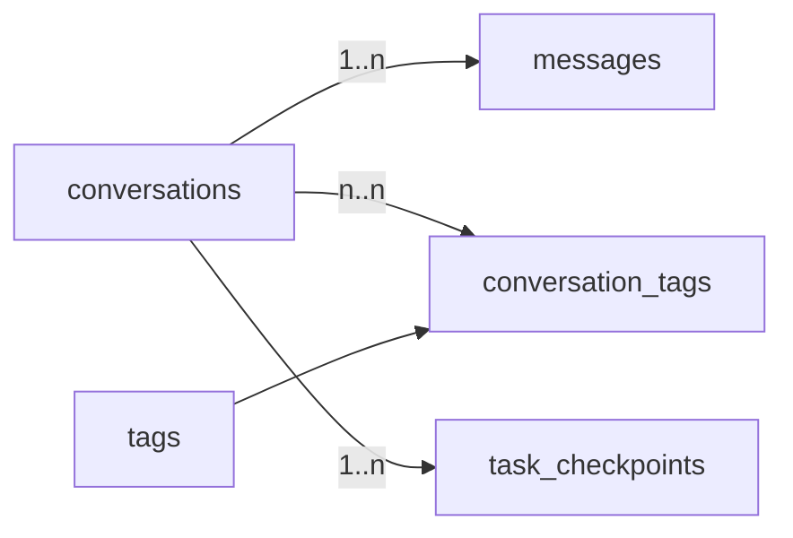

## What this covers

How to lay out tables for AI back ends (conversations, messages, task state, documents) in Azure Database for PostgreSQL: where databases and schemas fit, picking keys and data types, enforcing integrity with constraints and foreign keys, adding basic B-tree indexes, and changing a schema safely. Vector columns are covered in [Store and query embeddings with pgvector](/study/develop-ai-solutions-with-azure-database-for-postgresql/store-and-query-embeddings-with-pgvector).

**Exam weight:** Develop AI solutions by using Azure data management services (30–35%)

**Skills measured**

- "Model schemas and implement indexing strategies, including designing tables and choosing appropriate data types"

## Key concepts

### Object hierarchy

Server → database → schema → table/index/function. A connection targets one database and can't query another database directly. Inside a database, schemas are namespaces; `public` is the default.

- **Separate databases**: full isolation, separate apps sharing one server, or independent restore needs.
- **Separate schemas**: logical grouping or per-tenant namespaces when you still want cross-schema joins and foreign keys.
- Most single-app AI back ends need one database and `public`.

### Primary keys

| Option | When |
| --- | --- |
| `SERIAL` (32-bit) | Small tables, under about 2 billion rows |
| `BIGSERIAL` (64-bit) | High insert volume (messages, events) |
| `UUID DEFAULT gen_random_uuid()` | IDs generated outside the database, merging sources, not leaking row counts |
| Composite key | Junction tables, e.g. `(conversation_id, tag_id)` |

`GENERATED ALWAYS AS IDENTITY` is the SQL-standard alternative to `SERIAL`.

### Data types for AI workloads

- **JSONB**: binary JSON. You can index it with GIN and query it with `->`, `->>`, `@>`, `?`. Use it for variable metadata, model parameters and tool outputs. Avoid the older `json` type for querying.
- **TEXT vs VARCHAR(n)**: same performance. Use `VARCHAR(n)` only when you want the database to enforce a maximum length.
- **TIMESTAMPTZ**: stores UTC and converts on display. Always prefer it over `TIMESTAMP` for events.
- **BYTEA**: small binary values. Put large files in Azure Blob Storage and keep the URL in the row.
- **NUMERIC(p,s)**: exact money and prices. **BOOLEAN** for flags.
- **vector(n) / halfvec(n)**: embeddings (pgvector).

### Constraints

`NOT NULL`, `DEFAULT`, `CHECK` (for example `CHECK (role IN ('user','assistant','system'))`), `UNIQUE` and `PRIMARY KEY`. They're checked on every insert and update, so bad data fails at the database, not later in an LLM prompt.

### Relationships

A foreign key enforces that the referenced row exists. Referential actions:

| Action | Effect on child rows when parent is deleted |
| --- | --- |
| `NO ACTION` / `RESTRICT` (default behaviour) | Delete is blocked |
| `CASCADE` | Children deleted too |
| `SET NULL` | FK set to NULL |
| `SET DEFAULT` | FK set to its default |

Use `ON DELETE CASCADE` deliberately. Deleting one conversation removes every message. Many-to-many relationships use a junction table with a composite primary key.

### Index basics

Primary keys and unique constraints get B-tree indexes automatically. Add B-tree indexes on columns used in `WHERE`, `JOIN` and `ORDER BY`. PostgreSQL does **not** auto-index foreign key columns. A composite index `(a, b)` serves filters on `a` or `a AND b`, but not `b` alone. Every index costs storage and slows writes, so be selective on insert-heavy tables like `messages`.

### Changing schemas

`ALTER TABLE ... ADD COLUMN` with a constant default is metadata-only (no table rewrite) since PostgreSQL 11. Most DDL in PostgreSQL is transactional, so related changes can be wrapped in `BEGIN ... COMMIT` and rolled back together. Exceptions are `CREATE INDEX CONCURRENTLY` and `VACUUM`. `DROP TABLE` is refused while other tables reference it, unless you add `CASCADE`, which drops the dependent constraints.

## How it works



## Hands-on

### Azure portal

1. Open the server, then **Databases**, and select **Add** to create `appdb`.
2. Open **Connect** to copy a psql command, or use the **PostgreSQL for VS Code** extension with Entra auth.
3. Run the SQL below in your editor.

### Azure CLI

```bash
az postgres flexible-server db create \
  --resource-group <resource-group> --server-name <server-name> \
  --database-name appdb
```

```sql
CREATE TABLE conversations (
    id BIGSERIAL PRIMARY KEY,
    session_id UUID NOT NULL,
    user_id VARCHAR(255) NOT NULL,
    started_at TIMESTAMP WITH TIME ZONE DEFAULT CURRENT_TIMESTAMP,
    ended_at TIMESTAMP WITH TIME ZONE,
    metadata JSONB DEFAULT '{}'::jsonb
);

CREATE TABLE messages (
    id BIGSERIAL PRIMARY KEY,
    conversation_id BIGINT NOT NULL REFERENCES conversations(id) ON DELETE CASCADE,
    role VARCHAR(50) NOT NULL CHECK (role IN ('user', 'assistant', 'system')),
    content TEXT NOT NULL,
    created_at TIMESTAMP WITH TIME ZONE DEFAULT CURRENT_TIMESTAMP
);

CREATE TABLE tags (id BIGSERIAL PRIMARY KEY, name TEXT UNIQUE NOT NULL);

CREATE TABLE conversation_tags (
    conversation_id BIGINT REFERENCES conversations(id) ON DELETE CASCADE,
    tag_id BIGINT REFERENCES tags(id) ON DELETE CASCADE,
    PRIMARY KEY (conversation_id, tag_id)
);

-- FK columns are not indexed automatically
CREATE INDEX idx_messages_conversation_created ON messages (conversation_id, created_at);
CREATE INDEX idx_conversations_metadata ON conversations USING gin (metadata);

-- Atomic schema change
BEGIN;
ALTER TABLE conversations ADD COLUMN category VARCHAR(100);
CREATE INDEX idx_conversations_category ON conversations(category);
COMMIT;
```

### Python

```python
import psycopg

DDL = """
CREATE TABLE IF NOT EXISTS task_checkpoints (
    id BIGSERIAL PRIMARY KEY,
    task_id UUID NOT NULL,
    step_number INT NOT NULL,
    checkpoint_data JSONB NOT NULL,
    created_at TIMESTAMPTZ DEFAULT now(),
    updated_at TIMESTAMPTZ,
    UNIQUE (task_id, step_number)
);
"""

with psycopg.connect("<conninfo>") as conn:  # Entra token as password, see Connect to PostgreSQL
    conn.execute(DDL)  # committed when the with-block exits cleanly
```

## Exam traps

| Need | Choose |
| --- | --- |
| Attributes vary per row, filtered by containment | `JSONB` + GIN index |
| Attribute filtered by range and always present | Real typed column + B-tree |
| Event time across regions | `TIMESTAMPTZ` |
| IDs created by clients before insert | `UUID` with `gen_random_uuid()` |
| Billions of rows | `BIGSERIAL`/`BIGINT` |
| Large images or PDFs | Blob Storage + URL column, not `BYTEA` |

> [!WARNING]
> **Exam trap:** A foreign key does not create an index on the child column. Joins and `ON DELETE CASCADE` on large tables scan unless you add one.

> [!WARNING]
> **Exam trap:** A composite index `(conversation_id, created_at)` doesn't help `WHERE created_at > ...` on its own; the leading column must be filtered.

> [!TIP]
> Typed columns for anything you filter or sort on; JSONB for the long tail.

> [!NOTE]
> `TEXT` and `VARCHAR` perform the same in PostgreSQL; the choice is about validation only.

## Quick review

- Server → database → schema → objects; default schema `public`.
- `BIGSERIAL` for high-volume tables, `UUID` when IDs come from outside.
- JSONB is binary and GIN-indexable; prefer it to `json`.
- Use `TIMESTAMPTZ` for timestamps.
- FK actions: RESTRICT/NO ACTION, CASCADE, SET NULL, SET DEFAULT.
- FK columns need manual indexes; composite indexes follow leftmost-prefix rules.
- Most DDL is transactional in PostgreSQL.

## Practice

[Practice: schema and data type questions](/practice/pg-schema)

## Official references

- [AI-200 study guide](https://learn.microsoft.com/en-us/credentials/certifications/resources/study-guides/ai-200)
- [Unit: Create and manage schemas](https://learn.microsoft.com/en-us/training/modules/build-query-azure-database-postgresql/4-create-manage-schemas)
- [Module: Build and query with Azure Database for PostgreSQL](https://learn.microsoft.com/en-us/training/modules/build-query-azure-database-postgresql/)
- [Microsoft Learn](https://learn.microsoft.com/)
