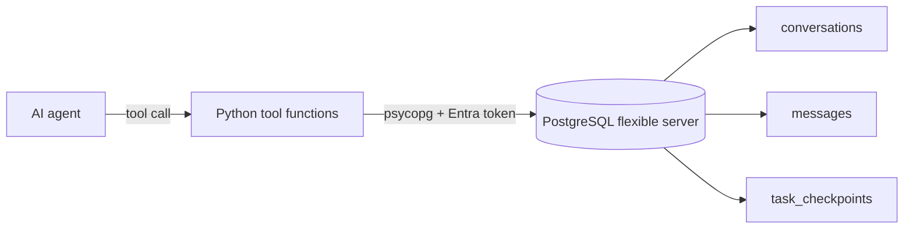

## What this covers

A guided version of the module's 30-minute lab. You deploy an Azure Database for PostgreSQL flexible server that uses Microsoft Entra authentication, design an agent-memory schema (conversations, messages, task checkpoints), write Python functions an AI agent can call as tools, and query the stored context with SQL. The point is that an agent keeps memory across sessions and can resume a half-finished task from its last checkpoint.

**Exam weight:** Develop AI solutions by using Azure data management services (30–35%)

**Skills measured**

- "Connect and query Azure Database for PostgreSQL by using SDKs"
- "Model schemas and implement indexing strategies, including designing tables and choosing appropriate data types"

## Key concepts

### What "agent tool backend" means

An agent (for example one built with an orchestration SDK) decides when to call tools. Here the tools are plain Python functions backed by PostgreSQL:

| Tool | SQL pattern |
| --- | --- |
| `start_conversation(user_id)` | `INSERT ... RETURNING id` |
| `add_message(conversation_id, role, content)` | `INSERT` with a `CHECK` on role |
| `get_recent_messages(conversation_id, n)` | `ORDER BY created_at DESC LIMIT n` on an indexed column |
| `save_checkpoint(task_id, step, data)` | `INSERT ... ON CONFLICT DO UPDATE` |
| `resume_task(task_id)` | latest checkpoint by `step_number DESC LIMIT 1` |

PostgreSQL is a good fit because tool calls need transactions (no half-written state), JSONB for free-form tool output, and strong constraints so the LLM can't write invalid roles or orphan messages.

### Schema choices you should be able to justify

- `BIGSERIAL` keys on high-volume tables (`messages`).
- `UUID` session and task IDs, which the agent can generate before the first insert.
- `TIMESTAMPTZ` for ordering events across regions.
- `JSONB` for checkpoint payloads whose shape changes between steps.
- `UNIQUE (task_id, step_number)` so a retried tool call is idempotent through an upsert.
- Composite index `(conversation_id, created_at)` for "last N messages".

### Lab prerequisites

An Azure subscription, Visual Studio Code, the latest Azure CLI, Python 3.12+ and the `psql` client. The deployment script creates the server and sets your signed-in account as Entra admin. Then the Python code connects with `DefaultAzureCredential`, so no password is needed.

## How it works



1. Download the starter files and set variables in the deployment script.
2. Run the script to deploy the server with Entra authentication.
3. Create the agent-memory tables.
4. Fill in the Python tool functions.
5. Run the provided test script that simulates an agent session and an interrupted task.
6. Query the stored context with psql.

## Hands-on

### Azure portal

1. After the script finishes, open the server and confirm **Authentication** shows your account as Microsoft Entra admin.
2. Check **Networking** shows a firewall rule for your client IP.
3. Open **Databases** and confirm the lab database exists.

### Azure CLI

```bash
az login
az postgres flexible-server show -g <resource-group> -n <server-name> \
  --query "{state:state, version:version, auth:authConfig}"

export PGPASSWORD=$(az account get-access-token --resource-type oss-rdbms --query accessToken -o tsv)
psql "host=<server-name>.postgres.database.azure.com dbname=<database> user=<your-upn> sslmode=require"
```

```sql
CREATE TABLE conversations (
    id BIGSERIAL PRIMARY KEY,
    session_id UUID NOT NULL,
    user_id VARCHAR(255) NOT NULL,
    started_at TIMESTAMPTZ DEFAULT now(),
    ended_at TIMESTAMPTZ,
    metadata JSONB DEFAULT '{}'::jsonb
);
CREATE TABLE messages (
    id BIGSERIAL PRIMARY KEY,
    conversation_id BIGINT NOT NULL REFERENCES conversations(id) ON DELETE CASCADE,
    role VARCHAR(50) NOT NULL CHECK (role IN ('user','assistant','system','tool')),
    content TEXT NOT NULL,
    created_at TIMESTAMPTZ DEFAULT now()
);
CREATE INDEX idx_messages_conv_created ON messages (conversation_id, created_at);
CREATE TABLE task_checkpoints (
    id BIGSERIAL PRIMARY KEY,
    task_id UUID NOT NULL,
    step_number INT NOT NULL,
    checkpoint_data JSONB NOT NULL,
    created_at TIMESTAMPTZ DEFAULT now(),
    updated_at TIMESTAMPTZ,
    UNIQUE (task_id, step_number)
);

-- Context query used by the agent
SELECT m.role, m.content, m.created_at
FROM conversations c JOIN messages m ON m.conversation_id = c.id
WHERE c.session_id = '<session-uuid>' AND c.ended_at IS NULL
ORDER BY m.created_at
LIMIT 50;
```

### Python

```python
import uuid
import psycopg
from psycopg.types.json import Jsonb
from azure.identity import DefaultAzureCredential

def connect() -> psycopg.Connection:
    token = DefaultAzureCredential().get_token(
        "https://ossrdbms-aad.database.windows.net/.default").token
    return psycopg.connect(host="<server-name>.postgres.database.azure.com",
                           dbname="<database>", user="<your-upn>",
                           password=token, sslmode="require")

def start_conversation(conn, user_id: str) -> int:
    return conn.execute(
        "INSERT INTO conversations (session_id, user_id) VALUES (%s, %s) RETURNING id",
        (uuid.uuid4(), user_id)).fetchone()[0]

def add_message(conn, conversation_id: int, role: str, content: str) -> None:
    conn.execute("INSERT INTO messages (conversation_id, role, content) VALUES (%s, %s, %s)",
                 (conversation_id, role, content))

def save_checkpoint(conn, task_id: uuid.UUID, step: int, data: dict) -> bool:
    row = conn.execute("""
        INSERT INTO task_checkpoints (task_id, step_number, checkpoint_data)
        VALUES (%s, %s, %s)
        ON CONFLICT (task_id, step_number)
        DO UPDATE SET checkpoint_data = EXCLUDED.checkpoint_data, updated_at = now()
        RETURNING (xmax = 0) AS is_new""", (task_id, step, Jsonb(data))).fetchone()
    return row[0]

def resume_task(conn, task_id: uuid.UUID):
    return conn.execute("""
        SELECT step_number, checkpoint_data FROM task_checkpoints
        WHERE task_id = %s ORDER BY step_number DESC LIMIT 1""", (task_id,)).fetchone()

with connect() as conn:
    cid = start_conversation(conn, "user123")
    add_message(conn, cid, "user", "Summarize last week's tickets")
```

## Exam traps

| Requirement | Design choice |
| --- | --- |
| Retried tool call must not duplicate state | Unique key + `ON CONFLICT DO UPDATE` |
| Agent must not store invalid roles | `CHECK` constraint |
| Fast "last N messages" | Index on `(conversation_id, created_at)` |
| No secrets in agent code | Entra auth with `DefaultAzureCredential` |
| Variable tool output | `JSONB` column |

> [!WARNING]
> **Exam trap:** Running the agent as the Entra admin works in a lab but is wrong for production; map a dedicated managed identity with least privilege.

> [!TIP]
> Think "memory = rows, resume = latest checkpoint, idempotent = upsert".

> [!NOTE]
> Clean up the lab resource group afterwards (`az group delete -n <resource-group>`) to stop compute charges.

## Quick review

- The lab uses PostgreSQL flexible server with Entra auth and Python tool functions.
- Tables: conversations, messages, task_checkpoints.
- Upsert with `EXCLUDED` keeps checkpoint writes idempotent.
- `RETURNING id` gives the new conversation ID in one round trip.
- `(xmax = 0)` distinguishes inserts from updates.
- Context retrieval joins conversations to messages ordered by time.

## Practice

[Practice: connect and query questions](/practice/pg-connect-query) · [Practice: schema questions](/practice/pg-schema)

## Official references

- [AI-200 study guide](https://learn.microsoft.com/en-us/credentials/certifications/resources/study-guides/ai-200)
- [Unit: Exercise - Build an agent tool backend](https://learn.microsoft.com/en-us/training/modules/build-query-azure-database-postgresql/7-exercise-build-agent-tool-backend)
- [Launch the exercise](https://go.microsoft.com/fwlink/?linkid=2349114)
- [Microsoft Learn](https://learn.microsoft.com/)
