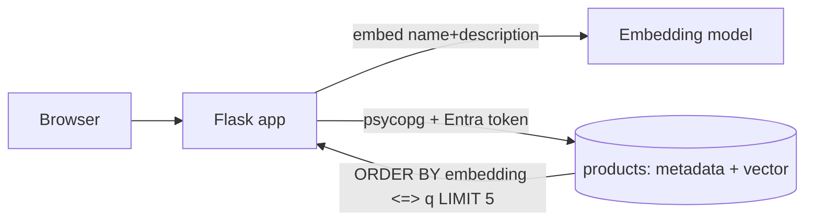

## What this covers

A guided version of the module's 30-minute lab. You deploy Azure Database for PostgreSQL flexible server with Microsoft Entra authentication, enable pgvector, create a `products` table with an embedding column, load sample products through a small Flask web app, and run "find similar products" queries. Then you add products and watch the results change. The same pattern underpins recommendations and semantic search.

**Exam weight:** Develop AI solutions by using Azure data management services (30–35%)

**Skills measured**

- "Run vector similarity search, including storing embeddings, semantic retrieval, and implementing retrieval-augmented generation (RAG) patterns by using metadata filter"
- "Implement indexing strategies, including optimizing query latency and reducing pgvector compute overhead"

## Key concepts

### Lab flow

1. Download the starter project and set variables in the deployment script (resource group, region, server name).
2. Run the script. It deploys the flexible server with Entra auth and your account as admin.
3. While it deploys, finish the Flask app code: connect, insert products, query neighbours.
4. Allow-list and create `vector`, then create the `products` table.
5. Start the app, load products, run similarity searches.
6. Add new products and observe how the nearest neighbours shift.

Prerequisites: Azure subscription, VS Code, latest Azure CLI, Python 3.12+, and the `psql` client.

### Similarity as recommendation

"Customers who viewed X also like..." becomes `ORDER BY embedding <=> (SELECT embedding FROM products WHERE id = X) LIMIT 5`, excluding X itself. Metadata filters (category, in stock, price band) narrow the candidates. New products are searchable as soon as they are inserted: exact search sees them immediately, and HNSW indexes them on insert.

### When to add an index in this lab

The sample catalogue is small, so a sequential scan is fast and gives exact results. In production, with hundreds of thousands of products, add an HNSW index with `vector_cosine_ops` and confirm the plan with `EXPLAIN ANALYZE`. The optimize module's exercise measures the difference.

## How it works



## Hands-on

### Azure portal

1. Open the deployed server and check **Authentication** lists your Entra account.
2. **Server parameters > azure.extensions**: tick **VECTOR**, **Save**.
3. **Networking**: confirm your client IP is allowed so Flask can connect.

### Azure CLI

```bash
az login
az postgres flexible-server parameter set -g <resource-group> --server-name <server-name> \
  --name azure.extensions --value vector

export PGPASSWORD=$(az account get-access-token --resource-type oss-rdbms --query accessToken -o tsv)
psql "host=<server-name>.postgres.database.azure.com dbname=<database> user=<your-upn> sslmode=require"
```

```sql
CREATE EXTENSION IF NOT EXISTS vector;

CREATE TABLE products (
    id BIGSERIAL PRIMARY KEY,
    name TEXT NOT NULL,
    description TEXT,
    category TEXT NOT NULL,
    price NUMERIC(10,2),
    in_stock BOOLEAN DEFAULT true,
    embedding vector(1536)
);

-- Products similar to product 42, same category, in stock
SELECT p.id, p.name, p.embedding <=> t.embedding AS distance
FROM products p, (SELECT embedding, category FROM products WHERE id = 42) t
WHERE p.id <> 42 AND p.category = t.category AND p.in_stock
ORDER BY p.embedding <=> t.embedding
LIMIT 5;

-- For larger catalogues
CREATE INDEX products_embedding_hnsw ON products USING hnsw (embedding vector_cosine_ops);
```

### Python

```python
from flask import Flask, jsonify, request
import psycopg
from pgvector.psycopg import register_vector
from azure.identity import DefaultAzureCredential

app = Flask(__name__)
credential = DefaultAzureCredential()

def get_conn() -> psycopg.Connection:
    token = credential.get_token("https://ossrdbms-aad.database.windows.net/.default").token
    conn = psycopg.connect(host="<server-name>.postgres.database.azure.com", dbname="<database>",
                           user="<your-upn>", password=token, sslmode="require")
    register_vector(conn)
    return conn

def embed(text: str) -> list[float]:
    raise NotImplementedError("call your embedding endpoint here")

@app.post("/products")
def add_product():
    p = request.get_json()
    with get_conn() as conn:
        new_id = conn.execute(
            "INSERT INTO products (name, description, category, price, embedding) "
            "VALUES (%s, %s, %s, %s, %s) RETURNING id",
            (p["name"], p["description"], p["category"], p["price"],
             embed(f"{p['name']}. {p['description']}"))).fetchone()[0]
    return jsonify(id=new_id), 201

@app.get("/products/<int:pid>/similar")
def similar(pid: int):
    with get_conn() as conn:
        rows = conn.execute("""
            SELECT p.id, p.name, p.embedding <=> t.embedding AS distance
            FROM products p, (SELECT embedding FROM products WHERE id = %s) t
            WHERE p.id <> %s
            ORDER BY p.embedding <=> t.embedding LIMIT 5""", (pid, pid)).fetchall()
    return jsonify([{"id": r[0], "name": r[1], "distance": float(r[2])} for r in rows])
```

In a real service, replace the per-request connect with a pool (see [Connection optimization](/study/develop-ai-solutions-with-azure-database-for-postgresql/connection-optimization)).

## Exam traps

| Requirement | Answer |
| --- | --- |
| "Similar items" to a stored item | Use that row's embedding as the query vector; exclude the item itself |
| Only recommend in-stock items in the same category | `WHERE` metadata filters with the vector `ORDER BY` |
| New product must appear in results immediately | Insert with embedding; no rebuild needed for exact search or HNSW |
| `CREATE EXTENSION vector` denied | Allow-list in `azure.extensions` |

> [!WARNING]
> **Exam trap:** Embedding the product name with one model and the query with another gives meaningless distances. Use one model for both.

> [!TIP]
> Recommendation = nearest neighbours of an item; search = nearest neighbours of a query. Same SQL, different query vector.

> [!NOTE]
> Delete the lab resource group when done to stop billing.

## Quick review

- The lab deploys flexible server with Entra auth via script.
- pgvector is allow-listed, then created with `CREATE EXTENSION vector`.
- Products store metadata and `vector(1536)` in one row.
- `<=>` with `ORDER BY ... LIMIT 5` returns the most similar items.
- Inserted items are searchable right away.
- Add HNSW for large catalogues and verify with `EXPLAIN ANALYZE`.

## Practice

[Practice: vector search and RAG questions](/practice/pg-vector-rag) · [Practice: indexing questions](/practice/pg-indexing)

## Official references

- [AI-200 study guide](https://learn.microsoft.com/en-us/credentials/certifications/resources/study-guides/ai-200)
- [Unit: Exercise - Implement vector search](https://learn.microsoft.com/en-us/training/modules/implement-vector-search-azure-database-postgresql/7-exercise-implement-vector-search)
- [Launch the exercise](https://go.microsoft.com/fwlink/?linkid=2348708)
- [Microsoft Learn](https://learn.microsoft.com/)
