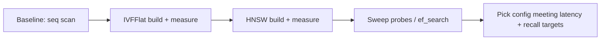

## What this covers

A guided version of the module's 30-minute lab. You deploy Azure Database for PostgreSQL flexible server with Microsoft Entra authentication, generate a test table of embeddings, measure a baseline query with no index, build IVFFlat and HNSW indexes, compare them, and tune `ivfflat.probes` and `hnsw.ef_search` against recall. The method (baseline, change one thing, measure latency and recall) is what exam scenarios test.

**Exam weight:** Develop AI solutions by using Azure data management services (30–35%)

**Skills measured**

- "Implement indexing strategies, including optimizing query latency and reducing pgvector compute overhead"
- "Configure compute, memory, and storage resources to support vector workloads"

## Key concepts

### Lab flow

1. Download starter files and configure the deployment script.
2. Deploy the flexible server with Entra auth.
3. Create a test dataset of random or sample embeddings.
4. Run `EXPLAIN ANALYZE` on a top-10 query with no index (sequential scan, exact).
5. Build IVFFlat, measure; drop it; build HNSW, measure.
6. Sweep `probes` and `ef_search` and record latency versus recall.

Prerequisites: Azure subscription, VS Code, latest Azure CLI and `psql`.

### Measuring recall

Recall@k = |ANN top-k ∩ exact top-k| / k. Get the exact answer by disabling index scans for one transaction (`SET LOCAL enable_indexscan = off`), or by running before the index exists, then compare it with the indexed result for the same query vectors. Average over many queries.

### What you should observe

| Configuration | Latency | Recall | Notes |
| --- | --- | --- | --- |
| No index | Highest, grows with rows | 100% | `Seq Scan` + sort; parallel workers may help |
| IVFFlat, `probes = 1` | Low | Lowest | Default probes; few lists scanned |
| IVFFlat, `probes ≈ sqrt(lists)` | Moderate | High | Sweet spot to start |
| HNSW, `ef_search = 40` | Low | High | Default |
| HNSW, `ef_search = 200` | Higher | ~99%+ | Diminishing returns |

Also note build times (IVFFlat faster) and index sizes (HNSW larger) with `pg_relation_size`.

### Compute angle

If the HNSW index doesn't fit in memory, latency is dominated by disk reads (watch `BUFFERS` output and Storage IO percent). Raising `maintenance_work_mem` speeds builds. A Memory Optimized SKU keeps the index hot. Scale up temporarily for the build if needed.

## How it works



## Hands-on

### Azure portal

1. Confirm the deployed server's **Authentication** shows your Entra account and `azure.extensions` includes **VECTOR**.
2. Open **Metrics** and chart **CPU percent**, **Memory percent** and **Storage IO percent** while you build indexes.

### Azure CLI

```bash
export PGPASSWORD=$(az account get-access-token --resource-type oss-rdbms --query accessToken -o tsv)
psql "host=<server-name>.postgres.database.azure.com dbname=<database> user=<your-upn> sslmode=require"
```

```sql
CREATE EXTENSION IF NOT EXISTS vector;
CREATE TABLE items (id BIGSERIAL PRIMARY KEY, category INT, embedding vector(384));

-- 100k random unit-ish vectors for testing
INSERT INTO items (category, embedding)
SELECT (random() * 10)::int,
       (SELECT array_agg(random() - 0.5)::vector(384) FROM generate_series(1, 384) WHERE g > 0)
FROM generate_series(1, 100000) AS g;
ANALYZE items;

-- Baseline
\timing on
EXPLAIN (ANALYZE, BUFFERS)
SELECT id FROM items ORDER BY embedding <=> (SELECT embedding FROM items WHERE id = 1) LIMIT 10;

-- IVFFlat
CREATE INDEX items_ivf ON items USING ivfflat (embedding vector_cosine_ops) WITH (lists = 100);
SET ivfflat.probes = 10;
EXPLAIN ANALYZE SELECT id FROM items ORDER BY embedding <=> (SELECT embedding FROM items WHERE id = 1) LIMIT 10;
DROP INDEX items_ivf;

-- HNSW
SET maintenance_work_mem = '1GB';
CREATE INDEX items_hnsw ON items USING hnsw (embedding vector_cosine_ops) WITH (m = 16, ef_construction = 64);
SET hnsw.ef_search = 100;
EXPLAIN ANALYZE SELECT id FROM items ORDER BY embedding <=> (SELECT embedding FROM items WHERE id = 1) LIMIT 10;

SELECT indexrelname, pg_size_pretty(pg_relation_size(indexrelid)) FROM pg_stat_user_indexes WHERE relname = 'items';
```

The correlated `WHERE g > 0` makes PostgreSQL build a new random vector for every row instead of reusing one.

### Python

```python
import psycopg

Q = "SELECT id FROM items ORDER BY embedding <=> %s LIMIT 10"

def topk(conn, qvec, setting: str | None = None, exact: bool = False):
    with conn.transaction():
        if exact:
            conn.execute("SET LOCAL enable_indexscan = off")
        if setting:
            conn.execute(setting)            # e.g. "SET LOCAL hnsw.ef_search = 100"
        return {r[0] for r in conn.execute(Q, (qvec,)).fetchall()}

def recall(conn, query_vectors, setting):
    scores = []
    for q in query_vectors:
        truth = topk(conn, q, exact=True)
        approx = topk(conn, q, setting)
        scores.append(len(truth & approx) / len(truth))
    return sum(scores) / len(scores)

# for ef in (20, 40, 100, 200): print(ef, recall(conn, qs, f"SET LOCAL hnsw.ef_search = {ef}"))
```

## Exam traps

| Observation | Conclusion |
| --- | --- |
| Index exists but plan shows `Seq Scan` | Opclass/operator mismatch, missing `LIMIT`, or stale stats |
| IVFFlat recall poor at default settings | `ivfflat.probes` defaults to 1; raise it |
| HNSW recall short of target | Raise `hnsw.ef_search` first; rebuild with higher `m` only if needed |
| Index build slow, CPU low | Raise `maintenance_work_mem` / parallel maintenance workers |
| Latency spikes with high IO | Index not in memory: bigger or Memory Optimized SKU |

> [!WARNING]
> **Exam trap:** Comparing index types without measuring recall is meaningless. A faster index that misses half the true neighbours isn't better.

> [!TIP]
> Baseline → one change → measure latency **and** recall → repeat.

> [!NOTE]
> Delete the lab resource group afterwards to avoid charges.

## Quick review

- The lab compares no index, IVFFlat and HNSW on the same data.
- `EXPLAIN (ANALYZE, BUFFERS)` shows plan, timing and cache hits.
- Recall@k compares ANN results with exact results.
- `ivfflat.probes` (default 1) and `hnsw.ef_search` (default 40) trade recall for latency.
- HNSW builds slower and is larger but gives better recall per millisecond.
- Memory and `maintenance_work_mem` drive build and query speed.

## Practice

[Practice: indexing questions](/practice/pg-indexing) · [Practice: compute questions](/practice/pg-compute)

## Official references

- [AI-200 study guide](https://learn.microsoft.com/en-us/credentials/certifications/resources/study-guides/ai-200)
- [Unit: Exercise - Optimize vector search performance](https://learn.microsoft.com/en-us/training/modules/optimize-vector-search-azure-database-postgresql/7-exercise-optimize-vector-search)
- [Launch the exercise](https://go.microsoft.com/fwlink/?linkid=2348919)
- [Optimize performance when using pgvector](https://learn.microsoft.com/en-us/azure/postgresql/extensions/how-to-optimize-performance-pgvector)
- [Microsoft Learn](https://learn.microsoft.com/)
