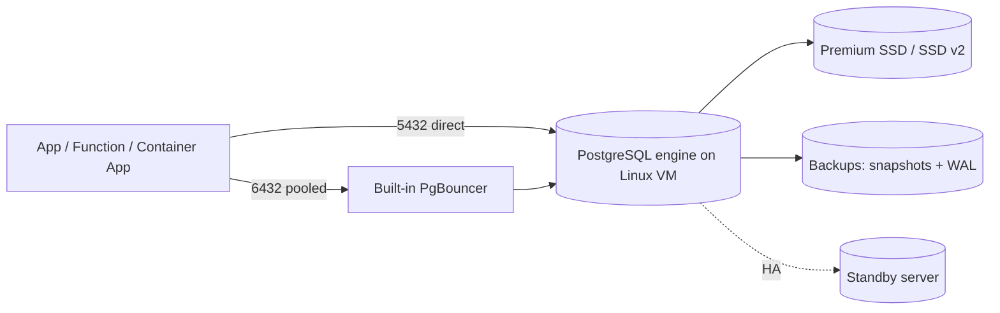

## What this covers

This page explains what Azure Database for PostgreSQL flexible server is, how its compute and storage are laid out, which compute tier fits which workload, what the platform manages for you (backups, patching, high availability, built-in PgBouncer), and which extensions matter for AI back ends. It is the foundation for every other PostgreSQL topic on AI-200.

**Exam weight:** Develop AI solutions by using Azure data management services (30–35%)

**Skills measured**

- "Connect and query Azure Database for PostgreSQL by using SDKs"
- "Configure compute, memory, and storage resources to support vector workloads"

## Key concepts

### A managed community PostgreSQL

Azure Database for PostgreSQL flexible server runs the community PostgreSQL engine, so existing drivers (psycopg, Npgsql, JDBC), tools (psql, pgAdmin) and SQL work unchanged. Microsoft handles provisioning, minor-version patching, backups and the high-availability plumbing. You still control the maintenance window, server parameters, networking, extensions and the compute size. Single Server, the older deployment option, is retired, so any exam answer that mentions "Azure Database for PostgreSQL" means flexible server.

For AI workloads the attraction is that one engine gives you transactions, relational joins, JSONB for flexible metadata and vector search (through pgvector) side by side. You do not need a separate vector store for many retrieval scenarios.

### Compute and storage are separate

The engine runs on a Linux VM, and data files live on Azure managed disks (Premium SSD or Premium SSD v2). Because the two are independent you can change vCores without moving data, and grow storage without changing the VM. Storage can only grow, never shrink. Locally redundant replicas of the disks give built-in durability.

### Compute tiers

| Tier | VM family | Memory per vCore | Use it for |
| --- | --- | --- | --- |
| Burstable | B-series (1–20 vCores) | Varies by size | Dev/test, proof of concept, low or intermittent load. CPU credits; throttled to baseline when credits run out. No built-in PgBouncer. |
| General Purpose | D-series (2–192 vCores, v6) | 4 GiB | Most production web/API back ends with steady load. |
| Memory Optimized | E-series (2–192 vCores, v6) | About 6.75–9.5 GiB | Large working sets, caching-heavy and vector workloads where HNSW indexes must stay in RAM. |

Changing tier or vCore count needs a short restart. Each SKU also caps IOPS and throughput, so a small VM can bottleneck a large disk.

### Managed operations

- **Backups**: automatic full snapshots plus WAL. Retention defaults to 7 days and can go up to 35 days. Backups are on zone-redundant storage where the region has availability zones, otherwise locally redundant. They are encrypted with AES-256 using platform-managed keys or customer-managed keys.
- **Point-in-time restore (PITR)**: restores to any second inside the retention window, always into a **new** server.
- **Built-in PgBouncer**: a connection pooler on the same VM, enabled with the `pgbouncer.enabled` server parameter and reached on port **6432** instead of 5432. Only General Purpose and Memory Optimized support it.
- **High availability**: optional same-zone or zone-redundant standby with automatic failover.

### Extensions relevant to AI

Extensions add types, operators and index methods without changing the engine. On flexible server an extension must be **allow-listed** in the `azure.extensions` server parameter before `CREATE EXTENSION` works.

- `vector` (pgvector): `vector`, `halfvec`, `sparsevec` types, distance operators, HNSW and IVFFlat indexes.
- `pg_diskann`: Azure-specific DiskANN index method for very large vector sets.
- `pg_trgm`: trigram similarity for fuzzy text matching and autocomplete.
- `hstore`: simple key-value column type.
- `azure_ai`: calls Azure AI services from SQL (only as a consumer for this exam).

## How it works



Clients resolve `<server-name>.postgres.database.azure.com`, connect over TLS, authenticate with a password or Microsoft Entra token, and then talk to the engine either directly or through PgBouncer.

## Hands-on

### Azure portal

1. Search for **Azure Database for PostgreSQL flexible servers** and select **Create**.
2. Choose a resource group, server name, region and PostgreSQL version (16 or later).
3. Under **Compute + storage**, pick **Burstable B2s** for a lab or **Memory Optimized** for a vector workload, and choose Premium SSD v2 if you need independently tunable IOPS.
4. Under **Authentication**, choose **PostgreSQL and Microsoft Entra authentication** and add yourself as Entra admin.
5. Under **Networking**, choose public access with your client IP, or private access (VNet integration).
6. After deployment, open **Server parameters**, find `azure.extensions`, select `VECTOR` and save.

### Azure CLI

```bash
# Create a Flexible Server (kept from the original notes; use a Key Vault secret, not a literal, in real scripts)
az postgres flexible-server create \
  --name pg-ai200 \
  --resource-group rg-ai200 \
  --location eastus \
  --admin-user pgadmin \
  --admin-password '<strong-password>' \
  --sku-name Standard_B2s \
  --tier Burstable \
  --version 16

# Allow-list pgvector before CREATE EXTENSION
az postgres flexible-server parameter set \
  --resource-group rg-ai200 --server-name pg-ai200 \
  --name azure.extensions --value vector

# Move to Memory Optimized for production vector search (short restart)
az postgres flexible-server update \
  --resource-group rg-ai200 --name pg-ai200 \
  --tier MemoryOptimized --sku-name Standard_E4ds_v5
```

### Python

```python
import psycopg
from azure.identity import DefaultAzureCredential

token = DefaultAzureCredential().get_token(
    "https://ossrdbms-aad.database.windows.net/.default"
).token

with psycopg.connect(
    host="<server-name>.postgres.database.azure.com",
    dbname="postgres",
    user="<entra-user-or-identity-name>",
    password=token,
    sslmode="require",
) as conn:
    print(conn.execute("SHOW server_version").fetchone())
    print(conn.execute(
        "SELECT name, default_version FROM pg_available_extensions WHERE name IN ('vector','pg_diskann')"
    ).fetchall())
```

## Exam traps

| Requirement | Choose |
| --- | --- |
| Cheapest dev/test server | Burstable |
| Steady production API load | General Purpose |
| Vector indexes must fit in memory | Memory Optimized |
| Built-in connection pooling | General Purpose or Memory Optimized + `pgbouncer.enabled` (port 6432) |
| Recover from an accidental DELETE an hour ago | Point-in-time restore (creates a new server) |
| Use pgvector | Allow-list `vector` in `azure.extensions`, then `CREATE EXTENSION vector` |

> [!WARNING]
> **Exam trap:** `CREATE EXTENSION vector` fails with "extension is not allow-listed" until `azure.extensions` includes it. The SQL is correct; the server parameter is missing.

> [!WARNING]
> **Exam trap:** Burstable has no built-in PgBouncer. Scaling a server down to Burstable silently removes the pooler.

> [!TIP]
> B = Burstable/budget, D = Default production, E = Extra memory.

> [!NOTE]
> PITR never overwrites the source server. Plan for a new host name after a restore.

## Quick review

- Flexible server runs community PostgreSQL; Single Server is retired.
- Compute and storage scale independently; storage grows only.
- Burstable for dev, General Purpose for balanced prod, Memory Optimized for large in-memory working sets.
- Backup retention 7 days by default, up to 35; PITR restores to a new server.
- Built-in PgBouncer listens on 6432 and is not available on Burstable.
- Extensions must be allow-listed in `azure.extensions` before `CREATE EXTENSION`.

## Practice

[Practice: compute, memory and storage questions](/practice/pg-compute) · [Practice: connect and query questions](/practice/pg-connect-query)

## Official references

- [AI-200 study guide](https://learn.microsoft.com/en-us/credentials/certifications/resources/study-guides/ai-200)
- [Module: Build and query with Azure Database for PostgreSQL](https://learn.microsoft.com/en-us/training/modules/build-query-azure-database-postgresql/)
- [Compute options](https://learn.microsoft.com/en-us/azure/postgresql/compute-storage/concepts-compute)
- [Allow extensions](https://learn.microsoft.com/en-us/azure/postgresql/extensions/how-to-allow-extensions)
- [PgBouncer in flexible server](https://learn.microsoft.com/en-us/azure/postgresql/connectivity/concepts-pgbouncer)
- [Microsoft Learn](https://learn.microsoft.com/)
