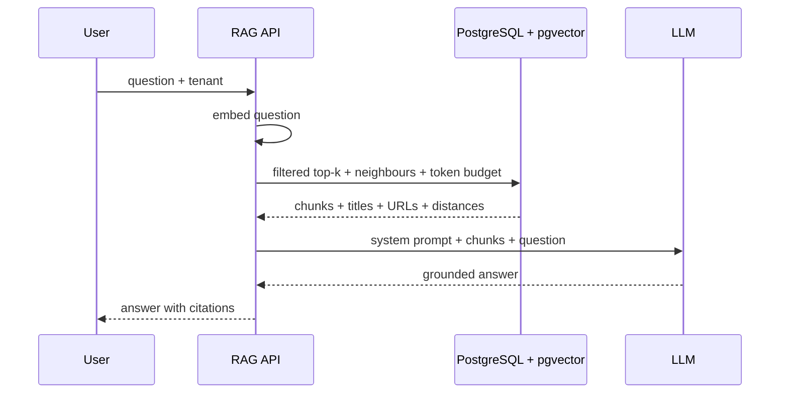

## What this covers

How Azure Database for PostgreSQL with pgvector acts as the **retriever** in retrieval-augmented generation (RAG): a two-table document/chunk schema, chunking choices, ingestion and updates, retrieval queries that add neighbouring chunks and respect a token budget, citation metadata, metadata-filtered retrieval, and how to measure retrieval quality. The LLM call itself is out of scope; PostgreSQL feeds it context.

**Exam weight:** Develop AI solutions by using Azure data management services (30–35%)

**Skills measured**

- "Run vector similarity search, including storing embeddings, semantic retrieval, and implementing retrieval-augmented generation (RAG) patterns by using metadata filter"

## Key concepts

### RAG in three steps

1. **Embed the question** with the same model used for the documents.
2. **Retrieve** the most relevant chunks from PostgreSQL (vector similarity plus metadata filters).
3. **Generate**: send the chunks as grounding context to the LLM.

If retrieval returns irrelevant chunks the model may hallucinate. If it misses relevant chunks the answer is incomplete. Retrieval quality caps answer quality.

### Schema: documents plus chunks

- `source_documents` holds title, URL, type, tenant, ingestion time, stored once.
- `document_chunks` holds `document_id` (FK `ON DELETE CASCADE`), `chunk_index`, `content`, `embedding vector(n)`, `token_count`, optional `section_title`, `page_number`, and `UNIQUE (document_id, chunk_index)`.

Benefits: every chunk links to its source for citations, document metadata isn't duplicated, and replacing a document is "delete document, cascade chunks, re-ingest". Add B-tree indexes on `document_id` and `(document_id, chunk_index)` for joins and neighbour lookups, plus HNSW on `embedding`. If you filter by tenant or document type, copy those columns onto the chunk table (or partition by them) so one query can filter and rank.

### Chunking strategies

| Strategy | Pros | Cons | Good for |
| --- | --- | --- | --- |
| Fixed size (N tokens/chars) | Simple, predictable token counts | Cuts sentences | Unstructured text |
| Semantic (paragraph/section) | Keeps whole ideas | Variable size | Contracts, docs, FAQs |
| Overlapping (for example 200 chars on 1,000) | Concepts at boundaries survive | More storage, duplicates | Queries hitting boundaries |

### Retrieval shapes

- **Top-k chunks**: simplest; good when chunks stand alone.
- **Context window**: for each hit, also fetch chunks `chunk_index ± 1` so references like "the foregoing" make sense.
- **Token budget**: running `SUM(token_count) OVER (...)` and stop at, say, 3,000 tokens so the prompt, question and answer still fit.
- **Grouped by document**: rank chunks per document with `ROW_NUMBER() OVER (PARTITION BY document_id ...)`, keep the best few, `array_agg` them, and present one citation per source.

### Ingestion and updates

Insert the document row first (`RETURNING id`), embed all its chunks in one API call where the model allows batching, then insert chunks with one multi-row `INSERT` or `COPY`. For updates, replacement is simplest. For history, add a `version` column and filter on it. HNSW handles deletes without a rebuild. IVFFlat may need periodic reindexing after heavy churn.

### Measuring retrieval

- **Precision@k**: share of retrieved chunks that are relevant. Raise it with a tighter threshold or smaller k.
- **Recall@k**: share of relevant chunks retrieved. Raise it with a larger k, a looser threshold, or higher `ef_search`/`probes`.
- **MRR**: how high the first relevant chunk ranks.

Build a labelled set of 20–50 real questions with judged top 10–20 chunks, script the metrics, and rerun them whenever chunk size, overlap, model, index parameters or thresholds change.

## How it works



## Hands-on

### Azure portal

1. Size the server for the vector data (Memory Optimized for large indexes) and allow-list `vector`.
2. Put the ingestion job in Azure Functions or a Container Apps job with a managed identity mapped to a PostgreSQL role.
3. Monitor **CPU percent** during ingestion and **Active connections** during query peaks.

### Azure CLI

```bash
az postgres flexible-server db create -g <resource-group> -s <server-name> -d ragdb
```

```sql
CREATE TABLE source_documents (
    id SERIAL PRIMARY KEY,
    title TEXT NOT NULL,
    source_url TEXT,
    document_type TEXT,
    tenant_id TEXT NOT NULL,
    ingested_at TIMESTAMPTZ DEFAULT NOW()
);
CREATE TABLE document_chunks (
    id SERIAL PRIMARY KEY,
    document_id INTEGER REFERENCES source_documents(id) ON DELETE CASCADE,
    tenant_id TEXT NOT NULL,
    chunk_index INTEGER NOT NULL,
    content TEXT NOT NULL,
    embedding vector(1536),
    token_count INTEGER,
    section_title TEXT,
    page_number INTEGER,
    UNIQUE (document_id, chunk_index)
);
CREATE INDEX document_chunks_doc_chunk_idx ON document_chunks (document_id, chunk_index);
CREATE INDEX document_chunks_tenant_idx ON document_chunks (tenant_id);
CREATE INDEX document_chunks_embedding_idx ON document_chunks USING hnsw (embedding vector_cosine_ops);

-- Top matches + neighbours + token budget + citations, filtered by tenant
WITH matched_chunks AS (
    SELECT id, document_id, chunk_index, embedding <=> $1 AS distance
    FROM document_chunks
    WHERE tenant_id = $2
    ORDER BY embedding <=> $1
    LIMIT 3
), context_window AS (
    SELECT DISTINCT ON (dc.id) dc.id, dc.document_id, dc.chunk_index, dc.content,
           dc.token_count, mc.distance
    FROM matched_chunks mc
    JOIN document_chunks dc ON dc.document_id = mc.document_id
     AND dc.chunk_index BETWEEN mc.chunk_index - 1 AND mc.chunk_index + 1
    ORDER BY dc.id, mc.distance
), token_limited AS (
    SELECT cw.*, sd.title AS source_title, sd.source_url,
           SUM(cw.token_count) OVER (ORDER BY cw.distance, cw.chunk_index) AS cumulative_tokens
    FROM context_window cw JOIN source_documents sd ON cw.document_id = sd.id
)
SELECT id, content, source_title, source_url, distance
FROM token_limited
WHERE cumulative_tokens <= 3000
ORDER BY distance, chunk_index;

-- One citation per document, up to three excerpts each
WITH ranked_chunks AS (
    SELECT dc.*, sd.title AS document_title, sd.source_url,
           dc.embedding <=> $1 AS distance,
           ROW_NUMBER() OVER (PARTITION BY dc.document_id ORDER BY dc.embedding <=> $1) AS rank_in_doc
    FROM document_chunks dc JOIN source_documents sd ON dc.document_id = sd.id
    WHERE dc.embedding <=> $1 < 0.5
)
SELECT document_id, document_title, source_url,
       array_agg(content ORDER BY chunk_index) AS chunks, MIN(distance) AS best_distance
FROM ranked_chunks
WHERE rank_in_doc <= 3
GROUP BY document_id, document_title, source_url
ORDER BY best_distance
LIMIT 5;
```

### Python

```python
import psycopg
from pgvector.psycopg import register_vector

def ingest(conn: psycopg.Connection, title, url, tenant, chunks, embed_batch):
    """chunks: list[(text, token_count)]; embed_batch returns one vector per text."""
    register_vector(conn)
    with conn.transaction():
        doc_id = conn.execute(
            "INSERT INTO source_documents (title, source_url, tenant_id) VALUES (%s, %s, %s) RETURNING id",
            (title, url, tenant)).fetchone()[0]
        vectors = embed_batch([c[0] for c in chunks])
        with conn.cursor() as cur:
            cur.executemany(
                "INSERT INTO document_chunks (document_id, tenant_id, chunk_index, content, token_count, embedding) "
                "VALUES (%s, %s, %s, %s, %s, %s)",
                [(doc_id, tenant, i, c[0], c[1], v) for i, (c, v) in enumerate(zip(chunks, vectors))])
    return doc_id
```

## Exam traps

| Need | Choose |
| --- | --- |
| Cite sources in answers | Chunk table FK to document table; return title/URL |
| Tenant isolation in retrieval | `tenant_id` on chunks + `WHERE` filter (or partition/RLS) |
| Chunks reference earlier text | Context-window retrieval (±1 chunk) |
| Stay inside model context | Token budget with `SUM(token_count) OVER` |
| Replace an updated document | Delete parent; `ON DELETE CASCADE` removes chunks; re-ingest |
| Improve recall | Higher k / `ef_search`, looser threshold, overlap |

> [!WARNING]
> **Exam trap:** Filtering by tenant *after* the LLM call, or in application code after `LIMIT`, leaks or drops results. Filter in the SQL that does the ranking.

> [!WARNING]
> **Exam trap:** Embedding whole long documents as one vector hurts precision and blows the context window. Chunk first.

> [!TIP]
> Precision complains about junk; recall complains about gaps. Thresholds move one against the other.

> [!NOTE]
> Row-level security (`CREATE POLICY ... USING (tenant_id = current_setting('app.tenant'))`) can enforce tenant filters inside PostgreSQL for defence in depth.

## Quick review

- PostgreSQL is the retriever; the LLM is the generator.
- Two tables: source documents and chunks with embeddings.
- Index `document_id`, `(document_id, chunk_index)` and the embedding.
- Chunking: fixed, semantic, overlapping.
- Context windows and token budgets shape the prompt.
- Group chunks per document for clean citations.
- Evaluate with precision@k, recall@k and MRR on a labelled set.

## Practice

[Practice: vector search and RAG questions](/practice/pg-vector-rag)

## Official references

- [AI-200 study guide](https://learn.microsoft.com/en-us/credentials/certifications/resources/study-guides/ai-200)
- [Unit: Implement retrieval patterns for RAG pipelines](https://learn.microsoft.com/en-us/training/modules/implement-vector-search-azure-database-postgresql/6-implement-retrieval-patterns-rag-pipelines)
- [Module: Implement vector search with Azure Database for PostgreSQL](https://learn.microsoft.com/en-us/training/modules/implement-vector-search-azure-database-postgresql/)
- [Microsoft Learn](https://learn.microsoft.com/)
