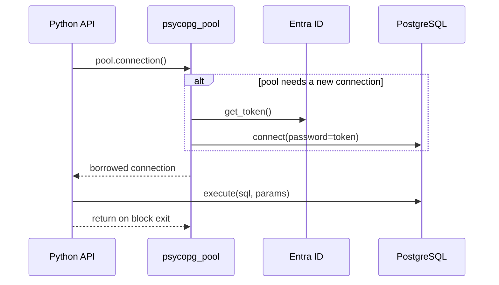

## What this covers

Wiring Azure Database for PostgreSQL into Python code with the psycopg 3 driver: installing it, opening connections (including Microsoft Entra tokens through `azure-identity`), running parameterized queries, pooling, timeouts, retry logic, handling specific database errors, and loading data fast with `executemany` and `COPY`. The same rules apply to Npgsql (.NET) and other drivers.

**Exam weight:** Develop AI solutions by using Azure data management services (30–35%)

**Skills measured**

- "Connect and query Azure Database for PostgreSQL by using SDKs"
- "Implement connection optimization to improve throughput and minimize latency"

## Key concepts

### Driver choice

- **psycopg 3** (`import psycopg`) is the current, recommended adapter. It has sync and async APIs, server-side binding options and `COPY` support. Install it with `pip install "psycopg[binary]"` for prebuilt wheels, or plain `psycopg` plus system `libpq` when you build against specific client libraries.
- **psycopg_pool** (`pip install psycopg_pool`) provides `ConnectionPool` and `AsyncConnectionPool`.
- **psycopg2** is the older 2.x line (`import psycopg2`, `psycopg2.pool`). It still works but is in maintenance. Don't mix the two APIs.
- **pgvector-python** (`pip install pgvector`) adds `register_vector(conn)` so NumPy arrays map to `vector`.
- **azure-identity** gives `DefaultAzureCredential` for Entra tokens.

### Connections and cursors

`psycopg.connect()` accepts a URI or keyword arguments. Keyword arguments make it easy to inject a token or a Key Vault secret at runtime. Use context managers: the connection block commits on success, rolls back on exception, then closes. The cursor block releases the cursor. `conn.execute()` is a shortcut that creates a cursor for you.

### Parameterized queries

Always pass values separately: `%s` positional or `%(name)s` named placeholders. Never build SQL with f-strings. This prevents SQL injection and lets the server reuse plans. Identifiers (table names) can't be parameters; use `psycopg.sql.Identifier` for those.

Fetch with `fetchone()` for one row, `fetchall()` for small sets, or iterate the cursor for large results so you don't load everything into memory.

### Tokens and pools

Entra tokens last 5–60 minutes but are checked only at connect time. A pool must therefore get a **fresh token for each new physical connection**. With psycopg_pool, subclass `psycopg.Connection` and override `connect` to inject the password. Then set `max_lifetime` so connections recycle regularly.

### Timeouts

- `connect_timeout=10`: how long to wait to open a connection.
- `options="-c statement_timeout=30000"`: server cancels queries that run longer than 30 s.
- Interactive APIs typically use 5–30 s; batch jobs longer.

### Errors and retries

| Error class (`psycopg.errors`) | Meaning | Action |
| --- | --- | --- |
| `OperationalError` | Network drop, failover, timeout | Retry with exponential backoff + jitter |
| `DeadlockDetected` | Server killed one transaction | Roll back, retry; lock rows in consistent order |
| `LockNotAvailable` | Lock wait timed out | Roll back, maybe retry |
| `UniqueViolation`, `ForeignKeyViolation`, `CheckViolation` | Bad data | Roll back, return a clear error, **don't** retry |
| syntax errors | Code bug | Fix code |

### Bulk performance

- Multi-row `INSERT` or `executemany` for hundreds to a few thousand rows (psycopg 3 pipelines these).
- `COPY ... FROM STDIN` for 10,000+ rows. It is often 2–10x faster than inserts.
- Prepared statements: psycopg 3 prepares automatically after a query repeats (`prepare_threshold`, default 5). Behind PgBouncer in transaction mode, set `prepare_threshold=None` unless `pgbouncer.max_prepared_statements` is above 0.

## How it works



## Hands-on

### Azure portal

1. Give your App Service, Container App or Function a **system-assigned managed identity** (Identity blade).
2. On the PostgreSQL server, under **Authentication**, confirm Entra auth is enabled.
3. As Entra admin, run `SELECT * FROM pgaadauth_create_principal('<app-identity-name>', false, false);` and grant table privileges.
4. Put host, database and user in app settings; no password is stored.

### Azure CLI

```bash
az containerapp identity assign -g <resource-group> -n <app-name> --system-assigned
az containerapp update -g <resource-group> -n <app-name> \
  --set-env-vars PGHOST=<server-name>.postgres.database.azure.com PGDATABASE=appdb PGUSER=<app-identity-name>
```

### Python

```python
import os, random, time
import psycopg
from psycopg import errors
from psycopg_pool import ConnectionPool
from azure.identity import DefaultAzureCredential

credential = DefaultAzureCredential()
SCOPE = "https://ossrdbms-aad.database.windows.net/.default"

class EntraConnection(psycopg.Connection):
    """Fetch a fresh Entra token every time the pool opens a connection."""
    @classmethod
    def connect(cls, conninfo: str = "", **kwargs):
        kwargs["password"] = credential.get_token(SCOPE).token
        return super().connect(conninfo, **kwargs)

pool = ConnectionPool(
    conninfo=(f"host={os.environ['PGHOST']} dbname={os.environ['PGDATABASE']} "
              f"user={os.environ['PGUSER']} sslmode=require connect_timeout=10"),
    connection_class=EntraConnection,
    kwargs={"options": "-c statement_timeout=30000"},
    min_size=1, max_size=10, max_lifetime=1800,
)

def get_conversation(conversation_id: int, attempts: int = 4):
    for attempt in range(attempts):
        try:
            with pool.connection() as conn:
                return conn.execute(
                    "SELECT * FROM conversations WHERE id = %s", (conversation_id,)
                ).fetchone()
        except errors.OperationalError:
            if attempt == attempts - 1:
                raise
            time.sleep((2 ** attempt) + random.uniform(0, 1))

def save_message(conversation_id: int, role: str, content: str):
    try:
        with pool.connection() as conn:
            return conn.execute(
                "INSERT INTO messages (conversation_id, role, content) VALUES (%s, %s, %s) RETURNING id",
                (conversation_id, role, content),
            ).fetchone()[0]
    except errors.ForeignKeyViolation:
        raise ValueError("conversation does not exist")  # no retry

def bulk_load(records):
    with pool.connection() as conn, conn.cursor() as cur:
        with cur.copy("COPY messages (conversation_id, role, content) FROM STDIN") as copy:
            for record in records:
                copy.write_row(record)
```

## Exam traps

| Need | Choose |
| --- | --- |
| Avoid SQL injection | `%s` / `%(name)s` placeholders |
| Load 1M embeddings | `COPY` (binary or text) |
| Load 500 rows | Multi-row `INSERT` / `executemany` |
| Long-running app with Entra auth | Pool + per-connection token callback + `max_lifetime` |
| Transient failover error | Retry `OperationalError` with backoff + jitter |
| Unique key violated | Roll back and report; never retry blindly |

> [!WARNING]
> **Exam trap:** Building SQL with string formatting (`f"... WHERE id = {user_input}"`) is the wrong answer even if it "works"; use bound parameters.

> [!WARNING]
> **Exam trap:** Fetching one token at startup and reusing it for every new connection fails after the token expires (at most about an hour).

> [!TIP]
> Retry the network, not the data: `OperationalError` yes, `IntegrityError` subclasses no.

> [!NOTE]
> In psycopg 3, `with psycopg.connect(...) as conn` commits on success and closes the connection; in psycopg2 the same block only ends the transaction and leaves the connection open.

## Quick review

- psycopg 3: `pip install "psycopg[binary]"`; pools come from `psycopg_pool`.
- Token scope `https://ossrdbms-aad.database.windows.net/.default`, used as the password.
- `connect_timeout` and `statement_timeout` stop hung requests.
- Retry `OperationalError` and `DeadlockDetected` with exponential backoff.
- `COPY` for 10k+ rows; `executemany` for smaller batches.
- Iterate cursors for big results instead of `fetchall()`.

## Practice

[Practice: connect and query questions](/practice/pg-connect-query) · [Practice: connection optimization questions](/practice/pg-connections)

## Official references

- [AI-200 study guide](https://learn.microsoft.com/en-us/credentials/certifications/resources/study-guides/ai-200)
- [Unit: Integrate SDKs and applications](https://learn.microsoft.com/en-us/training/modules/build-query-azure-database-postgresql/6-integrate-sdks-apps)
- [Use Microsoft Entra ID authentication](https://learn.microsoft.com/en-us/azure/postgresql/security/security-entra-configure)
- [psycopg 3 documentation](https://www.psycopg.org/psycopg3/docs/)
- [Microsoft Learn](https://learn.microsoft.com/)
