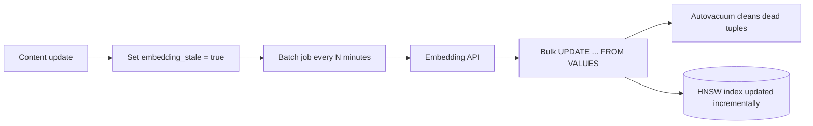

## What this covers

Running vector search over time: checking whether vector indexes are used and how big they are, rebuilding them without downtime, keeping embeddings in sync with changing content, migrating to a new embedding model, estimating storage, and controlling table bloat from frequent embedding updates.

**Exam weight:** Develop AI solutions by using Azure data management services (30–35%)

**Skills measured**

- "Implement indexing strategies, including optimizing query latency and reducing pgvector compute overhead"

## Key concepts

### Monitoring index health

- `pg_stat_user_indexes.idx_scan` counts index scans. Zero on a vector index usually means an opclass/operator mismatch, a missing `LIMIT`, or a table small enough that the planner prefers a sequential scan.
- `pg_relation_size(indexrelid)` and `pg_indexes_size(table)` show size.
- Track `EXPLAIN ANALYZE` timings of representative queries. A query that goes from 10 ms to 50 ms without more data suggests the index has degraded.
- `pg_stat_progress_create_index` shows build phase and percent. HNSW goes through `initializing` and `loading tuples`. IVFFlat adds `performing k-means` and `assigning tuples`.

### When to rebuild

ANN structures reflect the data at build time. IVFFlat centroids go stale fastest. Rebuild when:

- latency climbs without growth,
- measured recall or user-reported relevance drops,
- more than about 20–30% of rows are new, especially from a new domain.

Options:

| Method | Blocks writes? | Notes |
| --- | --- | --- |
| `REINDEX INDEX idx` | Yes | Simplest; schedule off-peak |
| `REINDEX INDEX CONCURRENTLY idx` | No | PostgreSQL 12+; slower, uses more resources |
| `CREATE INDEX CONCURRENTLY new_idx` + `DROP INDEX` + `ALTER INDEX ... RENAME` | No | Lets you test the new index (and new parameters) before the swap |

A plain `CREATE INDEX` blocks inserts/updates/deletes on the table but not reads. `CONCURRENTLY` can't run inside a transaction block. If it fails it leaves an `INVALID` index you must drop.

### Keeping embeddings in sync

- **Synchronous**: re-embed and update in the same transaction as the content. Always consistent, but adds embedding-API latency to every write and couples writes to API availability.
- **Asynchronous batch**: flag rows (`embedding_stale = TRUE` or compare `updated_at` to `embedded_at`), then a background job (Azure Functions timer, Container Apps job) re-embeds in batches. Cheaper per call, faster writes, survives API outages. Search briefly sees old embeddings.
- **Periodic full refresh**: re-embed oldest first to catch changes the flag missed.

### Changing embedding models

Vectors from different models aren't comparable, so never mix them in one column. Use a parallel column:

1. `ALTER TABLE ... ADD COLUMN embedding_v2 ...`
2. Index the new column.
3. Backfill in batches (`WHERE embedding_v2 IS NULL`), respecting API rate limits.
4. Compare results side by side.
5. Switch queries, drop the old column and index, rename.

Estimate the backfill from row count ÷ embedding calls per minute. For example, 500,000 documents at one document per request and 3,000 requests per minute is about 167 minutes. Sending 100 texts per request cuts the request count 100-fold, so token-per-minute quotas usually become the real limit.

### Storage estimates

- Vector data ≈ `dimensions × 4 bytes × rows` (1,536 dims × 1M rows ≈ 6 GB).
- HNSW index ≈ 1.5–2× the vector data. IVFFlat ≈ 1–1.5×.
- Check with `pg_relation_size`, `pg_indexes_size`, `pg_total_relation_size`.

### Bloat and VACUUM

PostgreSQL MVCC writes a new row version on every `UPDATE`. Re-embedding a row leaves a dead ~6 KB tuple behind until vacuum runs. Plain `VACUUM` runs alongside traffic and makes space reusable. `VACUUM FULL` rewrites the table, returns space to the OS, and takes an exclusive lock. For hot tables lower the autovacuum thresholds per table (defaults are 0.2 for vacuum and 0.1 for analyze).

## How it works



## Hands-on

### Azure portal

1. **Monitoring > Metrics**: chart **Storage used** and **CPU percent** during rebuilds and backfills.
2. **Server parameters**: review `autovacuum_vacuum_scale_factor` and `maintenance_work_mem`.
3. Turn on **Query Store** (`pg_qs.query_capture_mode = TOP`) to see vector query latency trends.

### Azure CLI

```bash
az postgres flexible-server parameter set -g <resource-group> --server-name <server-name> \
  --name pg_qs.query_capture_mode --value TOP
```

```sql
-- Usage and size
SELECT relname AS table_name, indexrelname AS index_name, idx_scan AS times_used,
       pg_size_pretty(pg_relation_size(indexrelid)) AS index_size
FROM pg_stat_user_indexes
WHERE indexrelname LIKE '%embedding%'
ORDER BY idx_scan DESC;

-- Zero-downtime rebuild and swap
CREATE INDEX CONCURRENTLY documents_embedding_new_idx
ON documents USING hnsw (embedding vector_cosine_ops) WITH (m = 16, ef_construction = 64);
DROP INDEX CONCURRENTLY documents_embedding_idx;
ALTER INDEX documents_embedding_new_idx RENAME TO documents_embedding_idx;

-- Stale-flag pattern
ALTER TABLE documents ADD COLUMN embedding_stale BOOLEAN DEFAULT FALSE;
UPDATE documents SET content = 'New content...', embedding_stale = TRUE, updated_at = NOW() WHERE id = 42;
SELECT id, content FROM documents WHERE embedding_stale LIMIT 100;
UPDATE documents SET embedding = data.embedding, embedding_stale = FALSE
FROM (VALUES (1, '[...]'::vector), (2, '[...]'::vector)) AS data(id, embedding)
WHERE documents.id = data.id;

-- Model migration to 3,072 dims: HNSW on vector is limited to 2,000 dims, so use halfvec
ALTER TABLE documents ADD COLUMN embedding_v2 halfvec(3072);
CREATE INDEX CONCURRENTLY documents_embedding_v2_idx
ON documents USING hnsw (embedding_v2 halfvec_cosine_ops);

-- Space and bloat
SELECT pg_size_pretty(pg_relation_size('documents')) AS table_size,
       pg_size_pretty(pg_indexes_size('documents'))  AS index_size,
       pg_size_pretty(pg_total_relation_size('documents')) AS total_size;
ALTER TABLE documents SET (autovacuum_vacuum_scale_factor = 0.05, autovacuum_analyze_scale_factor = 0.02);
VACUUM (ANALYZE) documents;
```

### Python

```python
import psycopg
from pgvector.psycopg import register_vector

def refresh_stale(conn: psycopg.Connection, embed_batch, batch_size: int = 100) -> int:
    """embed_batch(list[str]) -> list[list[float]] calls your embedding endpoint."""
    register_vector(conn)
    rows = conn.execute(
        "SELECT id, content FROM documents WHERE embedding_stale "
        "ORDER BY updated_at LIMIT %s FOR UPDATE SKIP LOCKED", (batch_size,)).fetchall()
    if not rows:
        return 0
    vectors = embed_batch([r[1] for r in rows])
    with conn.cursor() as cur:
        cur.executemany(
            "UPDATE documents SET embedding = %s, embedding_stale = FALSE WHERE id = %s",
            [(v, r[0]) for v, r in zip(vectors, rows)])
    conn.commit()
    return len(rows)
```

`FOR UPDATE SKIP LOCKED` lets several workers share the queue without picking the same rows.

## Exam traps

| Situation | Answer |
| --- | --- |
| Rebuild without blocking writes | `CREATE INDEX CONCURRENTLY` + swap, or `REINDEX ... CONCURRENTLY` |
| New embedding model | Parallel column, backfill, validate, switch |
| Writes slowed by embedding API | Stale flag + async batch re-embed |
| Disk keeps growing after re-embeds | Tune autovacuum; `VACUUM FULL` only in a maintenance window |
| Vector index shows `idx_scan = 0` | Check operator/opclass match and `LIMIT` |

> [!WARNING]
> **Exam trap:** `VACUUM FULL` reclaims disk space but takes an `ACCESS EXCLUSIVE` lock. It is not a routine maintenance answer.

> [!WARNING]
> **Exam trap:** Overwriting `embedding` in place with a new model's vectors returns mixed, wrong rankings during the migration.

> [!TIP]
> HNSW tolerates inserts and deletes well; IVFFlat drifts and needs periodic rebuilds.

> [!NOTE]
> On Azure, total storage includes index size. Each extra HNSW index on a large table can add gigabytes.

## Quick review

- `pg_stat_user_indexes.idx_scan` shows whether an index is used.
- Rebuild after big data shifts; IVFFlat is most sensitive.
- `CONCURRENTLY` avoids write locks but is slower and can't run inside a transaction.
- Async stale-flag batching decouples writes from the embedding API.
- Model change means a parallel column and a backfill.
- HNSW index ≈ 1.5–2× vector size; plan storage.
- Re-embedding causes MVCC bloat; tune autovacuum per table.

## Practice

[Practice: indexing questions](/practice/pg-indexing)

## Official references

- [AI-200 study guide](https://learn.microsoft.com/en-us/credentials/certifications/resources/study-guides/ai-200)
- [Unit: Manage index lifecycle and embedding updates](https://learn.microsoft.com/en-us/training/modules/implement-vector-search-azure-database-postgresql/4-manage-index-lifecycle-embedding-updates)
- [Optimize performance when using pgvector](https://learn.microsoft.com/en-us/azure/postgresql/extensions/how-to-optimize-performance-pgvector)
- [Microsoft Learn](https://learn.microsoft.com/)
