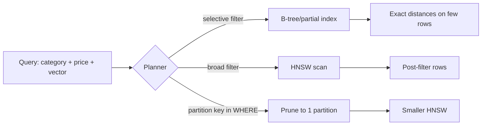

## What this covers

How table design affects filtered vector search: how much space vectors take, when metadata belongs in typed columns or JSONB, which supporting indexes (B-tree, composite, partial, GIN, expression) make filters cheap, how filtered vector queries execute, and when to partition large vector tables.

**Exam weight:** Develop AI solutions by using Azure data management services (30–35%)

**Skills measured**

- "Model schemas and implement indexing strategies, including designing tables and choosing appropriate data types"
- "Implement indexing strategies, including optimizing query latency and reducing pgvector compute overhead"

## Key concepts

### Vector storage math

A `vector` element is 4 bytes; storage grows linearly with dimensions:

| Dimensions | Per vector | 1M vectors |
| --- | --- | --- |
| 384 | ~1.5 KB | ~1.5 GB |
| 768 | ~3 KB | ~3 GB |
| 1,536 | ~6 KB | ~6 GB |
| 3,072 | ~12 KB | ~12 GB |

Two million 1,536-dim products need about 12 GB for vectors alone, plus roughly 50% more for an HNSW index. Levers: shorter embeddings (many models support fewer dimensions), `halfvec` (half the bytes), or dropping unused indexes. Declaring `vector(768)` also validates that every insert has the expected dimension.

Each vector column (title, image, behaviour embeddings) needs its own index. One index can't cover several vector columns.

### Typed columns vs JSONB for metadata

| | Typed columns | JSONB |
| --- | --- | --- |
| Index | B-tree: equality, range, sort | GIN: containment/key existence only |
| Planner statistics | Accurate | Weak inside documents |
| Validation | Types and constraints | None by default |
| Flexibility | Needs `ALTER TABLE` | Add keys freely |

Best of both: put frequently filtered attributes (category, price, in_stock, tenant, dates) in typed columns and leave the long tail in a JSONB `attributes` column. For a JSONB field that needs range filters, add an **expression index** on the cast value.

### Supporting indexes

- **Single-column B-tree** for equality filters.
- **Composite B-tree** `(category_id, price)` serves `category_id = ?` and `category_id = ? AND price < ?`, but not `price < ?` alone (leftmost-prefix rule).
- **Partial index** `WHERE in_stock = true` is smaller and faster when nearly every query has that predicate. The query must repeat the same predicate.
- **GIN on JSONB** for `@>`, `<@`, `?`, `?|`, `?&`.
- **Partial vector index** (for example only `tier = 'premium'` rows) gives each hot segment its own small ANN index.

### How filtered vector queries run

- Selective filter: metadata index finds a few candidate rows, then exact distances on those. Fast and exact.
- Broad filter (for example `price > 0`): planner uses the vector index and post-filters. It may skip the metadata index entirely.
- Restrictive filter on the vector-index path can return fewer than k rows. Fix it with pgvector 0.8 iterative scans (`hnsw.iterative_scan`), a partial or partitioned index, or the **over-fetch pattern**: take the top 100 by distance in a CTE, filter, then `LIMIT 10`.

Check with `EXPLAIN ANALYZE`: you want `Index Scan` / `Bitmap Index Scan` on metadata or `Index Scan` on the vector index, not `Seq Scan` on a large table. Run `ANALYZE` after loads.

### Partitioning

Consider it when tables reach tens of millions of rows, queries naturally filter by a key (date, tenant, category), you need to drop old data cheaply, or a single index build takes too long.

- **Range** by date for time-based embeddings. **List/hash** by tenant or category.
- Creating an index on the parent creates one per partition. Each partition's index is smaller and can be rebuilt on its own.
- Partition pruning only happens when the query filters on the partition key.
- Costs: queries that touch many partitions merge many index scans, unique constraints must include the partition key, and the app may need to know partition boundaries.

## How it works



## Hands-on

### Azure portal

1. **Server parameters**: ensure `azure.extensions` includes `VECTOR`.
2. **Monitoring > Metrics**: watch **Storage used** after adding indexes; each HNSW index on a large table can add gigabytes.
3. Use **Query Performance Insight** to spot sequential scans on big tables.

### Azure CLI

```bash
az postgres flexible-server show -g <resource-group> -n <server-name> \
  --query "{storageGB:storage.storageSizeGb, tier:sku.tier, sku:sku.name}"
```

```sql
-- Typed hot fields + JSONB long tail
CREATE TABLE products (
    id BIGSERIAL PRIMARY KEY,
    name TEXT NOT NULL,
    embedding vector(1536),
    category_id INTEGER NOT NULL,
    price NUMERIC(10,2) NOT NULL,
    in_stock BOOLEAN DEFAULT true,
    attributes JSONB DEFAULT '{}'
);
CREATE INDEX idx_products_category_price ON products (category_id, price);
CREATE INDEX idx_products_instock_category ON products (category_id) WHERE in_stock = true;
CREATE INDEX idx_products_attributes ON products USING gin (attributes);
CREATE INDEX idx_products_json_brand_rating ON products (((attributes->>'rating')::numeric));
CREATE INDEX ON products USING hnsw (embedding vector_cosine_ops);

-- Separate vector columns, separate indexes
ALTER TABLE products ADD COLUMN image_embedding vector(512);
CREATE INDEX ON products USING hnsw (image_embedding vector_cosine_ops);

-- Filtered search
SELECT id, name, embedding <=> $1 AS distance
FROM products
WHERE category_id = 5 AND in_stock = true AND price BETWEEN 100 AND 500
ORDER BY embedding <=> $1
LIMIT 10;

-- Over-fetch then filter
WITH candidates AS (
    SELECT id, name, price, in_stock, embedding <=> $1 AS distance
    FROM products ORDER BY embedding <=> $1 LIMIT 100
)
SELECT id, name, distance FROM candidates
WHERE in_stock = true AND price BETWEEN 100 AND 500
ORDER BY distance LIMIT 10;

-- Range partitioning by month
CREATE TABLE user_interactions (
    id BIGSERIAL,
    user_id BIGINT NOT NULL,
    embedding vector(768),
    created_at TIMESTAMPTZ NOT NULL,
    interaction_type TEXT,
    PRIMARY KEY (id, created_at)
) PARTITION BY RANGE (created_at);
CREATE TABLE user_interactions_2025_01 PARTITION OF user_interactions
    FOR VALUES FROM ('2025-01-01') TO ('2025-02-01');
CREATE INDEX ON user_interactions USING hnsw (embedding vector_cosine_ops);
```

### Python

```python
import psycopg

def storage_report(conn: psycopg.Connection, table: str = "products"):
    return conn.execute("""
        SELECT pg_size_pretty(pg_relation_size(%s::regclass))  AS table_size,
               pg_size_pretty(pg_indexes_size(%s::regclass))   AS index_size,
               pg_size_pretty(pg_total_relation_size(%s::regclass)) AS total_size
    """, (table, table, table)).fetchone()

def estimate_vector_gb(rows: int, dims: int, half: bool = False) -> float:
    return rows * dims * (2 if half else 4) / 1024**3
```

## Exam traps

| Need | Choose |
| --- | --- |
| Range filter on price | Typed `NUMERIC` column + B-tree |
| Flexible, rarely filtered attributes | JSONB (+ GIN for containment) |
| Range filter on a JSONB field | Expression index on the cast value |
| Almost all queries add `in_stock = true` | Partial index |
| Time-sliced embeddings, drop old months | Range partitioning by date |
| Half the vector storage | `halfvec` or fewer dimensions |

> [!WARNING]
> **Exam trap:** A GIN index on JSONB doesn't speed up `(attributes->>'price')::numeric BETWEEN 100 AND 500`. You need an expression B-tree index or a real column.

> [!WARNING]
> **Exam trap:** Partitioning helps only if queries filter on the partition key. Otherwise every partition's index is scanned and merged.

> [!TIP]
> Filter columns typed, long tail JSONB, one index per vector column.

> [!NOTE]
> A primary key on a partitioned table must include the partition key, which is why the example uses `(id, created_at)`.

## Quick review

- Vector bytes ≈ dims × 4 × rows; HNSW adds about 50% or more.
- Each vector column needs its own index.
- Typed columns + B-tree beat JSONB for filters and ranges.
- Composite indexes follow the leftmost-prefix rule; partial indexes need matching predicates.
- Broad filters can lead to post-filtering and short result lists; over-fetch or iterative scans fix it.
- Partition by date/tenant for very large tables; index the parent.

## Practice

[Practice: schema questions](/practice/pg-schema) · [Practice: indexing questions](/practice/pg-indexing)

## Official references

- [AI-200 study guide](https://learn.microsoft.com/en-us/credentials/certifications/resources/study-guides/ai-200)
- [Unit: Optimize data layout](https://learn.microsoft.com/en-us/training/modules/optimize-vector-search-azure-database-postgresql/4-optimize-data-layout)
- [Optimize performance when using pgvector](https://learn.microsoft.com/en-us/azure/postgresql/extensions/how-to-optimize-performance-pgvector)
- [Microsoft Learn](https://learn.microsoft.com/)
