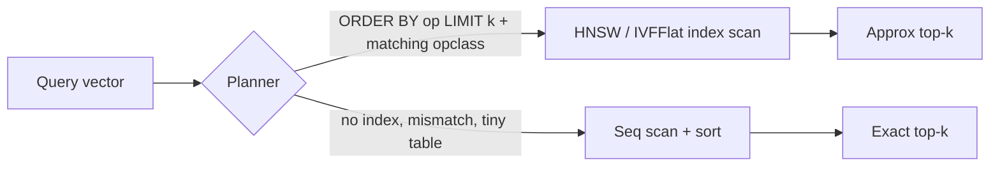

## What this covers

Why unindexed vector queries slow down as tables grow, how approximate nearest neighbour (ANN) indexes fix that, how IVFFlat and HNSW work and which parameters control them, how to match operator classes to distance operators, and how to prove with `EXPLAIN ANALYZE` that a query uses the index. Azure's DiskANN index is introduced here and compared in [Choose and configure vector indexes](/study/develop-ai-solutions-with-azure-database-for-postgresql/choose-and-configure-vector-indexes).

**Exam weight:** Develop AI solutions by using Azure data management services (30–35%)

**Skills measured**

- "Implement indexing strategies, including optimizing query latency and reducing pgvector compute overhead"

## Key concepts

### Exact vs approximate

Without a vector index, pgvector does **exact** k-nearest-neighbour search. It computes the distance to every row and sorts. Recall is 100%, but cost grows linearly: about 1.5 billion floating-point operations per query for one million 1,536-dim vectors. Under roughly 10,000 rows this is often fine.

**ANN** indexes look at only a subset of vectors. Quality is measured by **recall**, the share of the true top-k that comes back. Most AI apps are happy with 95–99% recall in exchange for millisecond latency.

### IVFFlat

- Build: k-means groups vectors into `lists` clusters, each with a centroid.
- Query: compare the query to the centroids, search only the closest `ivfflat.probes` lists. Work is roughly `(rows / lists) × probes` distance calculations.
- `lists` starting point: `rows / 1000` up to 1M rows, `sqrt(rows)` above that.
- `probes` starting point: `sqrt(lists)` (Azure docs also suggest `lists / 10` up to 1M rows). Default is **1**. Setting `probes = lists` makes the search exact.
- Needs representative data **before** you build. An index built on an empty or tiny table has poor centroids. Rebuild when the data distribution shifts.

### HNSW

- Build: a multi-layer proximity graph. Upper layers are sparse "express lanes", the bottom layer holds every vector.
- Query: greedy descent from the top layer, then a wider search on the bottom layer.
- `m`: max connections per node, default **16** (32–64 for higher recall, more memory).
- `ef_construction`: candidate list size during build, default **64**. Keep it at least `2 × m`; 100–200 gives better graphs at slower builds.
- `hnsw.ef_search`: candidate list at query time, default **40**. 100–200 typically gives 99%+ recall. It must be at least the `LIMIT`.
- Can be created on an empty table and updates incrementally on insert.

### IVFFlat vs HNSW

| Factor | IVFFlat | HNSW |
| --- | --- | --- |
| Query speed/recall trade-off | Good | Better |
| Build time | Faster | Slower |
| Memory | Lower | Higher |
| Build on empty table | No (needs data) | Yes |
| Insert cost | Cheap | Moderate |
| Recall at same latency | Lower | Higher |

Default to HNSW unless memory or build time is the constraint.

### Operator class must match the query

| Opclass | Operator |
| --- | --- |
| `vector_l2_ops` | `<->` |
| `vector_cosine_ops` | `<=>` |
| `vector_ip_ops` | `<#>` |

For `halfvec` use `halfvec_cosine_ops` and so on. If the query uses a different operator than the index, the planner falls back to a sequential scan.

### Index limits

`vector` columns can be indexed with HNSW or IVFFlat up to **2,000 dimensions**. `halfvec` can go up to 4,000. The column must have a declared dimension. Azure's `pg_diskann` with product quantization goes up to 16,000.

## How it works



The index is used only for the `ORDER BY <distance> LIMIT k` pattern. Without `LIMIT`, PostgreSQL has to rank every row anyway.

## Hands-on

### Azure portal

1. Confirm `vector` is allow-listed under **Server parameters > azure.extensions**.
2. Optionally raise `maintenance_work_mem` (for example `2GB` for the session) before big builds so the graph fits in memory.
3. Watch **Metrics > CPU percent** and **Memory percent** while the index builds.

### Azure CLI

```bash
az postgres flexible-server parameter set \
  --resource-group <resource-group> --server-name <server-name> \
  --name max_parallel_maintenance_workers --value 4
```

```sql
-- IVFFlat: load data first
CREATE INDEX documents_embedding_ivf ON documents
USING ivfflat (embedding vector_cosine_ops) WITH (lists = 100);
SET ivfflat.probes = 10;

-- HNSW (alternative)
SET maintenance_work_mem = '2GB';
CREATE INDEX documents_embedding_hnsw ON documents
USING hnsw (embedding vector_cosine_ops) WITH (m = 16, ef_construction = 64);
SET hnsw.ef_search = 100;

-- Prove the index is used
EXPLAIN ANALYZE
SELECT id, title FROM documents
ORDER BY embedding <=> '[0.0123, -0.0456, ...]'::vector
LIMIT 10;
-- Expect: Index Scan using documents_embedding_hnsw ... Order By: (embedding <=> ...)

-- Watch a long build
SELECT phase, round(100.0 * blocks_done / nullif(blocks_total, 0), 1) AS "%"
FROM pg_stat_progress_create_index;
```

### Python

```python
import psycopg
from pgvector.psycopg import register_vector

def search(conn: psycopg.Connection, qvec, k: int = 10, ef_search: int = 100):
    register_vector(conn)
    with conn.transaction():
        # SET LOCAL lasts only for this transaction (safe with pools / PgBouncer)
        conn.execute(f"SET LOCAL hnsw.ef_search = {int(ef_search)}")
        return conn.execute(
            "SELECT id, title, embedding <=> %s AS distance FROM documents "
            "ORDER BY embedding <=> %s LIMIT %s",
            (qvec, qvec, k),
        ).fetchall()
```

## Exam traps

| Symptom / need | Fix |
| --- | --- |
| Plan shows `Seq Scan` despite an index | Match opclass to operator, add `LIMIT`, run `ANALYZE`, check table size |
| Recall too low on HNSW | Raise `hnsw.ef_search` (no rebuild) or rebuild with higher `m` / `ef_construction` |
| Recall too low on IVFFlat | Raise `ivfflat.probes`; rebuild if data drifted |
| Need index before any data exists | HNSW |
| Tight memory, fast rebuilds | IVFFlat |
| 3,072-dim `vector` won't index | Use `halfvec(3072)`, reduce dimensions, or DiskANN |

> [!WARNING]
> **Exam trap:** An index built with `vector_cosine_ops` is ignored by a query that orders by `<->`. The query still works, just slowly.

> [!WARNING]
> **Exam trap:** IVFFlat built on an empty table "works" but returns poor results. Create it after loading data.

> [!TIP]
> Build-time knobs (`lists`, `m`, `ef_construction`) need a rebuild; query-time knobs (`probes`, `ef_search`) are just `SET`.

> [!NOTE]
> Filtered ANN queries can return fewer than k rows because filtering happens after the index scan. pgvector 0.8+ adds `hnsw.iterative_scan` / `ivfflat.iterative_scan` to keep scanning until enough rows pass.

## Quick review

- No index means exact search with linear cost.
- IVFFlat: `lists` at build time, `ivfflat.probes` at query time (default 1).
- HNSW: `m` 16, `ef_construction` 64, `hnsw.ef_search` 40 by default.
- HNSW gives better recall per millisecond but uses more memory and builds slower.
- Opclass ↔ operator: l2 `<->`, cosine `<=>`, ip `<#>`.
- HNSW/IVFFlat index `vector` up to 2,000 dims (`halfvec` 4,000).
- Confirm with `EXPLAIN ANALYZE` that you get "Index Scan".

## Practice

[Practice: indexing questions](/practice/pg-indexing)

## Official references

- [AI-200 study guide](https://learn.microsoft.com/en-us/credentials/certifications/resources/study-guides/ai-200)
- [Unit: Perform fast vector similarity search](https://learn.microsoft.com/en-us/training/modules/implement-vector-search-azure-database-postgresql/3-perform-fast-vector-similarity-search)
- [Optimize performance when using pgvector](https://learn.microsoft.com/en-us/azure/postgresql/extensions/how-to-optimize-performance-pgvector)
- [pgvector extension](https://github.com/pgvector/pgvector)
- [Microsoft Learn](https://learn.microsoft.com/)
