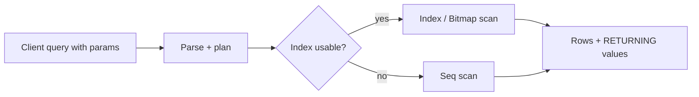

## What this covers

The PostgreSQL-specific SQL you need to read and write conversation history, task state and metadata efficiently: logical execution order and alias scope, PostgreSQL filtering helpers, JSONB operators, keyset pagination, common table expressions (including recursive ones), `RETURNING` and `INSERT ... ON CONFLICT` upserts. Standard `SELECT`/`JOIN`/`GROUP BY` knowledge is assumed.

**Exam weight:** Develop AI solutions by using Azure data management services (30–35%)

**Skills measured**

- "Connect and query Azure Database for PostgreSQL by using SDKs"

## Key concepts

### Logical execution order and alias scope

| Order | Clause |
| --- | --- |
| 1 | `FROM` |
| 2 | `WHERE` |
| 3 | `GROUP BY` |
| 4 | `HAVING` |
| 5 | `SELECT` |
| 6 | `ORDER BY` |
| 7 | `LIMIT` / `OFFSET` |

A column alias defined in `SELECT` exists only for later steps (`ORDER BY`, `LIMIT`). Using it in `WHERE` raises `column "x" does not exist`. Repeat the expression or wrap the query in a subquery or CTE.

### PostgreSQL filtering helpers

- `ILIKE`: case-insensitive pattern match (`content ILIKE '%error%'`).
- `NULLS FIRST` / `NULLS LAST`: by default NULL sorts as larger than any value (last in ASC, first in DESC).
- `COALESCE(a, b, ...)`: first non-null value, handy for defaults like `COALESCE(title, 'Untitled')`.
- `= ANY(%s)`: pass a Python list as one parameter instead of building an `IN (...)` string.

### JSONB operators

| Operator | Returns | Example |
| --- | --- | --- |
| `->` | jsonb | `metadata->'tags'` |
| `->>` | text | `metadata->>'status'` |
| `#>` / `#>>` | jsonb / text at a path | `checkpoint_data#>>'{results,0,score}'` |
| `?` | key exists | `metadata ? 'priority'` |
| `@>` | contains | `metadata @> '{"status":"completed"}'` |

`@>`, `?`, `?|`, `?&` can use a GIN index. Range comparisons on extracted values need an expression B-tree index such as `((metadata->>'score')::numeric)`. Expand arrays with `jsonb_array_elements` / `jsonb_array_elements_text`.

### Keyset pagination

`OFFSET` reads and discards every skipped row. Page 1,000 at 20 rows means scanning 20,000 rows. Keyset (cursor) pagination remembers the last row's sort key and filters past it, so each page costs the same. Include a unique tiebreaker (`id`) and back it with a matching index on `(created_at, id)`.

### CTEs and recursion

`WITH` blocks break a query into named steps. `WITH RECURSIVE` walks trees such as task hierarchies or threaded messages. It has an anchor query plus a recursive query joined with `UNION ALL`. Always add a depth limit so cyclic data can't loop forever.

### RETURNING and upserts

- `RETURNING` sends back generated values (IDs, defaults, timestamps) from `INSERT`/`UPDATE`/`DELETE` in the same round trip.
- `INSERT ... ON CONFLICT (cols) DO UPDATE SET col = EXCLUDED.col` turns a unique-key violation into an update. `EXCLUDED` holds the row you tried to insert. `DO NOTHING` skips duplicates. Add `WHERE` to `DO UPDATE` to update only when values change.
- `RETURNING (xmax = 0) AS is_new` tells you whether the row was inserted (`true`) or updated (`false`).
- The conflict target must match a unique index or constraint.

## How it works



Parameterized statements (`%s` in psycopg, `$1` server-side) let the planner reuse plans and stop SQL injection.

## Hands-on

### Azure portal

1. Open the server's **Connect** blade and launch psql from Cloud Shell, or use the PostgreSQL extension for VS Code.
2. Run the queries below against the schema from [Create and manage schemas](/study/develop-ai-solutions-with-azure-database-for-postgresql/create-and-manage-schemas).
3. Prefix a slow query with `EXPLAIN ANALYZE` to see whether it uses an index.

### Azure CLI

```bash
# Run a one-off query with an Entra token
export PGPASSWORD=$(az account get-access-token --resource-type oss-rdbms --query accessToken -o tsv)
psql "host=<server-name>.postgres.database.azure.com dbname=appdb user=<upn> sslmode=require" \
  -c "SELECT count(*) FROM messages;"
```

```sql
-- Alias scope: this fails, WHERE runs before SELECT
SELECT DATE(created_at) AS msg_date, content FROM messages WHERE msg_date > '2024-01-01';
-- This works: repeat the expression; ORDER BY may use the alias
SELECT DATE(created_at) AS msg_date, content
FROM messages
WHERE DATE(created_at) > '2024-01-01'
ORDER BY msg_date;

-- JSONB array filter
SELECT DISTINCT c.*
FROM conversations c, jsonb_array_elements_text(c.metadata->'tags') AS tag
WHERE tag = 'support';

-- Keyset pagination: next page after (created_at, id) of the last row seen
SELECT id, conversation_id, content, created_at
FROM messages
WHERE (created_at, id) < ('2024-06-15 10:30:00', 12345)
ORDER BY created_at DESC, id DESC
LIMIT 20;

-- CTE pipeline
WITH recent_conversations AS (
    SELECT id, user_id, started_at FROM conversations
    WHERE started_at > CURRENT_DATE - INTERVAL '7 days'
), message_stats AS (
    SELECT conversation_id, COUNT(*) AS message_count, MAX(created_at) AS last_message_at
    FROM messages GROUP BY conversation_id
)
SELECT rc.user_id, rc.started_at, COALESCE(ms.message_count, 0) AS message_count
FROM recent_conversations rc
LEFT JOIN message_stats ms ON rc.id = ms.conversation_id;

-- Recursive task tree with a depth guard
WITH RECURSIVE task_tree AS (
    SELECT id, parent_id, title, 1 AS depth FROM tasks WHERE id = 1
    UNION ALL
    SELECT t.id, t.parent_id, t.title, tt.depth + 1
    FROM tasks t JOIN task_tree tt ON t.parent_id = tt.id
    WHERE tt.depth < 10
)
SELECT * FROM task_tree ORDER BY depth, id;

-- RETURNING and upsert
INSERT INTO messages (conversation_id, role, content)
VALUES (1, 'user', 'Hello') RETURNING id, created_at;

INSERT INTO task_checkpoints (task_id, step_number, checkpoint_data)
VALUES ('<task-uuid>', 3, '{"status":"completed"}'::jsonb)
ON CONFLICT (task_id, step_number)
DO UPDATE SET checkpoint_data = EXCLUDED.checkpoint_data, updated_at = CURRENT_TIMESTAMP
RETURNING id, created_at, (xmax = 0) AS is_new;

INSERT INTO tags (name) VALUES ('important') ON CONFLICT (name) DO NOTHING;
```

### Python

```python
import psycopg
from psycopg.types.json import Jsonb

def recent_context(conn: psycopg.Connection, session_id: str, filter_json: dict,
                   last_started_at, last_id):
    sql = """
    SELECT c.id, c.session_id, c.started_at, c.metadata->>'status' AS status
    FROM conversations c
    WHERE c.session_id = %s
      AND c.metadata @> %s
      AND (c.started_at, c.id) < (%s, %s)
    ORDER BY c.started_at DESC, c.id DESC
    LIMIT 20
    """
    return conn.execute(sql, (session_id, Jsonb(filter_json), last_started_at, last_id)).fetchall()
```

## Exam traps

| Need | Use |
| --- | --- |
| Deep pagination that stays fast | Keyset pagination on an indexed `(sort_col, id)` |
| Get the generated ID after insert | `RETURNING id` |
| Idempotent write of agent state | `INSERT ... ON CONFLICT DO UPDATE` |
| Ignore duplicate tags | `ON CONFLICT DO NOTHING` |
| Filter JSONB by containment, fast | `@>` + GIN index |
| Walk a parent/child thread | `WITH RECURSIVE` + depth limit |

> [!WARNING]
> **Exam trap:** Referencing a `SELECT` alias in `WHERE` or `HAVING` fails; only `ORDER BY` (and later) can see it.

> [!WARNING]
> **Exam trap:** `ON CONFLICT (col)` requires a unique constraint or unique index on exactly those columns, otherwise the statement errors.

> [!TIP]
> Single arrow `->` keeps JSON, double arrow `->>` gives text. Compare text with `->>`.

> [!NOTE]
> GIN indexes on JSONB accelerate `@>` and key-existence operators, not `<`/`>` range filters.

## Quick review

- Execution order: FROM, WHERE, GROUP BY, HAVING, SELECT, ORDER BY, LIMIT.
- `ILIKE` is case-insensitive LIKE; NULLs sort last ascending by default.
- `->` json, `->>` text, `#>`/`#>>` paths, `?` key exists, `@>` contains.
- Keyset pagination beats OFFSET for deep pages.
- Recursive CTEs need a termination condition.
- `EXCLUDED` holds the proposed row in an upsert; `(xmax = 0)` flags inserts.

## Practice

[Practice: connect and query questions](/practice/pg-connect-query)

## Official references

- [AI-200 study guide](https://learn.microsoft.com/en-us/credentials/certifications/resources/study-guides/ai-200)
- [Unit: Query data](https://learn.microsoft.com/en-us/training/modules/build-query-azure-database-postgresql/5-query-data)
- [Module: Build and query with Azure Database for PostgreSQL](https://learn.microsoft.com/en-us/training/modules/build-query-azure-database-postgresql/)
- [Microsoft Learn](https://learn.microsoft.com/)
