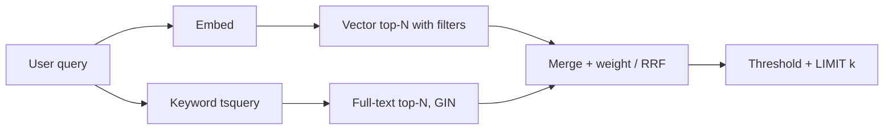

## What this covers

Query patterns that turn raw nearest-neighbour search into useful semantic retrieval: combining vector ranking with SQL metadata filters, cutting off weak matches with a distance threshold, returning everything the caller needs in one round trip, querying with several vectors, and blending vector similarity with PostgreSQL full-text search (hybrid search).

**Exam weight:** Develop AI solutions by using Azure data management services (30–35%)

**Skills measured**

- "Run vector similarity search, including storing embeddings, semantic retrieval, and implementing retrieval-augmented generation (RAG) patterns by using metadata filter"

## Key concepts

### Metadata filters

Add ordinary `WHERE` predicates (category, tenant, date) to an `ORDER BY embedding <=> $1 LIMIT k` query. The planner then picks one of two strategies based on statistics:

- **Filter first**: use B-tree indexes on the metadata, then compute exact distances on the matching rows. This wins when the filter is very selective (few rows).
- **Vector index first**: walk the HNSW/IVFFlat index in distance order and drop rows that fail the filter. This wins when the filter matches most rows.

The risk in the second strategy: HNSW returns about `ef_search` candidates, so a restrictive filter can leave **fewer than k** results. Remedies:

- pgvector 0.8+ iterative index scans: `SET hnsw.iterative_scan = relaxed_order` (or `strict_order`), bounded by `hnsw.max_scan_tuples`. For IVFFlat, `ivfflat.iterative_scan` with `ivfflat.max_probes`.
- Raise `hnsw.ef_search`.
- Partial indexes or partitions per common filter value (for example per tenant).
- Over-fetch then filter: take the top 100 by distance in a CTE, filter, keep 10.

Run `ANALYZE` after loads so the planner's selectivity estimates are right. Create B-tree or composite indexes on filter columns.

### Distance thresholds

`LIMIT` always returns k rows, even irrelevant ones. Add `WHERE embedding <=> $1 < threshold` to return only good matches, possibly none. Pick the threshold from data: measure distances for known-relevant and known-irrelevant pairs and choose a value in the gap. For OpenAI embeddings with cosine distance, useful thresholds often fall between about 0.3 (strict) and 0.6 (lenient). For best index use, put the threshold in an outer query over an `ORDER BY ... LIMIT` subquery.

### One round trip

Return title, content (or a summary), metadata, distance and joined fields (author, source URL) in the same query instead of IDs plus follow-up lookups. Index the join columns.

### Multi-vector queries

- Examples describing the **same** idea can be averaged into one centroid query vector. pgvector has an `avg(vector)` aggregate.
- **Different** aspects ("mergers" and "environmental compliance") should be queried separately and the results merged, because the average of two unrelated vectors may sit near neither.

### Hybrid search

Vectors miss exact tokens such as case names, SKUs and error codes. Combine:

- full-text: `to_tsvector('english', content) @@ plainto_tsquery('english', $2)` scored with `ts_rank`,
- semantic: `1 - (embedding <=> $1)`,

and weight them, for example 0.7 semantic + 0.3 keyword. Store the `tsvector` in a generated column with a GIN index so it isn't recomputed per query. Reciprocal Rank Fusion (RRF) is an alternative that merges ranks instead of raw scores, which avoids scale mismatches.

## How it works



## Hands-on

### Azure portal

1. Allow-list `vector` (and `pg_trgm` if you want fuzzy matching) in **Server parameters > azure.extensions**.
2. Use **Query Performance Insight** to find slow filtered vector queries.

### Azure CLI

```bash
az postgres flexible-server parameter set -g <resource-group> --server-name <server-name> \
  --name azure.extensions --value vector,pg_trgm
```

```sql
-- Filtered semantic search
CREATE INDEX idx_docs_cat_area ON documents (category, practice_area);
SELECT id, title, embedding <=> $1 AS distance
FROM documents
WHERE category = 'contracts' AND practice_area = 'corporate' AND created_at > '2024-01-01'
ORDER BY embedding <=> $1
LIMIT 10;

-- Keep scanning the HNSW index until enough filtered rows are found (pgvector 0.8+)
SET hnsw.iterative_scan = relaxed_order;

-- Threshold over an index-friendly inner query
SELECT * FROM (
    SELECT id, title, embedding <=> $1 AS distance
    FROM documents ORDER BY embedding <=> $1 LIMIT 20
) t
WHERE distance < 0.4
ORDER BY distance LIMIT 10;

-- Results with joined metadata in one round trip
SELECT d.id, d.title, d.content, d.embedding <=> $1 AS distance, a.name AS author_name
FROM documents d JOIN authors a ON d.author_id = a.id
WHERE d.embedding <=> $1 < 0.5
ORDER BY d.embedding <=> $1
LIMIT 5;

-- Two aspects queried separately, then combined
WITH merger_results AS (
    SELECT id, embedding <=> $1 AS distance FROM documents ORDER BY embedding <=> $1 LIMIT 20
), environmental_results AS (
    SELECT id, embedding <=> $2 AS distance FROM documents ORDER BY embedding <=> $2 LIMIT 20
)
SELECT d.id, d.title,
       (COALESCE(mr.distance, 1) + COALESCE(er.distance, 1)) / 2 AS combined_score
FROM documents d
LEFT JOIN merger_results mr ON d.id = mr.id
LEFT JOIN environmental_results er ON d.id = er.id
WHERE mr.id IS NOT NULL OR er.id IS NOT NULL
ORDER BY combined_score
LIMIT 10;

-- Hybrid search with a stored tsvector
ALTER TABLE documents ADD COLUMN content_tsv tsvector
    GENERATED ALWAYS AS (to_tsvector('english', coalesce(content, ''))) STORED;
CREATE INDEX idx_documents_tsv ON documents USING gin (content_tsv);

SELECT id, title,
       (1 - (embedding <=> $1)) * 0.7
     + ts_rank(content_tsv, plainto_tsquery('english', $2)) * 0.3 AS hybrid_score
FROM documents
WHERE content_tsv @@ plainto_tsquery('english', $2)
   OR embedding <=> $1 < 0.5
ORDER BY hybrid_score DESC
LIMIT 10;
```

### Python

```python
import psycopg
from pgvector.psycopg import register_vector

SQL = """
SELECT id, title, distance FROM (
    SELECT id, title, embedding <=> %(q)s AS distance
    FROM documents
    WHERE category = %(category)s
    ORDER BY embedding <=> %(q)s
    LIMIT %(fetch)s
) t
WHERE distance < %(max_distance)s
ORDER BY distance
LIMIT %(k)s
"""

def semantic_search(conn: psycopg.Connection, qvec, category: str, k: int = 5,
                    max_distance: float = 0.45):
    register_vector(conn)
    with conn.transaction():
        conn.execute("SET LOCAL hnsw.iterative_scan = relaxed_order")
        return conn.execute(SQL, {"q": qvec, "category": category, "fetch": k * 4,
                                  "k": k, "max_distance": max_distance}).fetchall()
```

## Exam traps

| Requirement | Pattern |
| --- | --- |
| Restrict results to one tenant/category | `WHERE` filter + B-tree index (+ iterative scan) |
| Prefer "no answer" to a wrong answer | Distance threshold |
| Exact names/codes must match | Hybrid: full-text (GIN) + vector |
| Filtered HNSW returns too few rows | `hnsw.iterative_scan`, higher `ef_search`, partial index or over-fetch |
| Find items like these three examples | Average the example vectors |

> [!WARNING]
> **Exam trap:** `LIMIT 10` alone guarantees ten rows, not ten *relevant* rows. Add a threshold when irrelevant context is harmful.

> [!WARNING]
> **Exam trap:** Storing filterable attributes only inside JSONB makes range filters (`price BETWEEN`) slow. Promote hot filter fields to typed, indexed columns.

> [!TIP]
> Hybrid = "meaning + exact words". GIN index for words, HNSW for meaning.

> [!NOTE]
> `ts_rank` and cosine similarity live on different scales. Normalize them or use RRF before you tune weights.

## Quick review

- Metadata filters are plain SQL `WHERE` clauses next to `ORDER BY distance LIMIT k`.
- The planner chooses filter-first or index-first using statistics; run `ANALYZE`.
- Filtered ANN can under-return; pgvector 0.8 iterative scans fix that.
- Distance thresholds trade recall for precision.
- Average related example vectors; query distinct aspects separately.
- Hybrid search combines `ts_rank` with vector similarity.

## Practice

[Practice: vector search and RAG questions](/practice/pg-vector-rag)

## Official references

- [AI-200 study guide](https://learn.microsoft.com/en-us/credentials/certifications/resources/study-guides/ai-200)
- [Unit: Run vector similarity search for semantic retrieval](https://learn.microsoft.com/en-us/training/modules/implement-vector-search-azure-database-postgresql/5-run-vector-similarity-search-semantic-retrieval)
- [Optimize performance when using pgvector](https://learn.microsoft.com/en-us/azure/postgresql/extensions/how-to-optimize-performance-pgvector)
- [pgvector extension](https://github.com/pgvector/pgvector)
- [Microsoft Learn](https://learn.microsoft.com/)
