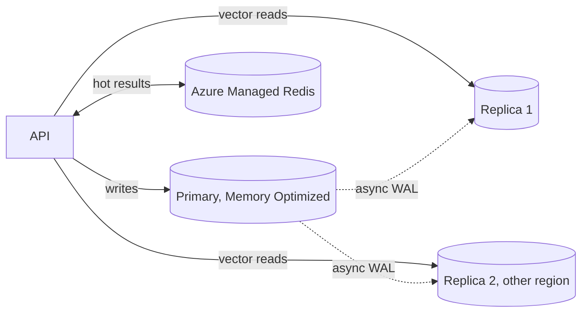

## What this covers

What to do when one Azure Database for PostgreSQL server no longer keeps up with vector traffic: scaling compute up, scaling reads out with replicas, caching repeat lookups, monitoring for capacity, and keeping costs down. Picking SKUs and storage is covered in depth in [Configure compute and storage for vector workloads](/study/develop-ai-solutions-with-azure-database-for-postgresql/configure-compute-and-storage-for-vector-workloads).

**Exam weight:** Develop AI solutions by using Azure data management services (30–35%)

**Skills measured**

- "Configure compute, memory, and storage resources to support vector workloads"

## Key concepts

### Scale up (vertical)

More vCores give more parallel distance calculations. More memory keeps HNSW graphs cached. Memory per vCore is what matters for vector work:

| Tier | vCores | Memory per vCore | Fit |
| --- | --- | --- | --- |
| Burstable | 1–20 | varies (2–4 GiB) | Dev, low traffic |
| General Purpose | 2–192 | 4 GiB | Balanced production |
| Memory Optimized | 2–192 | ~6.75–9.5 GiB | Large indexes, high concurrency |

Starting points from the module:

- **< 1M vectors**: General Purpose 4–8 vCores; scale up if CPU stays above about 70% at peak.
- **1–10M vectors**: Memory Optimized 8–16 vCores, with RAM at least 1.5× the vector index size; 32+ vCores for hundreds of concurrent queries.
- **> 10M vectors**: Memory Optimized 32+ vCores, plus replicas, partitioning, caching or DiskANN.

Scaling compute restarts the server briefly. Plan a window, or rely on retry logic.

### Scale out reads with replicas

- Read replicas use **asynchronous** physical streaming replication. Up to **five** per primary, same or other regions.
- Each replica has its own endpoint (virtual endpoints can give stable writer/reader names). The application routes reads, typically vector searches, to replicas and writes to the primary.
- Replica lag is usually milliseconds to seconds but grows under heavy writes, bulk loads or cross-region links. Read-your-own-write paths (just-saved preferences) should hit the primary.
- Replicas can be sized independently: many small ones for throughput, large ones for single-query latency, or regional ones near users.
- Replicas don't raise write throughput; scale up the primary or shard for that.

### Cache what repeats

Arbitrary similarity queries rarely repeat, but these do: precomputed "similar items" for popular products, embeddings of hot items, per-user profile vectors, category centroids. Put them in **Azure Managed Redis** with a TTL (15–60 minutes is common for recommendations), event-driven invalidation when the source changes, and optional background refresh of popular keys. Don't cache highly personalized queries with many filter combinations, or fast-changing data.

### Monitor and plan

- Server metrics: **CPU percent** (sustained > 70–80%), **Memory percent** (> 90% risks swapping), **Storage IO percent / IOPS consumed**, **Active connections** vs `max_connections`, **Max physical replication lag** on replicas.
- Query metrics: P95/P99 vector latency, queries per second, buffer cache hit ratio.
- Alerts: for example warning at CPU > 80% for 5 minutes, critical at Memory > 90% for 5 minutes.
- Capacity planning: measure baselines, identify growth drivers (catalogue size, users), project load, and test scale-up and replica failover before you need them.

### Cost control

Scale down when average CPU stays under about 30%. Move to General Purpose if memory is idle. Remove idle replicas and unused indexes. Archive cold vectors. Use `halfvec` where recall allows. Buy reserved capacity (1 or 3 years, up to about 65% off) for the steady baseline. Use Burstable or stopped servers outside production.

## How it works



## Hands-on

### Azure portal

1. **Compute + storage**: change tier to **Memory Optimized** and pick vCores; **Save** (brief restart).
2. **Replication**: **Create replica**, choose region and size.
3. **Alerts**: new alert rule on **CPU percent > 80** for 5 minutes and **Memory percent > 90**.

### Azure CLI

```bash
# Scale up
az postgres flexible-server update -g <resource-group> -n <server-name> \
  --tier MemoryOptimized --sku-name Standard_E8ds_v5

# Read replica in another region
az postgres flexible-server replica create -g <resource-group> \
  --replica-name <server-name>-ro1 --source-server <server-name> --location westeurope

# CPU alert
az monitor metrics alert create -g <resource-group> -n pg-cpu-high \
  --scopes $(az postgres flexible-server show -g <resource-group> -n <server-name> --query id -o tsv) \
  --condition "avg cpu_percent > 80" --window-size 5m --evaluation-frequency 1m
```

```sql
-- On a replica: seconds behind the primary
SELECT EXTRACT(EPOCH FROM (now() - pg_last_xact_replay_timestamp())) AS lag_seconds;
```

### Python

```python
import json
import redis
from azure.identity import DefaultAzureCredential
from redis_entraid.cred_provider import create_from_default_azure_credential

# Azure Managed Redis with Entra auth (port 10000); no access keys in code
cred_provider = create_from_default_azure_credential(("https://redis.azure.com/.default",))
cache = redis.Redis(host="<cache-name>.<region>.redis.azure.net", port=10000, ssl=True,
                    credential_provider=cred_provider)

def similar_products(product_id: int, read_pool, ttl: int = 1800):
    key = f"similar:{product_id}"
    if (hit := cache.get(key)) is not None:
        return json.loads(hit)
    with read_pool.connection() as conn:          # pool pointed at a read replica
        rows = conn.execute("""
            SELECT p.id FROM products p, (SELECT embedding FROM products WHERE id = %s) t
            WHERE p.id <> %s ORDER BY p.embedding <=> t.embedding LIMIT 10""",
            (product_id, product_id)).fetchall()
    ids = [r[0] for r in rows]
    cache.setex(key, ttl, json.dumps(ids))
    return ids
```

## Exam traps

| Symptom / goal | Action |
| --- | --- |
| Single query slow, memory pressure | Scale up / Memory Optimized |
| Total read QPS too high, staleness OK | Read replicas |
| Same recommendations requested repeatedly | Cache in Azure Managed Redis with TTL |
| Need to see a write immediately | Read from the primary |
| Predictable baseline spend | Reserved capacity |
| Write throughput limit | Scale up primary (replicas don't help) |

> [!WARNING]
> **Exam trap:** Replicas are asynchronous. A query right after an insert may not see the new row on a replica.

> [!WARNING]
> **Exam trap:** Adding replicas doesn't reduce latency for one heavy query that's bottlenecked on memory; scaling up does.

> [!TIP]
> Up for latency, out for throughput, cache for repetition.

> [!NOTE]
> The module's sample uses Azure Cache for Redis with an access key; for AI-200, prefer Azure Managed Redis with Microsoft Entra authentication.

## Quick review

- Memory Optimized gives the most RAM per vCore for HNSW caching.
- Scaling compute triggers a short restart.
- Up to five async read replicas, cross-region allowed, separate endpoints.
- Route read-only vector search to replicas; read-your-writes to the primary.
- Cache precomputed neighbours with TTLs; arbitrary vectors cache poorly.
- Alert on CPU, memory, IO and connections before users notice.

## Practice

[Practice: compute, memory and storage questions](/practice/pg-compute)

## Official references

- [AI-200 study guide](https://learn.microsoft.com/en-us/credentials/certifications/resources/study-guides/ai-200)
- [Unit: Scale for high-volume workloads](https://learn.microsoft.com/en-us/training/modules/optimize-vector-search-azure-database-postgresql/5-scale-high-volume-workloads)
- [Compute options](https://learn.microsoft.com/en-us/azure/postgresql/compute-storage/concepts-compute)
- [Microsoft Learn](https://learn.microsoft.com/)
