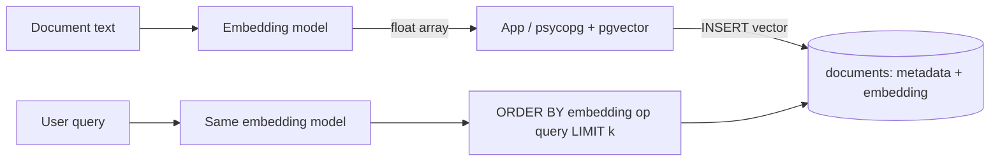

## What this covers

Getting embeddings into Azure Database for PostgreSQL and reading them back: allow-listing and creating the `vector` extension, designing tables with `vector(n)` columns, inserting and updating embeddings, the three distance operators, and the `vector`, `halfvec` and `sparsevec` types. Indexing is on the next page, [Perform fast vector similarity search](/study/develop-ai-solutions-with-azure-database-for-postgresql/perform-fast-vector-similarity-search).

**Exam weight:** Develop AI solutions by using Azure data management services (30–35%)

**Skills measured**

- "Run vector similarity search, including storing embeddings, semantic retrieval, and implementing retrieval-augmented generation (RAG) patterns by using metadata filter"
- "Model schemas and implement indexing strategies, including designing tables and choosing appropriate data types"

## Key concepts

### Enabling pgvector on flexible server

Two steps, in this order:

1. **Allow-list** it at server level: add `vector` (named `VECTOR` in the portal) to the `azure.extensions` server parameter.
2. **Create** it in each database that needs it: `CREATE EXTENSION IF NOT EXISTS vector;`. You need the server admin or a member of `azure_pg_admin`.

The extension's name is `vector`, not `pgvector`. Check it with `SELECT * FROM pg_extension WHERE extname = 'vector';`.

### Designing vector columns

`vector(n)` stores `n` single-precision floats. The dimension must equal the embedding model's output, otherwise inserts fail with a dimension mismatch:

| Model | Dimensions |
| --- | --- |
| Typical sentence-transformers (all-MiniLM) | 384 |
| text-embedding-ada-002, text-embedding-3-small | 1,536 |
| text-embedding-3-large | up to 3,072 (can be shortened with the `dimensions` parameter) |

Keep the embedding in the same row as its filterable metadata (category, tenant, dates) so a single query can filter and rank without joins. Move very large text to a side table if similarity queries don't need it. One table can hold several vector columns (for example `title_embedding vector(384)` and `content_embedding vector(1536)`), and each needs its own index. Always declare the dimension: an untyped `vector` column can't be indexed.

### Vector types

| Type | Element | Storage (1,536 dims) | Index limit (HNSW/IVFFlat) |
| --- | --- | --- | --- |
| `vector` | float32 | about 6 KB | 2,000 dims |
| `halfvec` | float16 | about 3 KB | 4,000 dims |
| `sparsevec` | non-zeros only | depends on non-zeros | HNSW up to 1,000 non-zero elements |

Use `vector` by default. Use `halfvec` to halve storage and index size, or to index 3,072-dim embeddings, after checking recall on your data. Use `sparsevec` for sparse models (for example SPLADE-style term weights).

### Distance operators

| Operator | Distance | Index opclass | Notes |
| --- | --- | --- | --- |
| `<->` | L2 (Euclidean) | `vector_l2_ops` | Magnitude matters |
| `<=>` | Cosine distance (0 to 2) | `vector_cosine_ops` | Default for text embeddings |
| `<#>` | **Negative** inner product | `vector_ip_ops` | Smaller is more similar; fastest for unit-length vectors |

Plus `<+>` (L1) and, for binary vectors, `<~>` (Hamming) and `<%>` (Jaccard). All operators return a distance, so you always `ORDER BY ... ASC`. Cosine similarity is `1 - (a <=> b)`. Inner-product similarity is `(a <#> b) * -1`. OpenAI embeddings are normalized to length 1, so cosine, L2 and inner product give the same ranking, and `<#>` is cheapest.

### Writing embeddings

Embeddings come from your application (or the `azure_ai` extension) and are sent as parameters. In SQL a vector literal looks like `'[0.1, -0.2, ...]'::vector`. Bulk loads should use multi-row `INSERT` or `COPY`. When content changes, update the embedding with it, or mark it stale and re-embed in batches off-peak (see [Manage index lifecycle and embedding updates](/study/develop-ai-solutions-with-azure-database-for-postgresql/manage-index-lifecycle-and-embedding-updates)).

## How it works



Without an index PostgreSQL computes the distance to every row (exact search). That's fine for small tables and is the baseline you compare indexes against.

## Hands-on

### Azure portal

1. Server, **Server parameters**, search `azure.extensions`, tick **VECTOR**, **Save**.
2. Connect with psql or the VS Code PostgreSQL extension.
3. Run `CREATE EXTENSION IF NOT EXISTS vector;` in your database.

### Azure CLI

```bash
az postgres flexible-server parameter set \
  --resource-group <resource-group> --server-name <server-name> \
  --name azure.extensions --value vector
```

```sql
CREATE EXTENSION IF NOT EXISTS vector;

CREATE TABLE documents (
    id SERIAL PRIMARY KEY,
    title TEXT NOT NULL,
    content TEXT,
    category TEXT,
    practice_area TEXT,
    created_at TIMESTAMPTZ DEFAULT NOW(),
    updated_at TIMESTAMPTZ DEFAULT NOW(),
    embedding vector(1536)
);

INSERT INTO documents (title, content, category, practice_area, embedding)
VALUES ('Corporate Merger Agreement Template',
        'This agreement outlines the terms...', 'contracts', 'corporate',
        '[0.0123, -0.0456, 0.0789, ...]'::vector);

-- Cosine distance, nearest first
SELECT id, title, embedding <=> '[0.0123, -0.0456, ...]'::vector AS distance
FROM documents
ORDER BY distance
LIMIT 10;

-- Half-precision storage
CREATE TABLE documents_compact (id SERIAL PRIMARY KEY, title TEXT NOT NULL, embedding halfvec(1536));
```

### Python

```python
import numpy as np
import psycopg
from pgvector.psycopg import register_vector

with psycopg.connect("<conninfo>") as conn:   # Entra token as password
    conn.execute("CREATE EXTENSION IF NOT EXISTS vector")
    register_vector(conn)  # after the extension exists; maps numpy arrays <-> vector

    conn.execute("""
        CREATE TABLE IF NOT EXISTS chunks (
            id SERIAL PRIMARY KEY,
            content TEXT,
            tenant_id TEXT,
            embedding vector(1536)
        )""")

    query_embedding = np.random.rand(1536).astype(np.float32)  # replace with your model output
    conn.execute("INSERT INTO chunks (content, tenant_id, embedding) VALUES (%s, %s, %s)",
                 ("RAG chunk text", "tenant-a", query_embedding))

    rows = conn.execute("""
        SELECT content, embedding <=> %s AS distance
        FROM chunks
        WHERE tenant_id = %s
        ORDER BY embedding <=> %s
        LIMIT 5""", (query_embedding, "tenant-a", query_embedding)).fetchall()
```

## Exam traps

| Need | Choose |
| --- | --- |
| Text embedding similarity | `<=>` + `vector_cosine_ops` |
| Normalized vectors, fastest scoring | `<#>` + `vector_ip_ops` |
| Halve storage with little recall loss | `halfvec(n)` |
| Index 3,072-dim embeddings with HNSW | `halfvec(3072)` (or reduce dimensions, or DiskANN with PQ) |
| `CREATE EXTENSION vector` fails on Azure | Allow-list in `azure.extensions` first |

> [!WARNING]
> **Exam trap:** `<#>` returns the *negative* inner product. Order ascending; multiply by -1 to show a similarity score.

> [!WARNING]
> **Exam trap:** Mixing embeddings from two models (or two dimension settings) in one column breaks similarity. Inserts fail if dimensions differ and rankings go wrong if they match but the models differ.

> [!TIP]
> Arrow `<->` = L2 (straight line), equals sign `<=>` = cosine, hash `<#>` = inner product.

> [!NOTE]
> A `vector` value takes 4 bytes per dimension plus 8 bytes of header, so 1,536 dims is about 6 KB per row.

## Quick review

- Allow-list `vector` in `azure.extensions`, then `CREATE EXTENSION vector` per database.
- `vector(n)` must match the model's dimensions; untyped columns can't be indexed.
- `<->` L2, `<=>` cosine, `<#>` negative inner product; always ORDER BY ascending.
- `halfvec` halves storage and raises the index limit to 4,000 dims.
- `sparsevec` HNSW indexes support up to 1,000 non-zeros.
- `register_vector(conn)` lets psycopg send NumPy arrays.

## Practice

[Practice: vector search and RAG questions](/practice/pg-vector-rag) · [Practice: schema questions](/practice/pg-schema)

## Official references

- [AI-200 study guide](https://learn.microsoft.com/en-us/credentials/certifications/resources/study-guides/ai-200)
- [Unit: Store and query embeddings with pgvector](https://learn.microsoft.com/en-us/training/modules/implement-vector-search-azure-database-postgresql/2-store-query-embeddings-pgvector)
- [Allow extensions](https://learn.microsoft.com/en-us/azure/postgresql/extensions/how-to-allow-extensions)
- [pgvector extension](https://github.com/pgvector/pgvector)
- [Microsoft Learn](https://learn.microsoft.com/)
