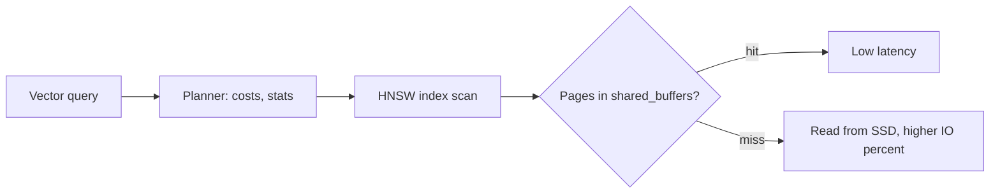

## What this covers

Which PostgreSQL and pgvector settings change vector-search latency and memory use on Azure Database for PostgreSQL flexible server, what each one does, safe starting values, how to set them at server, session or transaction level, and how to measure the effect with `EXPLAIN` and Azure Monitor.

**Exam weight:** Develop AI solutions by using Azure data management services (30–35%)

**Skills measured**

- "Configure compute, memory, and storage resources to support vector workloads"
- "Implement indexing strategies, including optimizing query latency and reducing pgvector compute overhead"

## Key concepts

### Why vector queries are different

One cosine distance on 1,536 dimensions costs about 1,536 multiply-adds. Brute force over a million rows is about 1.5 billion operations per query, so vector search is CPU-bound without an index and memory-bound with one. HNSW traversal is fast only while graph pages stay in RAM. Cost per comparison grows **linearly** with dimensions: 3,072 dims means about 2× the work and 2× the storage of 1,536 dims. Shortened embeddings (for example 768 or 1,024) cut both.

Operator cost: inner product (`<#>`) is cheapest. Cosine (`<=>`) adds normalization. For unit-length embeddings (OpenAI models) inner product gives the same ranking as cosine, so `<#>` with `vector_ip_ops` is a cheap win.

### Memory parameters

| Parameter | What it does | Guidance |
| --- | --- | --- |
| `shared_buffers` | PostgreSQL's page cache | Azure sets it per SKU (around 25% of RAM). Static, so changes need a restart. Aim for the hot vector index to fit; watch cache hit ratio (want 99%+). |
| `effective_cache_size` | Planner's estimate of total cache (shared buffers + OS) | About 75% of RAM; a hint only, nothing is allocated. Higher values favour index scans. |
| `work_mem` | Memory per sort/hash operation, per connection | Default 4 MB. Raise per session or with `SET LOCAL` for big sorts, not globally: 100 connections × several operations × `work_mem` adds up fast. |
| `maintenance_work_mem` | Memory for `CREATE INDEX`, `VACUUM` | Raise (for example 2–8 GB) during HNSW/DiskANN builds so the graph builds in memory; pgvector warns when it spills. |

### Planner and parallelism

- `random_page_cost`: default 4.0 assumes spinning disks. On Azure SSDs 1.1–1.5 encourages index scans.
- `effective_io_concurrency`: around 200 on SSD for bitmap-heap prefetching.
- `max_parallel_workers_per_gather`: lets exact (unindexed) scans run in parallel; look for `Workers Launched` in plans.
- `max_parallel_maintenance_workers`: parallel index builds (HNSW supports them; increase `max_worker_processes` if needed, which needs a restart).
- `parallel_setup_cost` / `parallel_tuple_cost` (defaults 1000 / 0.1): lower values make parallel plans more likely.

### pgvector knobs

| Knob | Default | Effect |
| --- | --- | --- |
| `ivfflat.probes` | 1 | Lists searched; start near `sqrt(lists)` or 5–10% of lists. Higher = better recall, slower. |
| `hnsw.ef_search` | 40 | Candidate list size; 100–200 for ~99% recall, ~20 for latency-first. Must be ≥ LIMIT. |
| `hnsw.iterative_scan` | off | pgvector 0.8+: keeps scanning when filters remove results. |
| `diskann.l_value_is` | 100 | DiskANN search list size. |

Set them per transaction with `SET LOCAL` so pooled connections don't keep someone else's settings.

### Measuring

- `EXPLAIN (ANALYZE, BUFFERS)`: look for `Index Scan using <vector index>`, actual times, and `shared hit` vs `read` buffers.
- `ANALYZE <table>` after bulk loads so the planner's statistics are current.
- `pg_stat_statements` and Query Store show the slowest normalized queries.
- Azure Monitor metrics: **CPU percent**, **Memory percent**, **Storage IO percent / Disk IOPS consumed**, **Active connections**. Alert before they saturate.

Best practice: baseline first, change one setting at a time, test with production-sized data, and record what changed and why.

## How it works



## Hands-on

### Azure portal

1. Server, **Server parameters**: search `work_mem`, `maintenance_work_mem`, `random_page_cost`, `effective_io_concurrency`; edit and **Save** (dynamic parameters apply without restart).
2. Static parameters such as `shared_buffers` show **Restart required**. Restart from **Overview**.
3. **Monitoring > Metrics**: add CPU percent, Memory percent and Storage IO percent to one chart and pin it.

### Azure CLI

```bash
az postgres flexible-server parameter set -g <resource-group> --server-name <server-name> \
  --name random_page_cost --value 1.1
az postgres flexible-server parameter set -g <resource-group> --server-name <server-name> \
  --name maintenance_work_mem --value 2097152   # in KB = 2 GB
az postgres flexible-server parameter show -g <resource-group> --server-name <server-name> \
  --name shared_buffers --query "{value:value, unit:unit, restart:isConfigPendingRestart}"
```

```sql
SHOW shared_buffers;

-- Cache hit ratio
SELECT sum(heap_blks_hit) / NULLIF(sum(heap_blks_hit) + sum(heap_blks_read), 0) AS cache_hit_ratio
FROM pg_statio_user_tables;

-- Per-query tuning inside one transaction
BEGIN;
SET LOCAL hnsw.ef_search = 100;
SET LOCAL work_mem = '256MB';
SELECT id, name, embedding <=> $1 AS distance FROM products ORDER BY embedding <=> $1 LIMIT 10;
COMMIT;

SET ivfflat.probes = 10;
EXPLAIN (ANALYZE, BUFFERS) SELECT id FROM products ORDER BY embedding <=> $1 LIMIT 10;
ANALYZE products;
SELECT indexname, indexdef FROM pg_indexes WHERE tablename = 'products';
```

### Python

```python
import time
import psycopg

def benchmark(conn: psycopg.Connection, qvec, settings=(20, 40, 100, 200), runs=20):
    """Compare latency for several hnsw.ef_search values; measure recall separately."""
    results = {}
    for ef in settings:
        start = time.perf_counter()
        for _ in range(runs):
            with conn.transaction():
                conn.execute(f"SET LOCAL hnsw.ef_search = {int(ef)}")
                conn.execute("SELECT id FROM products ORDER BY embedding <=> %s LIMIT 10",
                             (qvec,)).fetchall()
        results[ef] = (time.perf_counter() - start) / runs * 1000
    return results  # ms per query
```

## Exam traps

| Symptom | Likely fix |
| --- | --- |
| Memory percent high, Storage IO percent high, slow ANN | Index doesn't fit in RAM: Memory Optimized tier or smaller vectors (`halfvec`) |
| HNSW build very slow / warns about memory | Raise `maintenance_work_mem`, add parallel maintenance workers |
| Planner prefers seq scan on SSD | Lower `random_page_cost`, run `ANALYZE` |
| Global `work_mem` raise causes OOM | Set it per session/transaction |
| Need higher recall right now | Raise `hnsw.ef_search` / `ivfflat.probes` (no rebuild) |

> [!WARNING]
> **Exam trap:** `SET hnsw.ef_search` on a pooled (PgBouncer transaction mode) connection doesn't reliably persist and can leak to other clients. Use `SET LOCAL` inside a transaction.

> [!WARNING]
> **Exam trap:** `effective_cache_size` allocates nothing. Raising it doesn't add memory; it only changes planner choices.

> [!TIP]
> `maintenance_work_mem` for building, `work_mem` for querying, `shared_buffers` for caching.

> [!NOTE]
> Changing `shared_buffers` or `max_worker_processes` needs a server restart; most other settings here are dynamic.

## Quick review

- Vector cost grows linearly with dimensions; shorter embeddings are cheaper.
- Normalized embeddings: use `<#>` for the cheapest exact-equivalent ranking.
- Keep the vector index in memory: `shared_buffers` and enough RAM.
- `work_mem` is per operation per connection; scope it with `SET LOCAL`.
- `random_page_cost` 1.1–1.5 suits Azure SSD storage.
- `ivfflat.probes` default 1; `hnsw.ef_search` default 40.
- Measure with `EXPLAIN (ANALYZE, BUFFERS)` and Azure Monitor metrics.

## Practice

[Practice: compute and memory questions](/practice/pg-compute) · [Practice: indexing questions](/practice/pg-indexing)

## Official references

- [AI-200 study guide](https://learn.microsoft.com/en-us/credentials/certifications/resources/study-guides/ai-200)
- [Unit: Tune PostgreSQL for pgvector](https://learn.microsoft.com/en-us/training/modules/optimize-vector-search-azure-database-postgresql/2-tune-postgresql-pgvector)
- [Optimize performance when using pgvector](https://learn.microsoft.com/en-us/azure/postgresql/extensions/how-to-optimize-performance-pgvector)
- [Microsoft Learn](https://learn.microsoft.com/)
