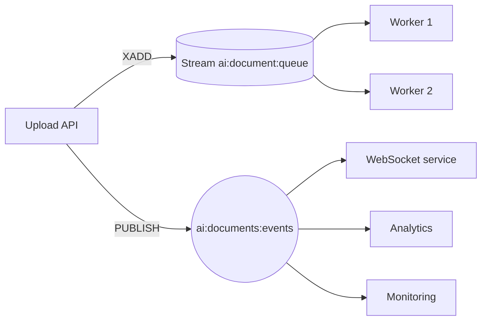

## What this covers

When several subscribers listen to Redis, what each one receives depends on the feature. With **pub/sub**, every subscriber receives every message (broadcast). With **Streams consumer groups**, each message goes to exactly one worker (coordinated distribution). This page explains both behaviors, the scenarios each one fits, how to recover work when a worker fails, and the hybrid design that uses both. A typical exam question gives you a scenario and asks which of the two to choose.

**Exam weight:** Develop AI solutions by using Azure data management services (30–35%)

**Skills measured**

- "Implement Azure Managed Redis data operations, including caching, expiration, and invalidation"

## Key concepts

### Broadcast with pub/sub

If five API instances subscribe to `ai:models:updated`, one `PUBLISH` reaches all five at once. That is exactly what you want when **every** instance has to do something:

- **Cache invalidation across instances**: each API instance clears its in-process model or embedding cache.
- **Configuration reloads**: feature flags or model parameters changed.
- **Monitoring fan-out**: dashboards, alerting and logging each consume the same metrics.
- **Heterogeneous notifications**: analytics, billing and recommendations each react differently to "interaction completed".

Broadcast is the **wrong** choice for work items. Three subscribed workers would run the same inference three times. That triples GPU cost and can produce inconsistent results. Pub/sub can't load-balance or acknowledge, and an offline worker simply misses the message.

### Coordinated distribution with Streams consumer groups

A consumer group splits a stream among its members. Every worker uses the **same group name** and a **unique consumer name**, and Redis hands each entry to just one of them. Add or remove workers and the share of work rebalances automatically, with no code changes.

- `>` asks for entries never delivered to anyone. That is what spreads the work.
- `0` asks for the entries already delivered to **this** consumer that are still unacknowledged. Use it for startup recovery.
- Create the group once, idempotently (catch `BUSYGROUP`). Run the same worker code on 2 or 20 instances.

### Handling worker failure

Unacknowledged entries stay pending with an idle timer. A health-check job finds entries idle for more than 5 minutes (`xpending_range`) and moves them to a live consumer (`xclaim` with `min_idle_time=300000`). On restart, a worker can also reprocess its own pending entries and then `XACK` them. This makes the pipeline self-healing.

### Decision summary

| Question | Pub/sub | Streams consumer group |
|---|---|---|
| Who gets each message? | Every subscriber | Exactly one consumer per group |
| Survives subscriber downtime? | No | Yes (entries persist) |
| Acknowledgment / retry? | No | `XACK`, pending list, `XCLAIM` |
| Scales work across workers? | No (duplicates it) | Yes |
| Latency | Lowest | A few ms more |

### Hybrid pattern

Many AI back ends need both. The upload endpoint does `XADD` to queue the real work (coordinated). It also does `PUBLISH` of a `document_received` event (broadcast), so the WebSocket service, analytics and the queue-depth monitor can each react on their own.

Several **different** consumer groups on the same stream also give a durable fan-out. Each group receives every entry once, and inside each group the work is shared.

## How it works



## Hands-on

### Azure portal

1. Open the AMR instance, then **Monitoring > Metrics**. Compare **Connected Clients** (subscribers and workers) with **Operations per second**.
2. Check that the instance has HA enabled. A queue on a non-HA instance loses pending work if a node fails.

### Azure CLI

```bash
az group create --name rg-ai200 --location eastus
az redisenterprise show --name <cache-name> --resource-group rg-ai200 \
  --query "{sku:sku.name, ha:highAvailability}"
```

### Python

```python
import json, os, socket, time
import redis
from redis_entraid.cred_provider import create_from_default_azure_credential

provider = create_from_default_azure_credential(("https://redis.azure.com/.default",))
r = redis.Redis(host="<cache-name>.<region>.redis.azure.net", port=10000, ssl=True,
                decode_responses=True, credential_provider=provider)

# Broadcast: every API instance clears its local cache
def deploy_new_model(model, version):
    r.publish("ai:models:invalidate",
              json.dumps({"model": model, "version": version, "ts": time.time()}))

# Coordinated: one worker per document
def setup_worker_infrastructure():
    try:
        r.xgroup_create("ai:document:analysis", "analysis-workers", "0", mkstream=True)
    except redis.ResponseError as e:
        if "BUSYGROUP" not in str(e):
            raise

def process_documents():
    setup_worker_infrastructure()
    worker_id = f"{socket.gethostname()}-{os.getpid()}"
    while True:
        for _s, tasks in r.xreadgroup("analysis-workers", worker_id,
                                      {"ai:document:analysis": ">"}, count=5, block=5000):
            for task_id, data in tasks:
                print("analyzing", data)
                r.xack("ai:document:analysis", "analysis-workers", task_id)

# Hybrid: queue the work and announce it
def process_document(doc_id, user_id):
    task_id = r.xadd("ai:document:queue", {"doc_id": doc_id, "user": user_id})
    r.publish("ai:documents:events",
              json.dumps({"event": "document_received", "task_id": task_id}))
    return task_id
```

## Exam traps

| Scenario | Choose |
|---|---|
| All API replicas must drop a cached model | Pub/sub |
| Each inference request must run once, across 10 workers | Streams consumer group |
| Worker crashes mid-task, and the task must not be lost | Streams (pending list + `XCLAIM`) |
| Notify a browser and also queue the job | Hybrid: `XADD` + `PUBLISH` |
| Two services each need every event, durably | Two consumer groups on one stream |

> [!WARNING]
> **Exam trap:** Subscribing several workers to one pub/sub channel does **not** load-balance. Every worker processes every message.

> [!WARNING]
> **Exam trap:** In a consumer group, two workers that use the **same consumer name** share one pending list and break recovery. Make each name unique, for example host name plus PID.

> [!TIP]
> If everyone needs it, use pub/sub. If only one worker should do it, use Streams.

## Quick review

- Pub/sub broadcasts to every current subscriber, with no acknowledgments and no persistence.
- A Streams consumer group delivers each entry to exactly one consumer in the group.
- Use pub/sub for invalidation, config reloads, metrics and notifications.
- Use Streams for task queues, guaranteed processing, horizontal scaling and failure takeover.
- `>` gets new entries and `0` gets your own pending entries.
- The hybrid pattern queues the work with `XADD` and broadcasts status with `PUBLISH`.

## Practice

[Practice: Azure Managed Redis data operations](/practice/redis-data-ops)

## Official references

- [Learn unit: Choose between broadcast and coordinated distribution](https://learn.microsoft.com/training/modules/implement-event-messaging-azure-managed-redis/4-coordinate-multiple-subscribers)
- [Learn module: Implement event messaging with Azure Managed Redis](https://learn.microsoft.com/training/modules/implement-event-messaging-azure-managed-redis/)
- [Redis Streams consumer groups](https://redis.io/docs/latest/develop/data-types/streams/)
- [AI-200 study guide](https://learn.microsoft.com/en-us/credentials/certifications/resources/study-guides/ai-200)
- [Microsoft Learn](https://learn.microsoft.com/)
