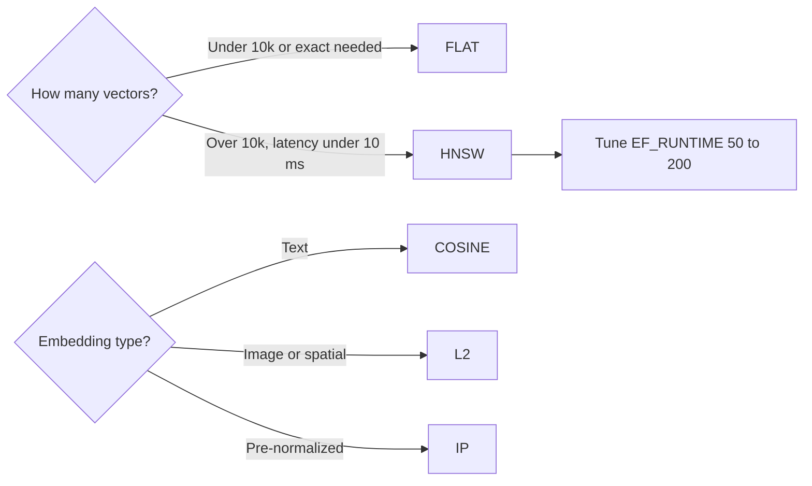

## What this covers

A Redis vector index needs three choices: the **data type** of each vector, the **distance metric** and the **indexing algorithm**. Together they decide memory cost, accuracy and latency. This page explains each option with concrete numbers, gives a configuration table for common AI workloads, and shows how to measure the speed/accuracy trade-off of HNSW on your own data. The exam usually gives a scenario (dataset size, latency target, embedding type) and asks for the right combination.

**Exam weight:** Develop AI solutions by using Azure data management services (30–35%)

**Skills measured**

- "Implement vector indexing to enable similarity search"

## Key concepts

### Vector data type

| TYPE | Bytes per dimension | 1,536-dim vector | Use |
|---|---|---|---|
| **FLOAT32** | 4 | 6,144 B (about 6 KB) | Default for AI embeddings. About 7 significant digits is more than the models need |
| FLOAT64 | 8 | 12,288 B (about 12 KB) | Specialized research only. It doubles memory and slows distance math |

For one million 1,536-dim vectors, FLOAT32 needs about 6 GB for the raw vectors alone, before index overhead. FLOAT64 needs about 12 GB. Recent RediSearch versions also accept FLOAT16 and BFLOAT16 to save memory. The Learn module covers only FLOAT32 and FLOAT64.

### Dimensions

`DIM` must equal the embedding model's output exactly. Common sizes are 384, 768, 1,024, 1,536 and 3,072. A mismatch makes ingestion skip the document or makes queries fail. If you switch embedding models, build a **new index** (and usually new keys).

### Distance metrics

| Metric | Measures | Use for |
|---|---|---|
| **COSINE** | Angle between vectors, ignoring magnitude | Text embeddings (OpenAI, Cohere, Sentence Transformers) |
| **L2** | Straight-line (Euclidean) distance, including magnitude | Image embeddings, spatial data |
| **IP** | Inner (dot) product | Only vectors that are already normalized, or models trained for it |

Match the metric your embedding model was trained with. The wrong metric still returns results, but the ranking means nothing.

### FLAT vs HNSW

| | **FLAT** | **HNSW** |
|---|---|---|
| Search | Exact, brute force against every vector | Approximate, graph navigation |
| Accuracy | 100% | About 95–99% recall |
| Query time | Grows linearly (about 10 ms at 10k vectors, around 1 s at 1M) | Milliseconds even at millions of vectors |
| Memory / build | Lowest, fast inserts | Extra graph memory, slower inserts |
| Choose when | Fewer than about 10,000 vectors, prototypes, exact results needed | More than about 10,000 vectors, production, under 10 ms latency |

HNSW (Hierarchical Navigable Small World) is a multi-layer graph. Upper layers make long jumps and lower layers refine locally, so a query touches only a small fraction of the vectors.

### HNSW tuning parameters

| Parameter | When set | Default | Effect |
|---|---|---|---|
| `M` | Index creation | 16 | Edges per node. Higher gives better recall and uses more memory |
| `EF_CONSTRUCTION` | Index creation | 200 | Candidates considered while building. Higher gives a better graph and a slower build |
| `EF_RUNTIME` | Creation default, or per query | 10 | Candidates explored per query. Higher gives better recall and higher latency |
| `EPSILON` | Range queries | 0.01 | Boundary slack for `VECTOR_RANGE` |

The module's guidance is to start `EF_RUNTIME` around 50 and raise it to 100–200 if recall is too low. Use `INITIAL_CAP` (and `BLOCK_SIZE` for FLAT) to pre-size the index when you know the vector count.

### Quick configuration guide

| Use case | TYPE | Metric | Algorithm |
|---|---|---|---|
| Text search, small corpus | FLOAT32 | COSINE | FLAT |
| Text search, large corpus | FLOAT32 | COSINE | HNSW |
| Image similarity | FLOAT32 | L2 | HNSW |
| Recommendations | FLOAT32 | COSINE | HNSW |

## How it works



## Hands-on

### Azure portal

1. Size the instance for the vectors. For example, 1M x 1,536-dim FLOAT32 is about 6 GB raw plus HNSW graph and metadata, and roughly 20% of instance memory is reserved. A Balanced B20 or larger is a sensible starting point.
2. After loading, check **Used Memory Percentage** in **Metrics** and scale up before it stays above 75%.

### Azure CLI

```bash
az group create --name rg-ai200 --location eastus
az redisenterprise create --name <cache-name> --resource-group rg-ai200 \
  --location eastus --sku Balanced_B20 \
  --clustering-policy EnterpriseCluster --eviction-policy NoEviction \
  --modules name=RediSearch
```

### Python

```python
import time
import numpy as np
import redis
from redis.commands.search.field import TagField, VectorField
from redis.commands.search.index_definition import IndexDefinition, IndexType
from redis.commands.search.query import Query
from redis_entraid.cred_provider import create_from_default_azure_credential

provider = create_from_default_azure_credential(("https://redis.azure.com/.default",))
r = redis.Redis(host="<cache-name>.<region>.redis.azure.net", port=10000, ssl=True,
                credential_provider=provider)

# Text index: HNSW + COSINE with explicit build parameters
text_vec = VectorField("embedding", "HNSW", {
    "TYPE": "FLOAT32", "DIM": 1536, "DISTANCE_METRIC": "COSINE",
    "M": 16, "EF_CONSTRUCTION": 200, "EF_RUNTIME": 50})

# Image index: L2
image_vec = VectorField("image_embedding", "HNSW", {
    "TYPE": "FLOAT32", "DIM": 768, "DISTANCE_METRIC": "L2"})

# Small exact index: FLAT
flat_vec = VectorField("embedding", "FLAT", {
    "TYPE": "FLOAT32", "DIM": 1536, "DISTANCE_METRIC": "COSINE"})

r.ft("idx:docs").create_index(
    [TagField("id"), text_vec],
    definition=IndexDefinition(prefix=["docs:"], index_type=IndexType.HASH))

# Measure latency at different EF_RUNTIME values
query_vector = np.random.rand(1536).astype(np.float32)
for ef in (50, 100, 200):
    q = (Query(f"*=>[KNN 10 @embedding $query_vec EF_RUNTIME {ef} AS score]")
         .return_fields("id", "score").dialect(2))
    t0 = time.perf_counter()
    r.ft("idx:docs").search(q, query_params={"query_vec": query_vector.tobytes()})
    print(f"EF_RUNTIME={ef}: {(time.perf_counter() - t0) * 1000:.2f} ms")
```

## Exam traps

| Scenario | Choose |
|---|---|
| 5,000 FAQ entries, exact answers required | FLAT + COSINE |
| 10M product embeddings, p99 under 10 ms | HNSW + COSINE |
| Recall too low on HNSW, latency OK | Raise `EF_RUNTIME` (per query) |
| Memory too high, precision is fine | FLOAT32 instead of FLOAT64 |
| Vision-model embeddings | L2 |
| Already-normalized vectors, fastest math | IP |

> [!WARNING]
> **Exam trap:** `EF_RUNTIME` can be changed **per query**. `M` and `EF_CONSTRUCTION` are fixed when you create the index, and changing them means rebuilding it.

> [!WARNING]
> **Exam trap:** FLOAT64 does **not** improve embedding search quality in practice. It only doubles memory.

> [!TIP]
> As a rule of thumb, use FLAT for up to about 10k vectors and HNSW above that, COSINE for text and L2 for images.

## Quick review

- FLOAT32 uses 4 bytes per dimension (about 6 KB at 1,536 dims) and is the standard choice. FLOAT64 doubles that.
- `DIM` must match the model output exactly.
- Use COSINE for text, L2 for images or spatial data, and IP for normalized vectors.
- FLAT is exact with linear time. HNSW is approximate (95–99%) and fast at scale.
- HNSW parameters: `M` (16), `EF_CONSTRUCTION` (200) and `EF_RUNTIME` (10 by default, tunable per query).
- Benchmark `EF_RUNTIME` against real data before production.

## Practice

[Practice: Azure Managed Redis vector indexing](/practice/redis-vector)

## Official references

- [Learn unit: Choose vector types and indexing strategies](https://learn.microsoft.com/training/modules/implement-vector-storage-azure-managed-redis/3-vector-types-index-strategy)
- [Learn module: Implement vector storage in Azure Managed Redis](https://learn.microsoft.com/training/modules/implement-vector-storage-azure-managed-redis/)
- [Redis vector field reference](https://redis.io/docs/latest/develop/interact/search-and-query/vectors/)
- [AI-200 study guide](https://learn.microsoft.com/en-us/credentials/certifications/resources/study-guides/ai-200)
- [Microsoft Learn](https://learn.microsoft.com/)
