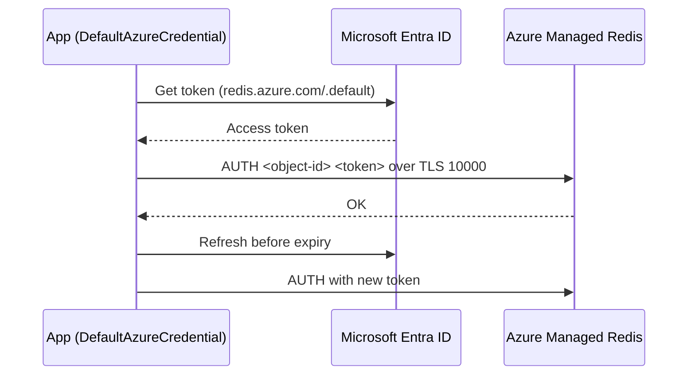

## What this covers

AMR works with the standard open-source Redis clients. This page covers which library to pick for each language, how the clustering policy changes the client you need, how to authenticate with Microsoft Entra ID instead of access keys, which commands are blocked or limited, and the practices that keep a Redis-backed AI service fast and reliable. These include small values, pipelining, `SCAN` instead of `KEYS`, connection reuse and the 75% scaling rule.

**Exam weight:** Develop AI solutions by using Azure data management services (30–35%)

**Skills measured**

- "Implement Azure Managed Redis data operations, including caching, expiration, and invalidation"

## Key concepts

### Client libraries

| Library | Language | Entra ID helper |
|---|---|---|
| StackExchange.Redis | C#/.NET | `Microsoft.Azure.StackExchangeRedis` |
| Lettuce / Jedis | Java | redis-authx-entraid |
| node-redis | Node.js | `@redis/entraid` |
| redis-py | Python | `redis-entraid` |

AMR and Azure Cache for Redis use the **same libraries**. What changes is the endpoint (`*.redis.azure.net:10000` for AMR, `*.redis.cache.windows.net:6380` for Azure Cache for Redis). Use the latest client version and upgrade it regularly.

### Clustering policy decides the client class

- **Enterprise** or **Non-clustered** policy: any client works, because the proxy hides the shards. In redis-py, use `redis.Redis`.
- **OSS** policy: the client must support the Redis Cluster API. In redis-py, use `redis.cluster.RedisCluster`. Don't hard-code the 85xx shard ports. The client discovers them itself.

### Multi-key commands and CROSSSLOT

AMR is always sharded, so multi-key commands can fail with `CROSSSLOT`:

- **OSS policy**: every key in the command must hash to the **same slot**. Use hash tags such as `{user:1001}:profile` and `{user:1001}:prefs` to keep related keys together.
- **Enterprise policy**: `DEL`, `MSET`, `MGET`, `EXISTS`, `UNLINK` and `TOUCH` work across slots.
- **Active-Active (geo-replicated) databases**: only `MGET`, `EXISTS` and `TOUCH` work across slots.

### Blocked commands

Microsoft manages the cluster, so some commands are disabled. The Enterprise policy blocks `CLUSTER INFO`, `CLUSTER HELP`, `CLUSTER KEYSLOT`, `CLUSTER NODES` and `CLUSTER SLOTS`. Active geo-replication blocks `FLUSHALL` and `FLUSHDB` (use `az redisenterprise database flush`, which also flushes linked databases).

### Microsoft Entra ID authentication

New AMR instances use Entra ID by default. The flow:

1. Add the user, service principal or managed identity as a Redis user (an **access policy assignment**, policy `default`). By default it gets full access (`+@all ~*`). You can narrow this with an ACL access string.
2. The client gets a token for scope `https://redis.azure.com/.default`.
3. It connects with **username = object ID** and **password = token**, over TLS only.
4. Before the token expires, the client sends a new `AUTH`. Do this at least 3 minutes early, with jitter. `redis-entraid` does this for you.

Entra **groups** aren't supported as Redis users. Disabling access keys drops **all** current connections, including Entra connections, so clients must retry.

### Development best practices

| Area | Practice |
|---|---|
| Data design | Keep values small and split big blobs across keys. Use pipelining. Never run `KEYS` in production; use `SCAN` |
| Large responses | Prefer many small values, use a bigger SKU for more bandwidth, or round-robin several connections |
| Network | Same region as the app. Connect by **host name**, not IP (IPs change during scaling). TLS 1.2/1.3 is required by default |
| Connections | Create one client per process and reuse it. redis-py pools connections automatically |
| Monitoring | Scale when **Used Memory Percentage, CPU, Connected Clients or network bandwidth** stay above **75%** |
| Configuration | Pick the tier from load tests. Keep HA on in production. Enable persistence or schedule import/export backups |

## How it works



## Hands-on

### Azure portal

1. Open the AMR instance and select **Settings > Authentication**.
2. On **Microsoft Entra Authentication**, select **User or service principal**, then **+ Select member**, and add your app's managed identity.
3. Optional: on **Access keys**, turn **Access Keys Authentication** off after every client uses Entra ID.
4. Under **Monitoring > Metrics**, chart **Used Memory Percentage**, **CPU** and **Connected Clients**.

### Azure CLI

```bash
az group create --name rg-ai200 --location eastus

# Grant a managed identity access to the default database
az redisenterprise database access-policy-assignment create \
  --resource-group rg-ai200 --cluster-name <cache-name> \
  --database-name default --access-policy-assignment-name appidentity \
  --access-policy-name default --object-id <principal-object-id>

# Check end-to-end connectivity with your az login identity
az redisenterprise test-connection --name <cache-name> \
  --resource-group rg-ai200 --auth entra
```

### Python

```python
import redis
from redis.backoff import ExponentialBackoff
from redis.retry import Retry
from redis_entraid.cred_provider import create_from_default_azure_credential

provider = create_from_default_azure_credential(("https://redis.azure.com/.default",))

# One client per process; redis-py pools connections internally
r = redis.Redis(
    host="<cache-name>.<region>.redis.azure.net", port=10000, ssl=True,
    credential_provider=provider, decode_responses=True,
    socket_timeout=30, socket_connect_timeout=30,
    retry=Retry(ExponentialBackoff(), 3),
    retry_on_error=[redis.exceptions.ConnectionError, redis.exceptions.TimeoutError],
)

# Iterate keys safely: SCAN, never KEYS
for key in r.scan_iter(match="session:*", count=500):
    print(key)
```

For an **OSS clustering policy**, replace `redis.Redis` with `redis.cluster.RedisCluster` and use the same arguments.

## Exam traps

| Scenario | Correct choice |
|---|---|
| Legacy client with no cluster support | Enterprise clustering policy |
| `CROSSSLOT` on `MGET` under OSS policy | Hash tags, or switch to Enterprise policy |
| Password-free app access | Managed identity + access policy assignment + `redis-entraid` |
| Iterate many keys in production | `SCAN` (`scan_iter`) |
| Many small round trips | Pipelining |

> [!WARNING]
> **Exam trap:** With Entra ID, the Redis **username is the object ID** of the identity, not its name or client ID, and the password is the access token.

> [!WARNING]
> **Exam trap:** Port 6380 is Azure Cache for Redis. An AMR answer that uses port 6380 or `redis.cache.windows.net` is wrong.

> [!TIP]
> The 75% rule: scale up when memory, CPU, connections or bandwidth stay above 75%.

> [!NOTE]
> `FT.CONFIG` is not supported. Module parameters are passed through the management API (`--modules name=... args=...`).

## Quick review

- Python uses `redis-py` plus `redis-entraid`. .NET uses StackExchange.Redis plus `Microsoft.Azure.StackExchangeRedis`.
- OSS clustering needs `RedisCluster`. Enterprise and Non-clustered work with `redis.Redis`.
- Under Enterprise policy, `DEL`, `MSET`, `MGET`, `EXISTS`, `UNLINK` and `TOUCH` work across slots.
- The Entra token scope is `https://redis.azure.com/.default`, and the token must be refreshed before it expires.
- `CLUSTER *` commands are blocked under Enterprise policy, and `FLUSHALL`/`FLUSHDB` are blocked with geo-replication.
- Use `SCAN` instead of `KEYS`, connect by host name, and keep TLS on.

## Practice

[Practice: Azure Managed Redis data operations](/practice/redis-data-ops)

## Official references

- [Learn unit: Client libraries and development best practices](https://learn.microsoft.com/training/modules/implement-data-operations-azure-managed-redis/3-client-libraries-best-practices)
- [Use Microsoft Entra for cache authentication with Azure Managed Redis](https://learn.microsoft.com/azure/redis/entra-for-authentication)
- [Azure Managed Redis architecture: clustering](https://learn.microsoft.com/azure/redis/architecture)
- [az redisenterprise database access-policy-assignment](https://learn.microsoft.com/cli/azure/redisenterprise/database/access-policy-assignment)
- [redis-py with Azure Managed Redis](https://redis.io/docs/latest/develop/clients/redis-py/amr/)
- [AI-200 study guide](https://learn.microsoft.com/en-us/credentials/certifications/resources/study-guides/ai-200)
- [Microsoft Learn](https://learn.microsoft.com/)
