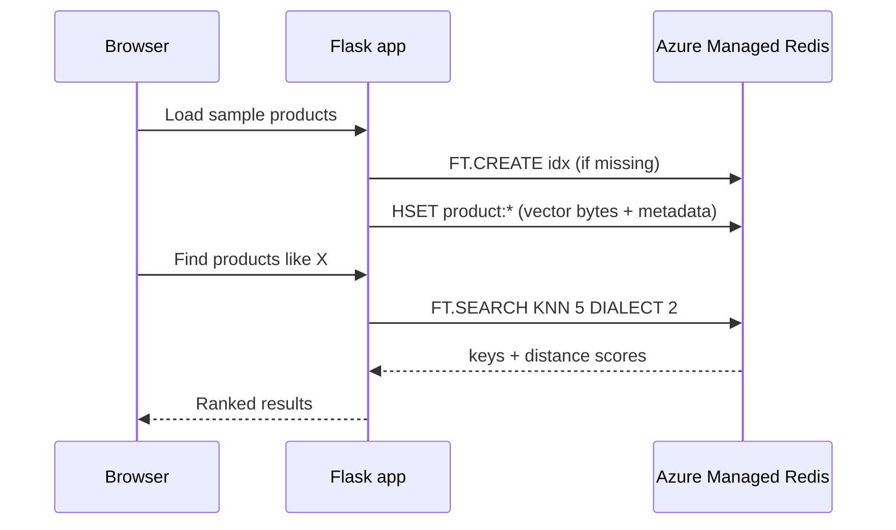

## What this covers

This 40-minute lab builds a small product-similarity app on Azure Managed Redis. You deploy an instance whose database has the **RediSearch** module, create a vector index, store product vectors with metadata, list and remove products, and run KNN similarity searches from a Flask UI. It is the end-to-end version of the vector-indexing skill. Search runs **on the server** through the index, not as client-side cosine math.

**Exam weight:** Develop AI solutions by using Azure data management services (30–35%)

**Skills measured**

- "Implement vector indexing to enable similarity search"

## Key concepts

### Prerequisites

- An Azure subscription that is allowed to create an Azure Managed Redis instance, VS Code, **Python 3.12+** and the Azure CLI.
- The **`redisenterprise`** extension, version **2.75.0 or later** (`az extension add --upgrade --name redisenterprise`).
- The **Microsoft.Cache** provider registered.

### Lab flow

1. Download and unzip the starter project and set the resource group and region in `azdeploy.py`.
2. Run the script and choose option 1 to deploy AMR (5–10 minutes). Write code while it provisions.
3. Complete `client/vector_functions.py`.
4. Option 2 creates the **database with RediSearch** and your Entra **access policy**, and writes `.env` / `.env.ps1`. Option 3 checks status and option 4 exits.
5. Create the venv, install requirements, run `app.py` and open `http://localhost:5000`.
6. Load sample products, list them, search for similar items, store a new product and search for it, then remove a product.
7. Delete the resource group.

### The code you complete

| Function | What it does |
|---|---|
| `get_client()` | `redis.Redis` on `REDIS_HOST:10000` with TLS, authenticated by `create_from_default_azure_credential` (`https://redis.azure.com/.default`). No access key |
| `_create_vector_index()` | Text fields `name`, `category`, `product_id` plus an **HNSW FLOAT32** vector field `embedding` with **DIM 8** and **COSINE**, on hashes with prefix **`product:`**. "Index already exists" errors are ignored so the call is idempotent |
| `store_product()` | Converts the vector to float32 bytes with NumPy and writes vector + metadata with `hset` |
| `search_similar_products()` | Runs `*=>[KNN k @embedding $query_vec AS score]` with dialect 2, sorted by score, and returns key, score, product ID, name and category |

The lab uses tiny 8-dimensional sample vectors so the data is easy to read. Real embedding models produce 384–3,072 dimensions, and `DIM` must match. The UI labels the returned value "similarity", but it is a **cosine distance**: lower means more similar.

## How it works



## Hands-on

### Azure portal

1. After option 1, open the resource and confirm the instance is running. Note the **Endpoint**.
2. After option 2, open **Authentication** and confirm that your account is listed. The database's modules include **RediSearch**.

### Azure CLI

```bash
az login
az provider register --namespace Microsoft.Cache
az extension add --upgrade --name redisenterprise
python azdeploy.py

cd client
python -m venv .venv && source .venv/bin/activate
pip install -r requirements.txt
source ../.env && python app.py

az account show            # troubleshooting: confirm the signed-in identity
az group delete --name <rg-name> --no-wait --yes
```

On PowerShell, use `.\.venv\Scripts\Activate.ps1` and `. .\.env.ps1`.

### Python

```python
import os
import numpy as np
import redis
from redis.commands.search.field import TextField, VectorField
from redis.commands.search.index_definition import IndexDefinition, IndexType
from redis.commands.search.query import Query
from redis_entraid.cred_provider import create_from_default_azure_credential

INDEX, PREFIX, DIM = "idx:products", "product:", 8

def get_client():
    provider = create_from_default_azure_credential(("https://redis.azure.com/.default",))
    return redis.Redis(host=os.environ["REDIS_HOST"], port=10000, ssl=True,
                       credential_provider=provider)

r = get_client()

def _create_vector_index():
    try:
        r.ft(INDEX).create_index(
            (TextField("name"), TextField("category"), TextField("product_id"),
             VectorField("embedding", "HNSW",
                         {"TYPE": "FLOAT32", "DIM": DIM, "DISTANCE_METRIC": "COSINE"})),
            definition=IndexDefinition(prefix=[PREFIX], index_type=IndexType.HASH))
    except redis.ResponseError as e:
        if "already exists" not in str(e).lower():
            raise

def store_product(product_id, name, category, vector):
    r.hset(f"{PREFIX}{product_id}", mapping={
        "product_id": product_id, "name": name, "category": category,
        "embedding": np.asarray(vector, dtype=np.float32).tobytes()})

def search_similar_products(vector, k=5):
    q = (Query(f"*=>[KNN {k} @embedding $query_vec AS score]")
         .return_fields("product_id", "name", "category", "score")
         .sort_by("score").dialect(2))
    res = r.ft(INDEX).search(q, query_params={
        "query_vec": np.asarray(vector, dtype=np.float32).tobytes()})
    return [(d.id, float(d.score), d.name) for d in res.docs]

_create_vector_index()
store_product("p1", "Trail running shoe", "footwear", [0.9, 0.1, 0, 0, 0.2, 0, 0, 0.1])
print(search_similar_products([0.85, 0.15, 0, 0, 0.2, 0, 0, 0.1]))
```

## Exam traps

| Lab symptom | Cause |
|---|---|
| `unknown command 'FT.CREATE'` | Database created without RediSearch. Modules are creation-time only |
| Query returns no results after storing | Key doesn't start with `product:`, or the vector isn't float32 bytes |
| Dimension error | Vector length doesn't equal `DIM 8` |
| `NOPERM` / auth failure | Access policy assignment missing for your object ID |
| Best match has the highest score | It doesn't. Scores are distances, so sort ascending |

> [!WARNING]
> **Exam trap:** Similarity is computed **by Redis** using the metric in the index definition. Fetching every vector and computing cosine in Python defeats the index.

> [!TIP]
> Make index creation idempotent (catch "already exists"), just as Streams code catches `BUSYGROUP`.

> [!NOTE]
> Removing a product is a plain `DEL product:<id>`. The index updates itself.

## Quick review

- The lab needs the `redisenterprise` extension 2.75.0+, Python 3.12+ and Microsoft.Cache registered.
- The database is created with RediSearch, and your identity gets an Entra access policy.
- The index is HNSW, FLOAT32, DIM 8, COSINE, on hashes with prefix `product:`.
- Vectors are stored as float32 bytes with `hset`.
- Searches use KNN with dialect 2, sorted by score (distance), on the server.

## Practice

[Practice: Azure Managed Redis vector indexing](/practice/redis-vector)

## Official references

- [Learn unit: Exercise - Implement semantic search in Azure Managed Redis](https://learn.microsoft.com/training/modules/implement-vector-storage-azure-managed-redis/5-exercise-semantic-search-azure-managed-redis)
- [Lab instructions (MicrosoftLearning mslearn-azure-ai)](https://microsoftlearning.github.io/mslearn-azure-ai/instructions/azure-managed-redis/03-amr-vector-storage.html)
- [Redis modules in Azure Managed Redis](https://learn.microsoft.com/azure/redis/redis-modules)
- [AI-200 study guide](https://learn.microsoft.com/en-us/credentials/certifications/resources/study-guides/ai-200)
- [Microsoft Learn](https://learn.microsoft.com/)
