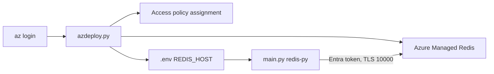

## What this covers

This is the hands-on lab for the data-operations module. It takes about 30 minutes. You deploy an Azure Managed Redis instance, give your own Entra ID account data access, and finish a Python console app that writes a hash, reads it back, sets and checks a TTL, and deletes the key. The lab steps are useful exam material: the exam expects you to know the CLI extension, the access policy step, the port, and what `TTL` returns.

**Exam weight:** Develop AI solutions by using Azure data management services (30–35%)

**Skills measured**

- "Implement Azure Managed Redis data operations, including caching, expiration, and invalidation"

## Key concepts

### Prerequisites

- An Azure subscription, VS Code, **Python 3.12+** and the latest Azure CLI.
- The **`redisenterprise`** CLI extension (`az extension add --name redisenterprise`). AMR is managed with `az redisenterprise`, not `az redis`.
- The **Microsoft.Cache** resource provider registered in the subscription.

### What the deployment script does

The starter project includes `azdeploy.py`, a menu-driven script. Set your resource group name and region at the top of the script and change nothing else.

| Option | Action |
|---|---|
| 1 | Create the resource group (if needed) and deploy AMR. This takes several minutes |
| 2 | Check the deployment status until it reports success |
| 3 | Create the database, assign a **Microsoft Entra ID data access policy** to your signed-in account, and write `.env` / `.env.ps1` with `REDIS_HOST` |
| 4 | Exit |

Step 3 matters for the exam. Having **Owner** or **Contributor** on the resource does **not** let you read or write keys. The identity also needs a Redis **access policy assignment** on the database.

### The app functions you complete

| Function | Redis call | What to remember |
|---|---|---|
| `store_hash_data` | `hset(key, mapping=...)` | Returns the number of **new** fields added (updated fields count as 0) |
| `retrieve_hash_data` | `hgetall(key)` | Returns an empty dict when the key doesn't exist |
| `set_expiration` | `expire(key, 3600)` | Returns `False` if the key doesn't exist |
| `retrieve_expiration` | `ttl(key)` | **-2** = missing key, **-1** = no expiry |
| `delete_key` | `delete(key)` | Returns the count of keys removed |

The client reads `REDIS_HOST`, connects on **port 10000** with TLS, and authenticates through a credential provider built from `DefaultAzureCredential` with scope `https://redis.azure.com/.default`. The provider refreshes tokens on its own. The lab also sets 30-second socket timeouts.

## How it works



## Hands-on

### Azure portal

1. After option 1 finishes, open the AMR resource and confirm **Status: Running**.
2. On **Overview**, copy the **Endpoint** host name (`<name>.<region>.redis.azure.net:10000`).
3. On **Authentication > Microsoft Entra Authentication**, confirm that your user appears in the list after option 3.
4. When you're done, delete the resource group.

### Azure CLI

```bash
az login
az provider register --namespace Microsoft.Cache
az extension add --upgrade --name redisenterprise

# Manual equivalent of the script's deploy + access steps
az group create --name rg-ai200 --location eastus
az redisenterprise create --name <cache-name> --resource-group rg-ai200 \
  --location eastus --sku Balanced_B0
USER_ID=$(az ad signed-in-user show --query id -o tsv)
az redisenterprise database access-policy-assignment create \
  --resource-group rg-ai200 --cluster-name <cache-name> --database-name default \
  --access-policy-assignment-name me --access-policy-name default --object-id $USER_ID

# Run the app
python -m venv .venv && source .venv/bin/activate
pip install -r requirements.txt
source .env && python main.py

# Clean up
az group delete --name rg-ai200 --no-wait --yes
```

On PowerShell, activate with `.\.venv\Scripts\Activate.ps1` and load variables with `. .\.env.ps1`.

### Python

```python
import os
import redis
from redis_entraid.cred_provider import create_from_default_azure_credential

provider = create_from_default_azure_credential(("https://redis.azure.com/.default",))
r = redis.Redis(host=os.environ["REDIS_HOST"], port=10000, ssl=True,
                decode_responses=True, credential_provider=provider,
                socket_timeout=30, socket_connect_timeout=30)

def store_hash_data(key, data):
    added = r.hset(key, mapping=data)
    print(f"{added} new field(s) written to {key}")

def retrieve_hash_data(key):
    data = r.hgetall(key)
    print(data if data else f"{key} not found")

def set_expiration(key, seconds=3600):
    print("TTL set" if r.expire(key, seconds) else f"{key} not found")

def retrieve_expiration(key):
    ttl = r.ttl(key)
    print({-2: "key missing", -1: "no expiration"}.get(ttl, f"{ttl}s left"))

def delete_key(key):
    print("deleted" if r.delete(key) else f"{key} not found")

store_hash_data("product:1001", {"name": "Laptop", "price": "999"})
retrieve_hash_data("product:1001")
set_expiration("product:1001")
retrieve_expiration("product:1001")
delete_key("product:1001")
```

## Exam traps

| Symptom in the lab | Cause and fix |
|---|---|
| `az redisenterprise` not found | Install the `redisenterprise` extension |
| Deployment fails with a provider error | Register `Microsoft.Cache` |
| `WRONGPASS` / `NOPERM` with Entra ID | Missing access policy assignment for your object ID |
| Connection timeout | Wrong port (6380) or TLS off. AMR uses 10000 with TLS |
| `TTL` prints -2 right after `expire` | The key was never written, or it was deleted |

> [!WARNING]
> **Exam trap:** Azure RBAC roles such as Contributor control the **resource**, not the **data**. Data access comes from the Redis access policy assignment.

> [!TIP]
> The lab uses `hset(..., mapping=...)` because the old `hmset` is deprecated in redis-py.

> [!NOTE]
> `az redisenterprise database list-keys` works only when access-key authentication is enabled. The lab never needs keys.

## Quick review

- The lab needs Python 3.12+, Azure CLI, the `redisenterprise` extension and the Microsoft.Cache provider.
- Option 3 of the script creates the database, assigns your Entra access policy and writes `REDIS_HOST`.
- The connection uses port 10000, TLS, and `create_from_default_azure_credential` with the `redis.azure.com` scope.
- `hset` returns new fields, `expire` returns a bool, `ttl` returns -2 or -1 or seconds, and `delete` returns a count.
- Clean up with `az group delete --no-wait --yes`.

## Practice

[Practice: Azure Managed Redis data operations](/practice/redis-data-ops)

## Official references

- [Learn unit: Exercise - Perform data operations in Azure Managed Redis](https://learn.microsoft.com/training/modules/implement-data-operations-azure-managed-redis/5-exercise-data-operations)
- [Lab instructions (MicrosoftLearning mslearn-azure-ai)](https://microsoftlearning.github.io/mslearn-azure-ai/instructions/azure-managed-redis/01-amr-data-operations.html)
- [Create and manage a cache with the Azure CLI](https://learn.microsoft.com/azure/redis/scripts/create-manage-cache)
- [AI-200 study guide](https://learn.microsoft.com/en-us/credentials/certifications/resources/study-guides/ai-200)
- [Microsoft Learn](https://learn.microsoft.com/)
