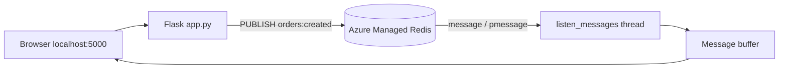

## What this covers

This 30–40 minute lab builds a small Flask web app that publishes and subscribes to Redis channels on Azure Managed Redis from one page. You complete the code that connects with Microsoft Entra ID, publishes an order event, broadcasts an announcement to every channel, formats incoming messages, listens on a background thread, and subscribes to exact channels and patterns. Then you watch the messages arrive live. The lab makes the pub/sub delivery rules concrete: subscribe before you publish, or the message is gone.

**Exam weight:** Develop AI solutions by using Azure data management services (30–35%)

**Skills measured**

- "Implement Azure Managed Redis data operations, including caching, expiration, and invalidation"

## Key concepts

### Lab flow

1. Download the starter files and set the resource group and region in `azdeploy.py`.
2. Sign in with `az login`, register **Microsoft.Cache**, and install or upgrade the **`redisenterprise`** extension.
3. Run the script and choose the deploy option. Provisioning takes 5–10 minutes, so write code while it runs.
4. Fill in `client/pubsub_functions.py`.
5. After deployment, use the script to create the database, configure Entra ID access for your account, and write `.env` / `.env.ps1` with `REDIS_HOST`.
6. Create a virtual environment in `client`, install `requirements.txt`, run `app.py`, and open `http://localhost:5000`.
7. Subscribe to a channel and a pattern, publish events, broadcast, and check which messages arrive.
8. Delete the resource group.

### The functions you write

| Function | What it does | Key point |
|---|---|---|
| `get_client()` | Builds a `redis.Redis` client from `REDIS_HOST`, TLS, port 10000, `decode_responses=True`, Entra credential provider | No access keys anywhere |
| `publish_order_created()` | Serializes an order event to JSON and publishes it to `orders:created` | Return value = number of subscribers reached |
| `broadcast_to_all()` | Publishes one announcement to every channel in `AVAILABLE_CHANNELS` and adds up the receivers | Shows that pub/sub is per channel |
| `format_message()` | Pulls out channel, pattern, event type and fields, and falls back to raw data for non-JSON | Handles both `message` and `pmessage` |
| `listen_messages()` | Background thread that iterates `pubsub.listen()` and buffers formatted messages | Errors are shown in the UI as system messages |
| `subscribe_to_channel()` / `subscribe_to_pattern()` | `subscribe("orders:created")` or `psubscribe("orders:*")`, then restart the listener | New subscriptions only see future messages |

### What you should observe

- If you publish while nothing is subscribed, the return value is **0** and the message is lost.
- A pattern subscription (`orders:*`) receives events from `orders:created`, `orders:shipped` and so on, delivered as `pmessage`.
- If you subscribe to both `orders:created` and `orders:*`, one publish produces **two** deliveries: one `message` and one `pmessage`.

## How it works



## Hands-on

### Azure portal

1. After the deploy option finishes, open the AMR resource and copy its **Endpoint**.
2. On **Authentication**, confirm that your account is listed under Microsoft Entra Authentication.
3. While the app runs, open **Metrics** and watch **Connected Clients**. The listener holds its own connection.

### Azure CLI

```bash
az login
az provider register --namespace Microsoft.Cache
az extension add --upgrade --name redisenterprise
python azdeploy.py

cd client
python -m venv .venv && source .venv/bin/activate
pip install -r requirements.txt
source ../.env && python app.py

az group delete --name <rg-name> --no-wait --yes
```

### Python

```python
import json, os, threading, time
import redis
from redis_entraid.cred_provider import create_from_default_azure_credential

AVAILABLE_CHANNELS = ["orders:created", "orders:shipped", "inventory:alerts"]

def get_client():
    provider = create_from_default_azure_credential(("https://redis.azure.com/.default",))
    return redis.Redis(host=os.environ["REDIS_HOST"], port=10000, ssl=True,
                       decode_responses=True, credential_provider=provider)

r = get_client()

def publish_order_created(order_id, amount):
    event = {"event_type": "order_created", "order_id": order_id,
             "amount": amount, "ts": time.time()}
    return r.publish("orders:created", json.dumps(event))   # subscriber count

def broadcast_to_all(text):
    return sum(r.publish(ch, json.dumps({"event_type": "announcement", "text": text}))
               for ch in AVAILABLE_CHANNELS)

def format_message(msg):
    try:
        body = json.loads(msg["data"])
    except (TypeError, ValueError):
        body = {"raw": msg["data"]}
    return {"channel": msg["channel"], "pattern": msg.get("pattern"), **body}

buffer = []
pubsub = r.pubsub()
pubsub.subscribe("orders:created")
pubsub.psubscribe("orders:*")

def listen_messages():
    for msg in pubsub.listen():
        if msg["type"] in ("message", "pmessage"):
            buffer.append(format_message(msg))

threading.Thread(target=listen_messages, daemon=True).start()
print(publish_order_created("A-100", 42.5))   # 2 deliveries: message + pmessage
```

## Exam traps

| Lab question | Answer |
|---|---|
| Why did `publish` return 0? | No active subscribers. The message is dropped |
| Which call listens to `orders:*`? | `psubscribe` |
| Which message type do pattern deliveries have? | `pmessage` |
| Why use a background thread? | `listen()` blocks, and the web request thread must stay free |
| How does the app authenticate? | Entra ID token via `redis-entraid`, with no access key |

> [!WARNING]
> **Exam trap:** Pub/sub won't deliver a message to a subscriber that connects **after** the publish. That needs a Stream.

> [!TIP]
> The return value of `PUBLISH` is the fastest way to check whether anyone is listening. It doesn't confirm that the subscriber processed the message.

> [!NOTE]
> The Learn module for this lab says both Azure Cache for Redis and Azure Managed Redis support pub/sub. Only the endpoint, port and authentication setup differ.

## Quick review

- The lab needs Python 3.12+, Azure CLI, the `redisenterprise` extension and the Microsoft.Cache provider.
- The client connects on port 10000 with TLS and an Entra credential provider.
- `publish` returns the number of subscribers that received the message. 0 means it was lost.
- `subscribe` takes exact channels and delivers `message`. `psubscribe` takes patterns and delivers `pmessage`.
- The listener runs on its own thread with its own connection.

## Practice

[Practice: Azure Managed Redis data operations](/practice/redis-data-ops)

## Official references

- [Learn unit: Exercise - Publish and subscribe to events in Azure Managed Redis](https://learn.microsoft.com/training/modules/implement-event-messaging-azure-managed-redis/5-exercise-publish-subscribe-events-redis)
- [Lab instructions (MicrosoftLearning mslearn-azure-ai)](https://microsoftlearning.github.io/mslearn-azure-ai/instructions/azure-managed-redis/02-amr-pub-sub.html)
- [Redis pub/sub documentation](https://redis.io/docs/latest/develop/interact/pubsub/)
- [AI-200 study guide](https://learn.microsoft.com/en-us/credentials/certifications/resources/study-guides/ai-200)
- [Microsoft Learn](https://learn.microsoft.com/)
