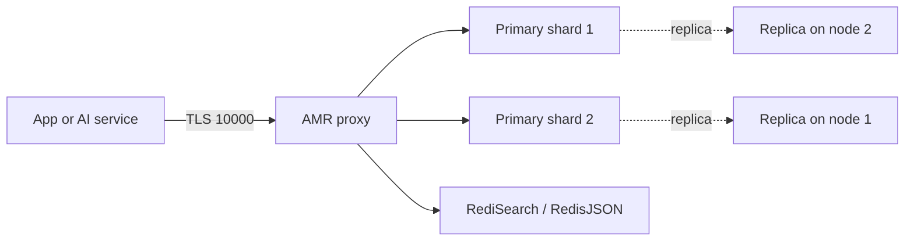

## What this covers

Azure Managed Redis (AMR) is Microsoft's managed in-memory data store built on Redis Enterprise software. AI back ends use it as a low-latency cache, a session store, a message broker and a vector database. This page covers what the service is, the four tiers and when to pick each one, the clustering policies, modules, and the settings you can only choose when you create the instance. It also separates AMR from the older Azure Cache for Redis, which the exam can mix into answer options.

**Exam weight:** Develop AI solutions by using Azure data management services (30–35%)

**Skills measured**

- "Implement Azure Managed Redis data operations, including caching, expiration, and invalidation"
- "Implement vector indexing to enable similarity search"

## Key concepts

### What AMR is

AMR runs Redis Enterprise (Redis 7.4.x) on Azure. Microsoft operates the cluster, and any app inside or outside Azure can connect to it. Each node runs **several Redis processes (shards)** behind a high-performance **proxy**, so it can use many vCPUs. Basic, Standard and Premium tiers of Azure Cache for Redis run single-threaded community Redis on a primary/replica VM pair.

| | Azure Managed Redis | Azure Cache for Redis (Basic/Standard/Premium) |
|---|---|---|
| Engine | Redis Enterprise, multi-shard per node | Community Redis, single-threaded |
| Host name | `<name>.<region>.redis.azure.net` | `<name>.redis.cache.windows.net` |
| TLS port | **10000** | **6380** |
| CLI group | `az redisenterprise` | `az redis` |
| Entra ID | On by default | Must be enabled |
| Modules (RediSearch, RedisJSON, ...) | Yes, chosen at creation | No |

### Common caching scenarios

- **Data cache**: cache-aside. Load an item into Redis only when it is requested, give it a TTL, and invalidate it when the source changes. Eviction policies free memory when the cache is full.
- **Content cache**: static page fragments (headers, menus, banners). ASP.NET uses the Redis Output Cache Provider.
- **Session store**: the cookie holds only a session ID, and Redis holds the session data. Active-Active geo-replication keeps sessions available if a region fails.
- Other uses: deduplication with Bloom filters, leaderboards with sorted sets, job queues, `MULTI`/`EXEC` transactions, and vector search.

### Tiers

| Tier | Memory : vCPU | Size range | Use it for |
|---|---|---|---|
| **Memory Optimized** (`M` SKUs) | 8:1 | 12–1,920 GB | Large datasets that need little throughput, and dev/test |
| **Balanced** (`B` SKUs) | 4:1 | 0.5–960 GB | Standard workloads. This is the default choice |
| **Compute Optimized** (`X` SKUs) | 2:1 | 3–720 GB | Highest throughput and lowest latency |
| **Flash Optimized** (`A` SKUs) | RAM + NVMe | 250–4,500 GB | Very large, read-heavy datasets at lower cost |

Flash Optimized keeps every **key** in RAM, plus hot values. Cold values move to NVMe (about 20% RAM and 80% flash). It suits read-heavy workloads with a hot subset of keys and large values. It does **not** support RediSearch, RedisBloom, RedisTimeSeries, active geo-replication or non-clustered mode. Only RedisJSON works on it. In-memory SKUs above 350 GB (M500, B500, X500 and up) and Flash A2000/A4500 are in preview.

### Clustering policies

AMR is always sharded internally. The clustering policy decides how clients see it:

- **OSS** (`OSSCluster`): the client uses the Redis Cluster API and connects straight to shards. You connect first on port 10000, then on shard ports in the 85xx range. It gives the best throughput but needs a cluster-aware client (`redis.cluster.RedisCluster` in redis-py). **It can't be used with RediSearch.**
- **Enterprise** (`EnterpriseCluster`): one endpoint, and the proxy routes each command. Any client works. **This is the only policy that supports RediSearch.** Cross-slot `DEL`, `MSET`, `MGET`, `EXISTS`, `UNLINK` and `TOUCH` are allowed.
- **Non-clustered** (`NoCluster`): no sharding. It is limited to 25 GB and lower performance. Use it for lift-and-shift from a non-clustered Azure Cache for Redis instance, or for heavy multi-key commands.

### Settings to plan up front

- **Modules** (RediSearch, RedisJSON, RedisBloom, RedisTimeSeries) can be added **only at creation**.
- RediSearch needs the **Enterprise** policy **and** the **NoEviction** eviction policy.
- **High availability** places primary and replica shards on at least two nodes, spread across zones where the region supports them. You can't turn HA off after creation (you can turn it on), and running without HA loses the SLA.
- Scaling **down** is not supported. About 20% of memory is reserved for replication and buffers.

## How it works



With the Enterprise policy, the app sees a single endpoint and the proxy fans commands out to shards. Writes replicate asynchronously to replicas on another node. If a node fails, the replicas are promoted.

## Hands-on

### Azure portal

1. Search for **Azure Managed Redis** and select **Create**.
2. On **Basics**, choose a region close to your app and a SKU such as **Balanced B1**.
3. On **Advanced**, pick the modules you need (for example **RediSearch** and **RedisJSON**), the **Clustering policy** (Enterprise for search) and the **Eviction policy** (NoEviction when RediSearch is selected).
4. Keep **High availability** on and **Microsoft Entra authentication** on, then create the instance.
5. After deployment, open **Authentication** and add your user or managed identity as a Redis user.

### Azure CLI

```bash
az group create --name rg-ai200 --location eastus
az extension add --upgrade --name redisenterprise

# Balanced B1 with RediSearch + RedisJSON (modules are creation-time only)
az redisenterprise create \
  --name <cache-name> \
  --resource-group rg-ai200 \
  --location eastus \
  --sku Balanced_B1 \
  --clustering-policy EnterpriseCluster \
  --eviction-policy NoEviction \
  --modules name=RediSearch \
  --modules name=RedisJSON

az redisenterprise show --name <cache-name> --resource-group rg-ai200 --query hostName
```

### Python

```python
import redis
from redis_entraid.cred_provider import create_from_default_azure_credential

provider = create_from_default_azure_credential(("https://redis.azure.com/.default",))
r = redis.Redis(host="<cache-name>.<region>.redis.azure.net", port=10000,
                ssl=True, decode_responses=True, credential_provider=provider)
print(r.ping())                  # True
print(r.info("server")["redis_version"])
```

## Exam traps

| Requirement | Choose |
|---|---|
| Vector search or full-text search | In-memory tier + RediSearch + Enterprise policy + NoEviction |
| Maximum throughput, cluster-aware client, no search | OSS clustering policy |
| Huge, mostly-read cache at the lowest cost per GB | Flash Optimized |
| Multi-region active-active sessions | In-memory tier (not Flash, not B0/B1) + active geo-replication |
| Migrate an old non-clustered cache without code changes | Non-clustered (25 GB or less) or Enterprise policy |

> [!WARNING]
> **Exam trap:** `az redis create --sku Basic` creates **Azure Cache for Redis**, not Azure Managed Redis. AMR uses `az redisenterprise create` with SKUs such as `Balanced_B1`.

> [!WARNING]
> **Exam trap:** You can't add RediSearch to an existing instance. If you forgot it, you must create a new instance and migrate the data.

> [!TIP]
> Remember the ratios as **M8, B4, X2**: Memory Optimized 8:1, Balanced 4:1, Compute Optimized 2:1.

> [!NOTE]
> Disabling HA lowers the price but gives you no replication and no SLA. Use it only for dev/test.

## Quick review

- AMR runs on Redis Enterprise: multiple shards per node behind a proxy, Redis 7.4.
- It connects over TLS on port 10000 at `*.redis.azure.net`. Azure Cache for Redis uses 6380.
- The tiers are Memory Optimized (8:1), Balanced (4:1), Compute Optimized (2:1) and Flash Optimized (RAM + NVMe).
- RediSearch needs the Enterprise clustering policy and NoEviction, and it isn't available on Flash.
- Modules can only be chosen at creation, and scaling down isn't supported.
- Entra ID authentication is on by default for new instances.

## Practice

[Practice: Azure Managed Redis data operations](/practice/redis-data-ops)

[Practice: Azure Managed Redis vector indexing](/practice/redis-vector)

## Official references

- [Learn module: Implement data operations in Azure Managed Redis](https://learn.microsoft.com/training/modules/implement-data-operations-azure-managed-redis/)
- [What is Azure Managed Redis?](https://learn.microsoft.com/azure/redis/overview)
- [Azure Managed Redis architecture](https://learn.microsoft.com/azure/redis/architecture)
- [Redis modules in Azure Managed Redis](https://learn.microsoft.com/azure/redis/redis-modules)
- [AI-200 study guide](https://learn.microsoft.com/en-us/credentials/certifications/resources/study-guides/ai-200)
- [Microsoft Learn](https://learn.microsoft.com/)
