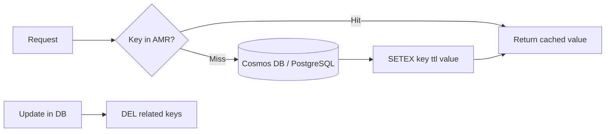

## What this covers

This page is the core of the data-operations skill. It shows how to store and read data in AMR with `redis-py`, which data type fits which job, how to set and check expiration, which eviction policy applies when memory fills up, and the four invalidation patterns that keep cached AI results fresh: time-based, explicit delete on write, cache-aside with TTL, and pattern-based deletion with `SCAN`.

**Exam weight:** Develop AI solutions by using Azure data management services (30–35%)

**Skills measured**

- "Implement Azure Managed Redis data operations, including caching, expiration, and invalidation"

## Key concepts

### Data types

| Type | Commands | Typical AI-backend use |
|---|---|---|
| String | `SET`, `GET`, `MSET`, `MGET`, `SETEX` | Serialized responses, cached embeddings, flags |
| Hash | `HSET`, `HGET`, `HGETALL` | Object-like records (user profile, model metadata). Uses less memory than one key per field |
| List | `LPUSH`/`RPUSH`, `LPOP`/`RPOP`, `LRANGE` | Simple FIFO/LIFO queues, recent-items feeds |
| Counter | `INCR`, `DECR`, `INCRBY`, `DECRBY` | Atomic counters and rate limits, with no race conditions |

`decode_responses=True` returns `str` instead of `bytes`. Keep it **False** for binary payloads such as pickled objects or vector bytes.

### Expiration commands

Expiration applies to the **key**, so it works for every data type:

- `SETEX key seconds value` / `PSETEX` (milliseconds): set a string and its TTL in one atomic step.
- `EXPIRE`, `PEXPIRE`, `EXPIREAT` (Unix time): add a TTL to an existing key. For hashes and lists, write the data first, then call `EXPIRE`.
- `TTL` / `PTTL`: remaining time. **-1** means the key has no expiry and **-2** means the key doesn't exist.
- `PERSIST`: remove the TTL.
- A plain `SET` without `EX`/`KEEPTTL` **clears** any existing TTL on that key.

Suggested TTLs from the module:

| Data | TTL |
|---|---|
| Changes often | 1–5 minutes |
| Moderate change | 15–60 minutes |
| Fairly stable | 1–24 hours |
| Static reference data | 24 hours or more |

### Eviction policies

When used memory hits the limit, the eviction policy decides what happens. The values are `NoEviction`, `AllKeysLRU`, `AllKeysLFU`, `AllKeysRandom`, `VolatileLRU`, `VolatileLFU`, `VolatileRandom` and `VolatileTTL`. **VolatileLRU** is the default: it evicts only keys that have a TTL, least recently used first. `AllKeys*` policies can evict any key, which suits a pure cache. **NoEviction** returns errors on writes when memory is full, and RediSearch requires it.

### Invalidation patterns

1. **Time-based**: every cached entry gets a TTL, and stale data ages out.
2. **Explicit delete on update**: after writing to the database, `DEL` every derived key (profile, summary, dashboard).
3. **Cache-aside with TTL**: read from the cache, and on a miss load from the database and `SETEX`.
4. **Pattern-based**: `SCAN` with `MATCH user:1001:*` in a loop, deleting each batch. Never use `KEYS`, because it blocks the server.

To tell several app instances to clear their **in-process** caches, publish an event on a pub/sub channel (see [broadcast vs coordinated distribution](/study/enhance-ai-solutions-with-azure-managed-redis/choose-between-broadcast-and-coordinated-distribution)).

## How it works



Reads go to Redis first. Misses load from the system of record and populate the cache with a TTL. Writes go to the database and then invalidate the cached copies, so the next read reloads fresh data.

## Hands-on

### Azure portal

1. When you create the instance, choose the **Eviction policy** on the **Advanced** tab. Keep the default (VolatileLRU) for a cache, or choose NoEviction if you enable RediSearch. You can change it later with `az redisenterprise database update`.
2. Open **Monitoring > Metrics** and add **Cache Hits**, **Cache Misses**, **Evicted Keys** and **Expired Keys** to see whether TTLs and memory are sized well.

### Azure CLI

```bash
az group create --name rg-ai200 --location eastus

# Pure cache: let Redis evict any key by LFU when memory is full
az redisenterprise database update --cluster-name <cache-name> \
  --resource-group rg-ai200 --eviction-policy AllKeysLFU

az redisenterprise database show --cluster-name <cache-name> \
  --resource-group rg-ai200 --query evictionPolicy
```

### Python

```python
import time
import redis
from redis_entraid.cred_provider import create_from_default_azure_credential

provider = create_from_default_azure_credential(("https://redis.azure.com/.default",))
r = redis.Redis(host="<cache-name>.<region>.redis.azure.net", port=10000, ssl=True,
                decode_responses=True, credential_provider=provider)

# Strings and hashes
r.set("user:1001:name", "Alice Smith")
r.hset("user:1001", mapping={"name": "Alice Smith", "email": "alice@example.com", "age": "28"})
print(r.hget("user:1001", "name"), r.hgetall("user:1001"))

# Multi-key and pipelines
r.mset({"user:1001:email": "alice@example.com", "user:1001:age": "28"})
pipe = r.pipeline()
pipe.hgetall("user:1001"); pipe.hgetall("user:1002")
profiles = pipe.execute()

print(r.exists("user:1001:name", "user:9999:name"))   # count of existing keys -> 1

# Expiration
r.setex("session:abc123", 60, "user_data")
r.psetex("temp:data", 5000, "temporary_value")
r.expire("user:1001", 3600)
r.expireat("user:1001:name", int(time.time()) + 7200)
print(r.ttl("user:1001"))      # seconds; -1 no TTL, -2 missing
r.persist("user:1001")

# Cache-aside with TTL
def get_user_data(user_id, ttl=3600):
    key = f"user:{user_id}:data"
    if (cached := r.get(key)) is not None:
        return cached
    value = f"User data for {user_id}"          # replace with a DB query
    r.setex(key, ttl, value)
    return value

# Explicit invalidation after a write
def update_user_profile(user_id, new_data):
    # save_to_database(user_id, new_data)
    r.delete(f"user:{user_id}:profile", f"user:{user_id}:summary", f"dashboard:user:{user_id}")

# Pattern invalidation with SCAN (non-blocking)
def invalidate_user_cache(user_id):
    deleted, cursor = 0, 0
    while True:
        cursor, keys = r.scan(cursor, match=f"user:{user_id}:*", count=100)
        if keys:
            deleted += r.delete(*keys)
        if cursor == 0:
            break
    return deleted
```

## Exam traps

| Need | Command or setting |
|---|---|
| Set a value and TTL atomically | `SETEX` (or `SET key value EX n`) |
| TTL on a hash or list | Write first, then `EXPIRE` |
| Check whether a key will expire | `TTL` (-1 none, -2 missing) |
| Remove the expiry | `PERSIST` |
| Delete keys by pattern | `SCAN` + `DEL`/`UNLINK`, never `KEYS` |
| Evict only keys that have a TTL | `VolatileLRU` (default) |
| Instance used for vector search | `NoEviction` (required by RediSearch) |

> [!WARNING]
> **Exam trap:** `TTL` returns **-2** for a missing key and **-1** for a key without expiry. Answer options often swap them.

> [!WARNING]
> **Exam trap:** With a `Volatile*` policy, keys **without** a TTL are never evicted. If nothing has a TTL, writes fail when memory is full, just as with NoEviction.

> [!TIP]
> Atomic counters (`INCR`) are the right answer for rate limiting and request counting across many app instances.

> [!NOTE]
> `UNLINK` deletes keys asynchronously and is safer than `DEL` for very large keys.

## Quick review

- Use hashes for object-like records, because they use less memory than one key per field.
- `SETEX`/`PSETEX` set a value and its TTL atomically. `EXPIRE` adds a TTL to any type.
- `TTL` returns -1 (no expiry) and -2 (missing key). `PERSIST` removes the TTL.
- The invalidation patterns are TTL, delete on write, cache-aside with TTL, and SCAN-based pattern delete.
- The default eviction policy is VolatileLRU. RediSearch requires NoEviction.
- Pipelines cut round trips when you work with many keys.

## Practice

[Practice: Azure Managed Redis data operations](/practice/redis-data-ops)

## Official references

- [Learn unit: Implement data operations](https://learn.microsoft.com/training/modules/implement-data-operations-azure-managed-redis/4-implement-data-operations)
- [Cache-aside pattern](https://learn.microsoft.com/azure/architecture/patterns/cache-aside)
- [What is Azure Managed Redis?](https://learn.microsoft.com/azure/redis/overview)
- [Redis connection pools and multiplexing](https://redis.io/docs/latest/develop/clients/pools-and-muxing/)
- [AI-200 study guide](https://learn.microsoft.com/en-us/credentials/certifications/resources/study-guides/ai-200)
- [Microsoft Learn](https://learn.microsoft.com/)
