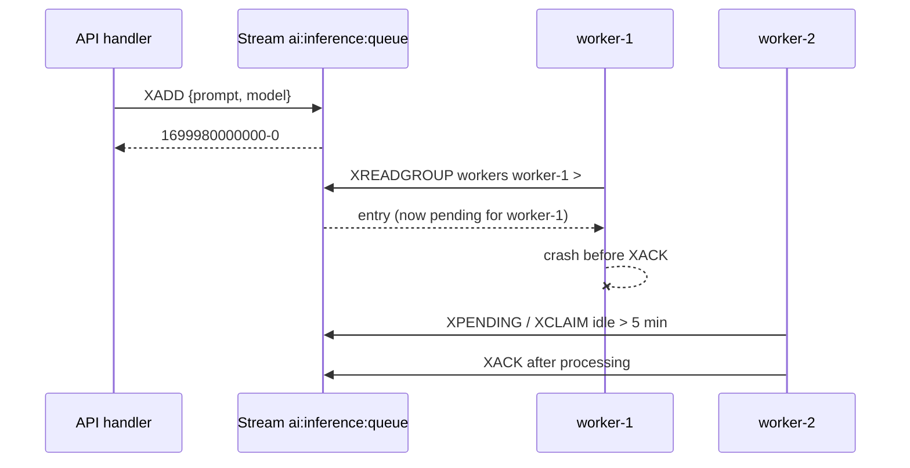

## What this covers

Redis Streams turn Azure Managed Redis into a durable, append-only task queue. API handlers can queue slow AI work, such as inference, document analysis or embedding generation, and return straight away while workers process it. This page covers the stream commands, consumer groups, acknowledgments, the pending entries list, recovering tasks from crashed workers, monitoring, and trimming so the stream doesn't grow without limit.

**Exam weight:** Develop AI solutions by using Azure data management services (30–35%)

**Skills measured**

- "Implement Azure Managed Redis data operations, including caching, expiration, and invalidation"

## Key concepts

### Stream entries

`XADD` appends an entry made of field-value pairs and returns an auto-generated **ID** such as `1699980000000-0` (millisecond timestamp, then a sequence number). IDs only increase, so entries stay ordered. Unlike pub/sub messages, entries **stay in memory** until you trim or delete them.

### Consumer groups

A **consumer group** (`XGROUP CREATE`) tracks how far the group has read. Each **consumer** in the group has a unique name, and every entry is delivered to **exactly one** consumer in the group. To scale out, add workers that use the same group name and different consumer names. You don't change any code.

- `id='0'` starts the group from the beginning of the stream. `id='$'` starts from new entries only.
- `mkstream=True` creates the stream if it doesn't exist yet.
- Creating a group that already exists raises `BUSYGROUP`. Catch that error so startup code can run more than once safely.

### Reading and acknowledging

- `XREADGROUP ... STREAMS key >` returns entries that **no consumer has received yet**.
- `XREADGROUP ... STREAMS key 0` returns **this consumer's own pending** entries. Use it on restart.
- `count` limits the batch size. `block` (milliseconds) waits for new work instead of polling.
- `XACK` marks an entry as done and removes it from the **Pending Entries List (PEL)**.

### Failure recovery

An entry that was read but never acknowledged stays in the PEL with an **idle time**. A recovery job calls `XPENDING` to find entries that have been idle too long, such as more than 5 minutes, and `XCLAIM` to move them to a healthy consumer. `XAUTOCLAIM` (Redis 6.2+) does the scan and claim in one call. Track the delivery count, and send entries that keep failing to a dead-letter stream.

### Monitoring and memory

- `XINFO STREAM` gives the length. `XINFO GROUPS` gives pending entries and consumers per group. `XLEN` gives the entry count.
- Trim with `XADD ... MAXLEN ~ 10000` (`maxlen=10000, approximate=True`) or a periodic `XTRIM`. Entries never expire on their own.

### Trade-offs compared with pub/sub

Streams add a few milliseconds of latency and need more code (groups, acknowledgments, recovery). In return, tasks survive crashes, work is load-balanced, and you get a processing history you can replay. For AI tasks that take seconds, the extra latency doesn't matter.

## How it works



## Hands-on

### Azure portal

1. Open the AMR instance, then **Monitoring > Metrics**, and add **Used Memory** to watch stream growth.
2. Add an alert rule on **Used Memory Percentage** above 75%, which is a sign that trimming isn't keeping up.

### Azure CLI

```bash
az group create --name rg-ai200 --location eastus
# Streams need no extra module; any AMR tier works
az redisenterprise create --name <cache-name> --resource-group rg-ai200 \
  --location eastus --sku Balanced_B1 --eviction-policy NoEviction
```

Use `NoEviction` (or a `Volatile*` policy with no TTL on stream keys) so that a full cache never silently evicts a queue.

### Python

```python
import os, socket, time
import redis
from redis_entraid.cred_provider import create_from_default_azure_credential

provider = create_from_default_azure_credential(("https://redis.azure.com/.default",))
r = redis.Redis(host="<cache-name>.<region>.redis.azure.net", port=10000, ssl=True,
                decode_responses=True, credential_provider=provider)
STREAM, GROUP = "ai:inference:queue", "workers"
CONSUMER = f"{socket.gethostname()}-{os.getpid()}"

def queue_inference_request(prompt, model):
    return r.xadd(STREAM, {"prompt": prompt, "model": model},
                  maxlen=10000, approximate=True)          # trims as it writes

try:
    r.xgroup_create(STREAM, GROUP, id="0", mkstream=True)
except redis.ResponseError as e:
    if "BUSYGROUP" not in str(e):
        raise

def worker_loop():
    while True:
        batches = r.xreadgroup(GROUP, CONSUMER, {STREAM: ">"}, count=5, block=5000)
        for _stream, entries in batches:
            for entry_id, fields in entries:
                try:
                    print("processing", entry_id, fields["model"])   # run inference here
                    r.xack(STREAM, GROUP, entry_id)
                except Exception as exc:                                 # stays pending
                    print(f"{entry_id} failed: {exc}")

def retry_stuck_tasks(min_idle_ms=300_000):
    for p in r.xpending_range(STREAM, GROUP, min="-", max="+", count=100):
        if p["time_since_delivered"] > min_idle_ms:
            r.xclaim(STREAM, GROUP, CONSUMER, min_idle_ms, [p["message_id"]])

def get_queue_stats():
    groups = r.xinfo_groups(STREAM)
    return {"total": r.xinfo_stream(STREAM)["length"],
            "pending": groups[0]["pending"], "consumers": groups[0]["consumers"]}
```

## Exam traps

| Need | Command |
|---|---|
| Add a task and get its ID | `XADD` |
| Spread tasks across workers without duplicates | Consumer group + `XREADGROUP ... >` |
| Mark a task done | `XACK` |
| Find tasks from crashed workers | `XPENDING` (idle time) |
| Take over a stuck task | `XCLAIM` / `XAUTOCLAIM` |
| Bound memory | `MAXLEN ~ n` on `XADD`, or `XTRIM` |

> [!WARNING]
> **Exam trap:** Reading with `>` gets **new** entries. Reading with `0` gets **your own pending** entries. Mixing them up either loses pending work or reprocesses everything.

> [!WARNING]
> **Exam trap:** If you skip `XACK`, entries stay in the PEL forever and look stuck. If you skip trimming, the stream grows until memory runs out.

> [!TIP]
> In redis-py, `xpending(stream, group)` returns only a **summary**. The per-entry list with idle times comes from `xpending_range(...)`. The Learn sample passes range arguments to `xpending`, which doesn't work in redis-py.

> [!NOTE]
> Streams are a Redis core data type. They don't need RediSearch or any other module, and they work on every AMR tier.

## Quick review

- `XADD` returns a time-based ID, and entries persist until they're trimmed.
- A consumer group delivers each entry to exactly one consumer. Add workers to scale.
- `XREADGROUP` with `>` gets new entries, `count` limits the batch and `block` waits for work.
- Unacknowledged entries stay in the PEL. Recover them with `XPENDING` + `XCLAIM` or `XAUTOCLAIM`.
- Trim with `MAXLEN ~` or `XTRIM`. Monitor with `XINFO STREAM` and `XINFO GROUPS`.

## Practice

[Practice: Azure Managed Redis data operations](/practice/redis-data-ops)

## Official references

- [Learn unit: Implement task queues with Redis Streams](https://learn.microsoft.com/training/modules/implement-event-messaging-azure-managed-redis/3-redis-streams)
- [Learn module: Implement event messaging with Azure Managed Redis](https://learn.microsoft.com/training/modules/implement-event-messaging-azure-managed-redis/)
- [Redis Streams documentation](https://redis.io/docs/latest/develop/data-types/streams/)
- [AI-200 study guide](https://learn.microsoft.com/en-us/credentials/certifications/resources/study-guides/ai-200)
- [Microsoft Learn](https://learn.microsoft.com/)
