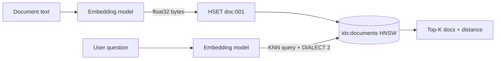

## What this covers

Azure Managed Redis can act as a vector database through the **RediSearch** module. This page covers how to define a vector index (`FT.CREATE`), store embeddings with their metadata so Redis indexes them automatically, load large batches efficiently, and run KNN, hybrid (filtered) and range queries with `redis-py`. It also covers the settings that most often break vector search: the instance prerequisites, dimension mismatches, the wrong distance metric and the query dialect.

**Exam weight:** Develop AI solutions by using Azure data management services (30–35%)

**Skills measured**

- "Implement vector indexing to enable similarity search"

## Key concepts

### Prerequisites on the instance

- **RediSearch** must be selected **when you create the instance**. You can't add it later.
- The clustering policy must be **Enterprise**. OSS clustering can't run RediSearch.
- The eviction policy must be **NoEviction**, so index entries are never silently evicted.
- An in-memory tier (Memory Optimized, Balanced or Compute Optimized). **Flash Optimized doesn't support RediSearch.**

### Index schema

An index has a name (for example `idx:documents`), a **key prefix** (`doc:`), a storage type (**HASH** or **JSON**) and fields:

- `TextField` for full-text search, `TagField` for exact-match filters such as category, `NumericField` for ranges.
- `VectorField(name, algorithm, attributes)`, where the algorithm is **FLAT** or **HNSW** and the attributes include `TYPE` (FLOAT32), `DIM` (must equal the model output, for example 1536) and `DISTANCE_METRIC` (COSINE, L2 or IP).

Once the index exists, **every key that matches the prefix is indexed automatically** when you write it, update it or delete it. There is no separate "add to index" call.

### Ingestion

In a hash, a vector is stored as **raw bytes**: `np.array(vec, dtype=np.float32).tobytes()`. Store it next to the metadata (title, content, category) so one lookup returns everything. For bulk loads, use a **pipeline** to batch many `HSET` calls into one round trip. That gives 10–100 times more throughput. `pipeline(transaction=False)` skips `MULTI`/`EXEC` when you don't need atomicity.

### Query forms

| Query | Syntax |
|---|---|
| Pure KNN | `*=>[KNN 5 @embedding $query_vec AS score]` |
| Hybrid (pre-filter) | `@category:{documentation}=>[KNN 3 @embedding $query_vec AS score]` |
| Range | `@embedding:[VECTOR_RANGE 0.2 $query_vec]=>{$YIELD_DISTANCE_AS: score}` |
| Runtime tuning | `...[KNN 10 @embedding $query_vec EF_RUNTIME 200 AS score]` |

Every vector query needs **`DIALECT 2`** (`.dialect(2)`) and passes the query vector as a **bytes parameter**. The `score` is a **distance**, so **lower means more similar**. With COSINE, 0 means identical and 2 means opposite. Sort ascending.

### Metric and tuning rules

- Use **COSINE** for text embeddings, **L2** for image or spatial vectors, and **IP** only for normalized vectors.
- If the query vector's dimension doesn't match `DIM`, the query fails.
- `EF_RUNTIME` (HNSW only, default 10) controls how much of the graph is searched. Start around 50 and raise it to 100–200 for better recall, at the cost of latency.

## How it works



## Hands-on

### Azure portal

1. Create an AMR instance (Balanced or higher). On **Advanced**, select **RediSearch** (and RedisJSON if you'll store JSON), **Clustering policy: Enterprise**, **Eviction policy: NoEviction**.
2. Add your identity under **Authentication > Microsoft Entra Authentication**.

### Azure CLI

```bash
az group create --name rg-ai200 --location eastus
az redisenterprise create --name <cache-name> --resource-group rg-ai200 \
  --location eastus --sku Balanced_B5 \
  --clustering-policy EnterpriseCluster --eviction-policy NoEviction \
  --modules name=RediSearch
```

Raw index command, which you can run from `redis-cli` or `r.execute_command`:

```text
FT.CREATE idx:documents ON HASH PREFIX 1 doc:
  SCHEMA title TEXT content TEXT category TAG
         embedding VECTOR HNSW 6 TYPE FLOAT32 DIM 1536 DISTANCE_METRIC COSINE
```

### Python

```python
import numpy as np
import redis
from redis.commands.search.field import TagField, TextField, VectorField
from redis.commands.search.index_definition import IndexDefinition, IndexType
from redis.commands.search.query import Query
from redis_entraid.cred_provider import create_from_default_azure_credential

provider = create_from_default_azure_credential(("https://redis.azure.com/.default",))
# decode_responses=False because vectors are binary
r = redis.Redis(host="<cache-name>.<region>.redis.azure.net", port=10000, ssl=True,
                credential_provider=provider)

schema = (
    TextField("title"), TextField("content"), TagField("category"),
    VectorField("embedding", "HNSW",
                {"TYPE": "FLOAT32", "DIM": 1536, "DISTANCE_METRIC": "COSINE"}),
)
r.ft("idx:documents").create_index(
    fields=schema,
    definition=IndexDefinition(prefix=["doc:"], index_type=IndexType.HASH),
)

def load(documents):                       # list of dicts with id/title/content/embedding
    pipe = r.pipeline(transaction=False)
    for d in documents:
        pipe.hset(f"doc:{d['id']}", mapping={
            "title": d["title"], "content": d["content"],
            "category": d.get("category", "general"),
            "embedding": np.array(d["embedding"], dtype=np.float32).tobytes()})
    pipe.execute()

def search(query_embedding, k=5, category=None):
    vec = np.array(query_embedding, dtype=np.float32).tobytes()
    prefix = f"@category:{{{category}}}" if category else "*"
    q = (Query(f"{prefix}=>[KNN {k} @embedding $query_vec AS score]")
         .return_fields("title", "category", "score").sort_by("score").dialect(2))
    return r.ft("idx:documents").search(q, query_params={"query_vec": vec}).docs

def within(query_embedding, max_distance=0.2):
    vec = np.array(query_embedding, dtype=np.float32).tobytes()
    q = (Query("@embedding:[VECTOR_RANGE $r $query_vec]=>{$YIELD_DISTANCE_AS: score}")
         .return_fields("title", "score").sort_by("score").dialect(2))
    return r.ft("idx:documents").search(q, query_params={"r": max_distance, "query_vec": vec}).docs
```

In redis-py versions older than 6.0, the import path is `redis.commands.search.indexDefinition` (the path the Learn module shows).

## Exam traps

| Situation | Fix |
|---|---|
| `FT.CREATE` returns unknown command | RediSearch wasn't enabled at creation. Recreate the instance |
| Can't enable RediSearch | The instance uses OSS clustering or Flash Optimized |
| Query error about dimensions | Query vector length doesn't equal `DIM` |
| Vector query syntax error | Missing `.dialect(2)` |
| Results look random for text | Metric is L2 or IP on COSINE-trained embeddings |
| Filter on category returns nothing | Category indexed as `TEXT`. Use `TAG` for `{...}` filters |

> [!WARNING]
> **Exam trap:** A KNN `score` is a **distance**, not a similarity. Sort ascending. The best match has the **lowest** score.

> [!WARNING]
> **Exam trap:** Vectors in hashes must be **bytes** (`tobytes()`), not a Python list or a JSON string.

> [!TIP]
> In the hybrid syntax the filter goes **before** `=>`. Redis filters first, then runs KNN inside the filtered set.

> [!NOTE]
> The Learn sample indexes `category` as a `TextField` but filters it with tag syntax `{...}`. Use a `TagField` for exact-match filters.

## Quick review

- Vector search needs RediSearch at creation, the Enterprise clustering policy, NoEviction and a non-Flash tier.
- `VectorField` takes the algorithm (FLAT or HNSW), `TYPE`, `DIM` and `DISTANCE_METRIC`.
- Keys that match the index prefix are indexed automatically on write.
- Store vectors as float32 bytes and bulk-load with pipelines.
- KNN syntax is `*=>[KNN k @field $vec AS score]` with dialect 2. A lower score is closer.
- Hybrid queries put a filter before `=>`. Range queries use `VECTOR_RANGE`.

## Practice

[Practice: Azure Managed Redis vector indexing](/practice/redis-vector)

## Official references

- [Learn unit: Index and query vector data](https://learn.microsoft.com/training/modules/implement-vector-storage-azure-managed-redis/2-index-query-vector-data)
- [Redis modules in Azure Managed Redis](https://learn.microsoft.com/azure/redis/redis-modules)
- [Azure Managed Redis architecture: clustering](https://learn.microsoft.com/azure/redis/architecture)
- [Redis vector search](https://redis.io/docs/latest/develop/interact/search-and-query/vectors/)
- [AI-200 study guide](https://learn.microsoft.com/en-us/credentials/certifications/resources/study-guides/ai-200)
- [Microsoft Learn](https://learn.microsoft.com/)
