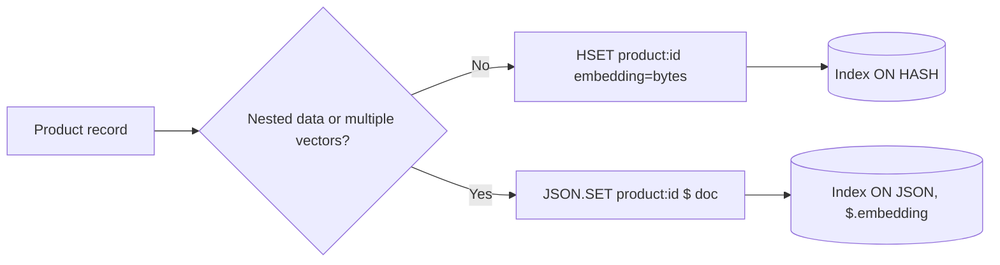

## What this covers

RediSearch can index vectors stored in a **Redis Hash** or in a **RedisJSON** document. This page compares the two: how the vector is stored, how the index definition changes (`IndexType.HASH` vs `IndexType.JSON` with JSONPath fields), the memory and speed trade-offs, when nested data or several vectors per item justify JSON, and how to migrate from one to the other. Choosing the storage type is a design decision that shows up in exam scenarios.

**Exam weight:** Develop AI solutions by using Azure data management services (30–35%)

**Skills measured**

- "Implement vector indexing to enable similarity search"

## Key concepts

### Hash storage

A Hash is a flat set of field/value pairs under one key, such as `product:12345`. The embedding is one field holding a **binary blob** (`np.float32` array `.tobytes()`), next to plain fields such as name, price and category. A Hash stores only what you put in it, so it has the **smallest memory footprint and the fastest queries**. Choose it for flat records, maximum performance and tight memory budgets. It is the default recommendation for most vector workloads.

### JSON storage

RedisJSON stores a whole document, with nested objects and arrays. The embedding is a **numeric array** (`.tolist()`) inside the document, for example next to a `specs` object or a list of image URLs. Index fields are addressed with **JSONPath** (`$.name`, `$.embedding`) and given short aliases with `as_name`, so queries can use `@name` and `@embedding`. JSON needs more memory (each number is a JSON element, not 4 packed bytes) and queries are slightly slower. In return you get:

- nested structures without flattening
- **several vectors per item** (for example a text vector and an image vector)
- partial updates with JSONPath (`JSON.SET key $.price 24.99`)
- a natural fit when the app already works with JSON

RedisJSON must be enabled at creation like any module. It is the only module available on **Flash Optimized**, but vector **search** still needs RediSearch, which Flash doesn't support.

### Comparison

| Factor | Hash | JSON |
|---|---|---|
| Vector format | Binary bytes (`tobytes()`) | Numeric array (`tolist()`) |
| Memory | Lower | Higher |
| Query speed | Faster | Slightly slower |
| Data shape | Flat fields only | Nested objects and arrays |
| Index field names | Field name (`embedding`) | JSONPath + alias (`$.embedding AS embedding`) |
| `IndexType` | `HASH` | `JSON` |
| Best for | Simple records, max performance | Complex documents, multiple vectors |

For a 1,536-dim FLOAT32 vector, the raw payload is 6,144 bytes in a Hash. The same values in JSON add per-element overhead on top of that. Across a million products, Hash saves a lot of memory and latency.

### Key design and lifecycle

- Use a consistent prefix per index (`product:`, `doc:`). The index watches the prefix.
- Expiring or deleting a key removes it from the index automatically, so a TTL works for short-lived vectors such as semantic-cache entries. Remember that the instance itself must use NoEviction for RediSearch.
- To change storage type, re-ingest the data into JSON keys, then **drop the old index and create a new one** with `IndexType.JSON`.

## How it works



## Hands-on

### Azure portal

1. When you create the instance, select both **RediSearch** and **RedisJSON** on the **Advanced** tab if you might store JSON. Modules can't be added later.
2. Keep **Clustering policy: Enterprise** and **Eviction policy: NoEviction**.

### Azure CLI

```bash
az group create --name rg-ai200 --location eastus
az redisenterprise create --name <cache-name> --resource-group rg-ai200 \
  --location eastus --sku Balanced_B5 \
  --clustering-policy EnterpriseCluster --eviction-policy NoEviction \
  --modules name=RediSearch --modules name=RedisJSON
```

### Python

```python
import numpy as np
import redis
from redis.commands.search.field import NumericField, TagField, TextField, VectorField
from redis.commands.search.index_definition import IndexDefinition, IndexType
from redis_entraid.cred_provider import create_from_default_azure_credential

provider = create_from_default_azure_credential(("https://redis.azure.com/.default",))
r = redis.Redis(host="<cache-name>.<region>.redis.azure.net", port=10000, ssl=True,
                credential_provider=provider)            # bytes mode for vector blobs
embedding = np.random.rand(1536).astype(np.float32)
vec_attrs = {"TYPE": "FLOAT32", "DIM": 1536, "DISTANCE_METRIC": "COSINE"}

# Hash: vector as bytes
r.hset("product:12345", mapping={"name": "Wireless Mouse", "price": 29.99,
                                 "category": "electronics", "embedding": embedding.tobytes()})
r.ft("idx:products").create_index(
    (TextField("name"), NumericField("price"), TagField("category"),
     VectorField("embedding", "HNSW", vec_attrs)),
    definition=IndexDefinition(prefix=["product:"], index_type=IndexType.HASH))

# JSON: vector as list, fields by JSONPath
r.json().set("jproduct:12345", "$", {
    "name": "Wireless Mouse", "price": 29.99, "category": "electronics",
    "embedding": embedding.tolist(),
    "specs": {"color": "black", "wireless": True, "battery": "AA"}})
r.ft("idx:jproducts").create_index(
    (TextField("$.name", as_name="name"), NumericField("$.price", as_name="price"),
     TagField("$.category", as_name="category"),
     VectorField("$.embedding", "HNSW", vec_attrs, as_name="embedding")),
    definition=IndexDefinition(prefix=["jproduct:"], index_type=IndexType.JSON))

# Migrate one Hash record to JSON
h = r.hgetall("product:12345")
r.json().set("jproduct:12345", "$", {
    "name": h[b"name"].decode(), "price": float(h[b"price"]),
    "category": h[b"category"].decode(),
    "embedding": np.frombuffer(h[b"embedding"], dtype=np.float32).tolist()})
# After migrating everything: r.ft("idx:products").dropindex(delete_documents=False)
```

The client runs with `decode_responses=False` because a vector blob isn't valid UTF-8. The Learn migration sample reads the hash with decoded strings, which fails on the binary field.

## Exam traps

| Requirement | Choose |
|---|---|
| Flat product records, lowest memory | Hash |
| Text and image embedding on the same item | JSON (two vector paths) |
| Nested specs or variants with vector search | JSON + RediSearch |
| Fastest KNN latency | Hash |
| Index a JSON field | `$.field` with `as_name` alias and `IndexType.JSON` |

> [!WARNING]
> **Exam trap:** A Hash stores the vector as **bytes**, and JSON stores it as a **float array**. Writing a list into a Hash field or bytes into a JSON document makes the key fail to index.

> [!WARNING]
> **Exam trap:** You can't change an index's `IndexType` in place. Re-ingest the data, then drop and recreate the index.

> [!TIP]
> Default to Hash. Switch to JSON when the data shape or multiple vectors require it.

> [!NOTE]
> `dropindex(delete_documents=False)` removes only the index and keeps the keys. `True` also deletes the indexed keys.

## Quick review

- Hash stores the vector as a `tobytes()` blob, with the least memory and the fastest queries.
- JSON stores the vector as a `tolist()` array and supports nested data and several vectors per item.
- JSON indexes use JSONPath (`$.embedding`) with `as_name` aliases and `IndexType.JSON`.
- A 1,536-dim FLOAT32 vector is 6,144 bytes raw. JSON adds formatting overhead on top.
- Changing storage type means re-ingesting the data and then dropping and recreating the index.

## Practice

[Practice: Azure Managed Redis vector indexing](/practice/redis-vector)

## Official references

- [Learn unit: Optimize Redis data structures for vector storage](https://learn.microsoft.com/training/modules/implement-vector-storage-azure-managed-redis/4-optimize-redis-data-structure)
- [Redis modules in Azure Managed Redis](https://learn.microsoft.com/azure/redis/redis-modules)
- [Redis: index JSON documents with vectors](https://redis.io/docs/latest/develop/interact/search-and-query/indexing/)
- [AI-200 study guide](https://learn.microsoft.com/en-us/credentials/certifications/resources/study-guides/ai-200)
- [Microsoft Learn](https://learn.microsoft.com/)
