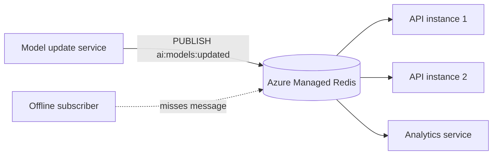

## What this covers

Redis pub/sub lets one service broadcast an event to every service that is listening right now. This page covers how channels and pattern subscriptions work, the delivery guarantees (or lack of them), where pub/sub fits in an AI back end, and how to publish and subscribe with `redis-py`, including the async client. The exam's Redis skill covers caching and invalidation, and pub/sub is the usual way to broadcast an invalidation to every app instance.

**Exam weight:** Develop AI solutions by using Azure data management services (30–35%)

**Skills measured**

- "Implement Azure Managed Redis data operations, including caching, expiration, and invalidation"

## Key concepts

### Channels and patterns

A **channel** is just a string name, such as `ai:conversations:123`, `ml:model:predictions` or `embeddings:cache:refresh`. Publishers send to a channel without knowing who listens. `SUBSCRIBE` listens to exact channel names. `PSUBSCRIBE` listens to glob patterns such as `ai:conversations:*`, `ml:models:*:status` or `ai:*:predictions`.

Both Azure Managed Redis and Azure Cache for Redis support pub/sub.

### Delivery semantics

| Property | Meaning |
|---|---|
| **At-most-once** | Only subscribers connected at publish time receive the message |
| **No persistence** | Redis doesn't store messages. A subscriber that was offline misses them for good |
| **Fire-and-forget** | `PUBLISH` returns the **number of subscribers that received it**, and nothing more |
| **No backpressure** | Slow subscribers get flooded, and their client output buffer can overflow |
| **High throughput** | Thousands of channels, with sub-millisecond fan-out |

### Good fits in AI systems

- Coordinating several AI components at once. For example, a new message on `conversations:new` triggers the sentiment, intent and context services in parallel.
- **Cache invalidation** when a model version or an embedding set changes, so every instance clears its local cache.
- Loosely coupled microservices that react to events without direct calls.
- Streaming model metrics to dashboards and alerting.
- Pushing live updates to browsers through WebSockets.

### Limits

Don't use pub/sub when a message must not be lost, must be processed exactly once, needs ordering guarantees across reconnects, or needs replay. Use [Redis Streams](/study/enhance-ai-solutions-with-azure-managed-redis/implement-task-queues-with-redis-streams) or Azure Service Bus for that.

### Message shapes in redis-py

`pubsub.listen()` yields dicts. Check the `type` field: `subscribe`/`psubscribe` confirmations, `message` for exact-channel deliveries, and `pmessage` for pattern deliveries (these also include `pattern`).

## How it works



Each subscriber holds a dedicated connection in subscribe mode. On `PUBLISH`, Redis pushes the payload to every current subscriber of the channel and to every matching pattern subscriber.

## Hands-on

### Azure portal

1. Open the AMR instance and check **Monitoring > Metrics > Connected Clients**. Each subscriber keeps one long-lived connection open.
2. From Cloud Shell or a local terminal, connect with `redis-cli -h <host> -p 10000 --tls` (an access key, or a user and token). Run `SUBSCRIBE ai:models:updated` in one session and `PUBLISH ai:models:updated v2` in another.

### Azure CLI

```bash
az group create --name rg-ai200 --location eastus
az redisenterprise show --name <cache-name> --resource-group rg-ai200 \
  --query "{host:hostName, state:provisioningState}"
az redisenterprise test-connection --name <cache-name> --resource-group rg-ai200 --auth entra
```

### Python

```python
import redis
from redis_entraid.cred_provider import create_from_default_azure_credential

provider = create_from_default_azure_credential(("https://redis.azure.com/.default",))
redis_client = redis.Redis(host="<cache-name>.<region>.redis.azure.net", port=10000,
                           ssl=True, decode_responses=True, credential_provider=provider)

# Publisher
def notify_model_updated(model_name, version):
    receivers = redis_client.publish("ai:models:updated", f"{model_name}:{version}")
    print(f"delivered to {receivers} subscriber(s)")

def notify_embeddings_refreshed(collection_id):
    redis_client.publish("ai:embeddings:refresh", collection_id)

# Subscriber (worker process)
pubsub = redis_client.pubsub()
pubsub.subscribe("ai:models:updated", "ai:embeddings:refresh")
pubsub.psubscribe("ai:*")
for message in pubsub.listen():
    if message["type"] == "message":
        print("exact", message["channel"], message["data"])
    elif message["type"] == "pmessage":
        print("pattern", message["pattern"], message["channel"], message["data"])
```

Forwarding to WebSocket clients with the async client (FastAPI):

```python
import redis.asyncio as aioredis
from fastapi import FastAPI, WebSocket
from redis_entraid.cred_provider import create_from_default_azure_credential

app = FastAPI()
provider = create_from_default_azure_credential(("https://redis.azure.com/.default",))

@app.websocket("/ws/{client_id}")
async def websocket_endpoint(websocket: WebSocket, client_id: str):
    await websocket.accept()
    client = aioredis.Redis(host="<cache-name>.<region>.redis.azure.net", port=10000,
                            ssl=True, decode_responses=True, credential_provider=provider)
    async with client.pubsub() as pubsub:
        await pubsub.subscribe("ai:predictions:ready")
        async for message in pubsub.listen():
            if message["type"] == "message":
                await websocket.send_json({"type": "prediction", "data": message["data"]})
```

The Learn sample for this pattern uses an Azure Cache for Redis host name (`*.redis.cache.windows.net`) and an access key. For AMR, use the `*.redis.azure.net` endpoint on port 10000 with Entra ID, as shown above.

## Exam traps

| Requirement | Use |
|---|---|
| Every instance must react to the same event | Pub/sub |
| Message must survive a subscriber restart | Streams (or Service Bus) |
| Listen to a family of channels | `PSUBSCRIBE` with a glob |
| Know whether anyone received the event | `PUBLISH` return value (subscriber count only) |
| Durable, ordered, replayable events | Streams |

> [!WARNING]
> **Exam trap:** Pub/sub gives **no** persistence and **no** acknowledgment. An answer that says pub/sub "retries delivery to offline subscribers" is wrong.

> [!WARNING]
> **Exam trap:** `PSUBSCRIBE` deliveries arrive as type `pmessage`, not `message`. A handler that only checks `message` ignores them.

> [!TIP]
> Pub/sub means **broadcast to whoever is listening now**. Streams mean **a durable queue with acknowledgments**.

> [!NOTE]
> A connection in subscribe mode can only run subscribe-related commands. Use a separate client connection for normal reads and writes.

## Quick review

- Channels are plain strings. `SUBSCRIBE` takes exact names and `PSUBSCRIBE` takes glob patterns.
- Delivery is at-most-once, with no persistence, no acknowledgments and no backpressure.
- `PUBLISH` returns the number of subscribers that received the message.
- Use it for cross-instance cache invalidation, config reloads, metrics fan-out and live UI updates.
- In redis-py, check `type == "message"` or `"pmessage"` in `listen()`.

## Practice

[Practice: Azure Managed Redis data operations](/practice/redis-data-ops)

## Official references

- [Learn unit: Publish and subscribe to events with Redis pub/sub](https://learn.microsoft.com/training/modules/implement-event-messaging-azure-managed-redis/2-redis-pub-sub)
- [Learn module: Implement event messaging with Azure Managed Redis](https://learn.microsoft.com/training/modules/implement-event-messaging-azure-managed-redis/)
- [Redis pub/sub documentation](https://redis.io/docs/latest/develop/interact/pubsub/)
- [AI-200 study guide](https://learn.microsoft.com/en-us/credentials/certifications/resources/study-guides/ai-200)
- [Microsoft Learn](https://learn.microsoft.com/)
