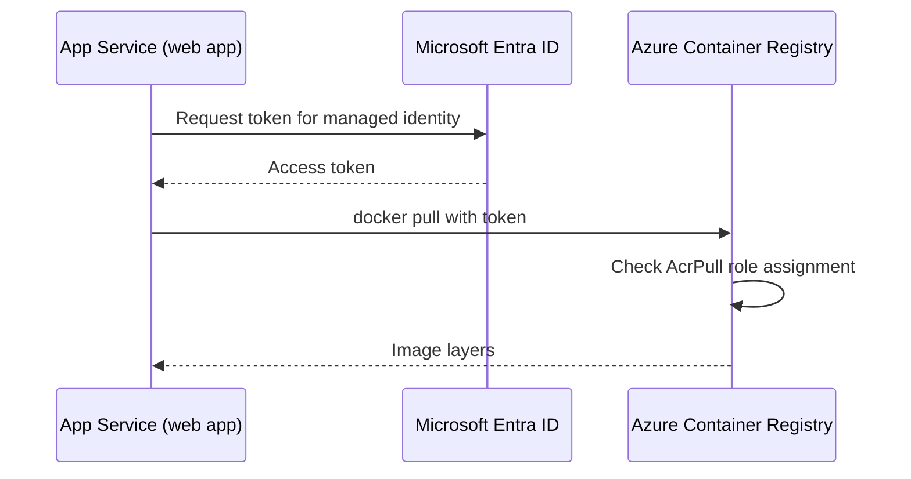

## What this covers

When App Service runs a custom container stored in Azure Container Registry (ACR), it has to authenticate to the registry before it can pull the image. You have two choices: a **managed identity** that holds the `AcrPull` role, or the registry's **admin credentials**. This page compares them, shows the exact CLI steps for each, and lists the failure modes the exam likes to test. Pick based on your security requirements and on who owns permission setup (the app team or a platform team).

**Exam weight:** Develop containerized solutions on Azure (20–25%)

**Skills measured**

- "Deploy containers to Azure App Service, including configuring App Service to supply environment variables and secrets"
- "Build, store, version, and manage container images by using Azure Container Registry"

## Key concepts

### Managed identity (recommended for production)

App Service gets a Microsoft Entra token for its own identity and presents it to ACR. Nothing secret is stored in the app's configuration, so there is no password to rotate, and every pull is auditable against a named identity.

| Identity type | Lifecycle | Best when |
|---------------|-----------|-----------|
| **System-assigned** | Created when you enable it on the web app, deleted with the app | Only this one web app needs registry access |
| **User-assigned** | A standalone Azure resource you create first | Several web apps share the same registry access, or you want permissions granted **before** the app exists |

Enabling an identity is not enough. The identity also needs the **`AcrPull`** role on the registry (often granted by a platform team), and the app must be told to use the identity for pulls (`acrUseManagedIdentityCreds`). For a user-assigned identity you also set `acrUserManagedIdentityID` to the identity's **client ID**.

### Admin credentials (dev and quick starts)

Every ACR has an optional admin account with a username and two passwords. It is disabled by default. Once you enable it, App Service stores the username and password in its configuration (as the reserved `DOCKER_REGISTRY_SERVER_USERNAME` and `DOCKER_REGISTRY_SERVER_PASSWORD` values, which are not exposed to your app).

- Simpler for development because no role assignment is needed
- One shared account with full push and pull rights, so there is no least privilege
- You rotate it by hand (`az acr credential renew`) and then update every app that uses it

## How it works



With admin credentials the first two steps go away: App Service sends the stored username and password straight to ACR.

## Hands-on

### Azure portal

1. Open the web app and go to **Settings** > **Identity**. Turn on **System assigned** (or add a user-assigned identity) and save.
2. Open the registry and go to **Access control (IAM)** > **Add role assignment**. Choose **AcrPull** and assign it to the web app's identity.
3. Back in the web app, go to **Deployment Center**. Set the registry source to **Azure Container Registry** and set **Authentication** to **Managed Identity**. Pick the identity, then the image and tag.
4. For the admin route instead: in the registry, open **Settings** > **Access keys** and enable **Admin user**. Then choose **Admin credentials** in Deployment Center.

### Azure CLI

```bash
# 1. Give the web app a system-assigned identity and capture its principal ID
principalId=$(az webapp identity assign \
  --resource-group <resource-group> --name <app-name> \
  --query principalId --output tsv)

# 2. Grant AcrPull on the registry
acrId=$(az acr show --resource-group <resource-group> --name <registry-name> --query id --output tsv)
az role assignment create --assignee "$principalId" --scope "$acrId" --role AcrPull

# 3. Tell App Service to pull with the managed identity
az webapp config set --resource-group <resource-group> --name <app-name> \
  --generic-configurations '{"acrUseManagedIdentityCreds": true}'

# 3b. User-assigned identity only: point at its client ID
az webapp config set --resource-group <resource-group> --name <app-name> \
  --generic-configurations '{"acrUserManagedIdentityID": "<client-id>"}'
```

You can also do this at creation time with `az webapp create ... --acr-use-identity --acr-identity [system]`. The admin path is a one-liner on the registry:

```bash
az acr update --name myregistry --admin-enabled true
az acr credential show --name myregistry   # username + two passwords
```

### Python

```python
from azure.identity import DefaultAzureCredential
from azure.mgmt.web import WebSiteManagementClient

client = WebSiteManagementClient(DefaultAzureCredential(), "<subscription-id>")
config = client.web_apps.get_configuration("<resource-group>", "<app-name>")

# Switch image pulls to the managed identity
config.acr_use_managed_identity_creds = True
# config.acr_user_managed_identity_id = "<client-id>"  # user-assigned only
client.web_apps.update_configuration("<resource-group>", "<app-name>", config)
```

## Exam traps

| Scenario | Choose |
|----------|--------|
| Production AI API, least privilege, no stored secrets | Managed identity + `AcrPull`, admin user disabled |
| Several web apps share one registry | **User-assigned** identity attached to each app |
| Permissions must exist before the app is created | **User-assigned** identity |
| Classroom lab, fastest first deploy | Admin credentials (temporary) |
| Pulling from Docker Hub or GHCR | Neither: use server URL + username/password |

> [!WARNING]
> **Exam trap:** Turning on a managed identity does not grant anything by itself. Without an `AcrPull` role assignment on the registry, the pull fails with an authorization error.

> [!WARNING]
> **Exam trap:** The admin path only works after `az acr update --admin-enabled true`. A question that says "admin user is disabled" rules out admin credentials.

> [!NOTE]
> Managed identity pulls need the registry to accept ARM-audience tokens. If `az acr config authentication-as-arm show` reports it disabled, pulls fail with `UNAUTHORIZED` until you enable it.

> [!TIP]
> System-assigned = "dies with the app". User-assigned = "lives on its own and can be shared".

## Quick review

- Managed identity is the recommended production method; admin credentials suit dev only.
- The identity needs the `AcrPull` role on the registry; pushing needs `AcrPush`.
- `acrUseManagedIdentityCreds: true` makes App Service pull with its identity.
- A user-assigned identity also needs `acrUserManagedIdentityID` set to its client ID.
- System-assigned identities share the app's lifecycle; user-assigned ones are independent and reusable.
- Enable the admin user with `az acr update --name <registry> --admin-enabled true`.
- Admin credentials sit in App Service config and must be rotated by hand.

## Practice

- [Practice: App Service container questions](/practice/app-service-containers)
- [Practice: Azure Container Registry image questions](/practice/acr-images)

## Official references

- [Deploy containers to Azure App Service (Learn module)](https://learn.microsoft.com/en-us/training/modules/deploy-containers-azure-app-service/)
- [Configure a custom container: use managed identity to pull from ACR](https://learn.microsoft.com/en-us/azure/app-service/configure-custom-container)
- [Authenticate with managed identity to ACR](https://learn.microsoft.com/en-us/azure/container-registry/container-registry-authentication-managed-identity)
- [ACR authentication options and admin user](https://learn.microsoft.com/en-us/azure/container-registry/container-registry-authentication)
- [AI-200 study guide](https://learn.microsoft.com/en-us/credentials/certifications/resources/study-guides/ai-200)
