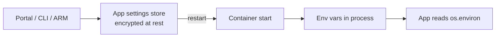

## What this covers

App settings are how App Service hands configuration to your container at runtime. Each setting is a name/value pair that the platform injects as an **environment variable** when the container starts. Because configuration lives outside the image, you can promote the **same image** from dev to staging to production and change only the settings. This page covers how to set and read app settings, the naming rules, and which reserved settings change platform behavior.

**Exam weight:** Develop containerized solutions on Azure (20–25%)

**Skills measured**

- "Deploy containers to Azure App Service, including configuring App Service to supply environment variables and secrets"

## Key concepts

### Name/value pairs become environment variables

- You set them in the portal (**Settings** > **Environment variables** > **App settings**) or with `az webapp config appsettings set --settings KEY=value`.
- Your code reads them like any other environment variable (`os.environ` in Python, `process.env` in Node.js).
- Changing an app setting **restarts** the app so the container picks up the new values. No rebuild is needed: raising `MAX_DOCUMENT_SIZE_MB` for an AI document processor is a config change, not a new image.
- Keep secrets and environment names out of the Dockerfile; supply them as settings instead.

### Naming rules

- Names may contain only **letters, numbers and underscores**.
- .NET reads nested configuration with colons (`ConnectionStrings:DefaultConnection`). Colons are not allowed in environment variable names on Linux, so use **double underscores**: `ConnectionStrings__DefaultConnection`. The .NET configuration system maps `__` back to `:`.

### Encryption at rest

App Service stores **all** app settings encrypted, whether or not they hold secrets, and decrypts them only when it injects them into the container. Encryption at rest does not stop anyone with Contributor rights on the app from reading the values. For secrets that need auditing and rotation, use a [Key Vault reference](/study/implement-container-application-hosting-on-azure/key-vault-references) instead.

### Reserved settings that change platform behavior

| Setting | Effect |
|---------|--------|
| `WEBSITES_PORT` | Port your container listens on when it isn't 80 |
| `WEBSITES_ENABLE_APP_SERVICE_STORAGE` | `true` mounts persistent, shared `/home` storage (off by default for Linux custom containers) |
| `WEBSITES_CONTAINER_START_TIME_LIMIT` | Seconds App Service waits for the container to start (default 230, max 1800) |
| `DOCKER_REGISTRY_SERVER_*` | Registry credentials; reserved and not exposed to your app |

See [Configure container runtime behavior](/study/implement-container-application-hosting-on-azure/configure-container-runtime-behavior) for details.

## How it works



1. You save a setting, and App Service writes it to the encrypted settings store.
2. The save restarts the app.
3. When the container starts, App Service decrypts the settings and passes them as environment variables.
4. Your application reads them at startup or on demand.

## Hands-on

### Azure portal

1. Open the web app and select **Settings** > **Environment variables**.
2. On the **App settings** tab, select **+ Add**, enter a name and value, and select **Apply**.
3. Tick **Deployment slot setting** if the value must stay with this slot during swaps.
4. Select **Apply** at the bottom of the page and confirm the restart.

### Azure CLI

```bash
az webapp config appsettings set \
  --resource-group myResourceGroup \
  --name myDocumentProcessor \
  --settings \
    STORAGE_ACCOUNT_NAME=mystorageaccount \
    LOG_LEVEL=INFO \
    MAX_DOCUMENT_SIZE_MB=50

# List names and values
az webapp config appsettings list \
  --resource-group myResourceGroup --name myDocumentProcessor -o table

# Remove a setting
az webapp config appsettings delete \
  --resource-group myResourceGroup --name myDocumentProcessor \
  --setting-names LOG_LEVEL
```

### Python

Read settings inside the container:

```python
import os

storage_account = os.environ.get("STORAGE_ACCOUNT_NAME")
log_level = os.environ.get("LOG_LEVEL", "WARNING")
max_size = int(os.environ.get("MAX_DOCUMENT_SIZE_MB", 10))
```

Manage them from outside with the management SDK:

```python
from azure.identity import DefaultAzureCredential
from azure.mgmt.web import WebSiteManagementClient

client = WebSiteManagementClient(DefaultAzureCredential(), "<subscription-id>")
settings = client.web_apps.list_application_settings("<resource-group>", "<app-name>")
settings.properties["LOG_LEVEL"] = "DEBUG"
# Replaces the whole set, so always start from the current values
client.web_apps.update_application_settings("<resource-group>", "<app-name>", settings)
```

## Exam traps

| Need | Use |
|------|-----|
| Plain configuration (log level, feature flag, endpoint) | App setting |
| Secret with audit trail and rotation | App setting holding a Key Vault reference |
| .NET app that expects `SQLAZURECONNSTR_` style names | [Connection string](/study/implement-container-application-hosting-on-azure/connection-strings) |
| Value that must not move during a slot swap | App setting marked as a slot setting |
| Many settings at once | [Bulk edit](/study/implement-container-application-hosting-on-azure/bulk-editing) with JSON |

> [!WARNING]
> **Exam trap:** Changing configuration does not mean rebuilding the image. App settings are injected at runtime, so the same image runs in every environment.

> [!WARNING]
> **Exam trap:** A .NET key such as `Logging:LogLevel:Default` must be written as `Logging__LogLevel__Default` on Linux containers. A colon in the name is invalid.

> [!WARNING]
> **Exam trap:** The SDK's `update_application_settings` and the ARM `PUT` replace the full collection. Any setting you leave out is deleted. `az webapp config appsettings set` merges instead.

> [!TIP]
> Settings are encrypted at rest for every value. "Encrypted" is not a reason to store secrets there when Key Vault is an option.

## Quick review

- App settings are injected into the container as environment variables at startup.
- Saving a setting restarts the app; no image rebuild is needed.
- Names allow letters, numbers and underscores only.
- Use `__` in place of `:` for .NET nested keys on Linux.
- All app settings are encrypted at rest and decrypted only on injection.
- `WEBSITES_PORT` and `WEBSITES_ENABLE_APP_SERVICE_STORAGE` are app settings that change platform behavior.
- Check injected values on the Kudu `/Env` page.

## Practice

[Practice: App Service container questions](/practice/app-service-containers)

## Official references

- [Deploy containers to Azure App Service: configure application settings (Learn unit)](https://learn.microsoft.com/en-us/training/modules/deploy-containers-azure-app-service/4-configure-settings)
- [Configure an App Service app](https://learn.microsoft.com/en-us/azure/app-service/configure-common)
- [Environment variables and app settings reference](https://learn.microsoft.com/en-us/azure/app-service/reference-app-settings)
- [az webapp config appsettings](https://learn.microsoft.com/en-us/cli/azure/webapp/config/appsettings)
- [AI-200 study guide](https://learn.microsoft.com/en-us/credentials/certifications/resources/study-guides/ai-200)
