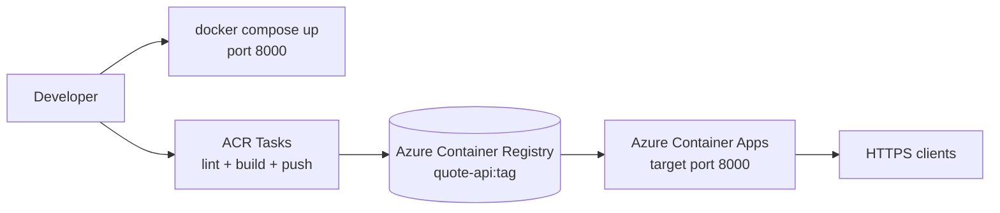

## What this covers

This page walks through the hands-on **Quote API** project: a small FastAPI service that you run locally with Docker Compose, build in the cloud with ACR Tasks, store in Azure Container Registry, and run on Azure Container Apps. Knowing what each file does helps you connect exam topics (image builds, registries, tags, multi-step tasks, target ports) to a real repository.

**Exam weight:** Develop containerized solutions on Azure (20–25%)

**Skills measured**

- "Build, store, version, and manage container images by using Azure Container Registry"
- "Build and run images by using Azure Container Registry Tasks"

## Key concepts

### Three stages, one image

- **Local inner loop:** `docker compose up` builds the same `Dockerfile` that production uses, so "works on my machine" means "works in the image".
- **Cloud build:** `az acr build` (a quick task) or `az acr run -f acr-task.yaml` (a multi-step task) builds in Azure. You don't need a local Docker engine, and the image is pushed straight into the registry.
- **Run:** Azure Container Apps pulls the tagged image from ACR and runs it behind managed HTTPS ingress.

### Port contract

The app listens on **8000** (Uvicorn). That number must appear in three places: the `CMD` in the `Dockerfile`, `--target-port 8000` on `az containerapp create`, and the port mapping in `docker-compose.yml`. A mismatch is the most common reason for a deployed container that runs but never answers.

### Configuration outside the image

`app/config.py` reads environment variables. `.env.example` documents them for local runs, and the deploy script passes them with `--env-vars`. No environment-specific values are baked into the image.

## How it works

Original text diagram from the project:

```text
Developer
    │
    ├── Local dev ──▶ docker compose up ──▶ Quote API (port 8000)
    │
    └── Azure deploy ──▶ ACR (build image) ──▶ Container Apps (run API)
                              │
                              └── ACR Tasks (build, lint, push on trigger)
```

The same flow as a diagram:



**Flow:**

1. Code is built into a Docker image.
2. The image is stored in **Azure Container Registry**.
3. **Azure Container Apps** pulls the image and runs the API.
4. **ACR Tasks** automate build, lint and push (see `acr-task.yaml`), on demand or on a trigger such as a Git commit or a schedule.

### Folder structure

```text
quote-api/
├── app/
│   ├── __init__.py
│   ├── main.py              # FastAPI app entry point
│   ├── config.py            # Environment settings
│   ├── models.py            # Domain models
│   ├── schemas.py           # Request/response schemas
│   ├── database.py          # In-memory quote store
│   ├── routes/
│   │   └── quotes.py        # API endpoints
│   └── services/
│       └── quote_service.py # Business logic
├── deploy.sh                # Azure deployment (Linux/macOS)
├── deploy.ps1               # Azure deployment (Windows)
├── acr-task.yaml            # Multi-step ACR build pipeline
├── Dockerfile               # Production container image
├── docker-compose.yml       # Local development
├── requirements.txt
├── .env.example             # Environment variable template
└── .gitignore
```

| File | Role |
|------|------|
| `deploy.ps1` / `deploy.sh` | End-to-end Azure provisioning and deployment ([explained step by step](/study/implement-container-application-hosting-on-azure/deploy-script-explained)) |
| `acr-task.yaml` | Multi-step ACR Task: lint, build and push |
| `Dockerfile` | Production image; Uvicorn on port 8000 |
| `docker-compose.yml` | Local run with the same image |
| `.env.example` | Template for local environment variables (never commit real secrets) |

## Hands-on

### Azure portal

1. After deployment, open the registry and select **Services** > **Repositories** > **quote-api** to see the pushed tags.
2. Select **Services** > **Tasks** to see any ACR Tasks and their run history.
3. Open the container app and select **Application** > **Containers** to confirm the image reference and the target port in **Ingress**.

### Azure CLI

```bash
# Quick task: build the Dockerfile in the cloud and push
az acr build --registry quoteapiacr --image quote-api:v1 .

# Multi-step task defined in acr-task.yaml (lint + build + push)
az acr run --registry quoteapiacr --file acr-task.yaml .

# Confirm what was stored
az acr repository show-tags --name quoteapiacr --repository quote-api -o table
```

A minimal shape for a multi-step `acr-task.yaml`:

```yaml
version: v1.1.0
steps:
  - id: lint
    cmd: python:3.12-slim sh -c "pip install flake8 && python -m flake8 app/"
  - id: build
    build: -t $Registry/quote-api:$ID -t $Registry/quote-api:latest .
  - id: push
    push:
      - $Registry/quote-api:$ID
      - $Registry/quote-api:latest
```

### Python

List the image tags the build produced, using Microsoft Entra auth instead of the admin password:

```python
from azure.identity import DefaultAzureCredential
from azure.containerregistry import ContainerRegistryClient

client = ContainerRegistryClient(
    "https://quoteapiacr.azurecr.io",
    DefaultAzureCredential(),
    audience="https://containerregistry.azure.net",
)
for tag in client.list_tag_properties("quote-api"):
    print(tag.name, tag.last_updated_on)
```

## Exam traps

| Need | Command |
|------|---------|
| Build one Dockerfile in the cloud and push | `az acr build` (quick task) |
| Run a multi-step YAML (test, build, push) once | `az acr run -f acr-task.yaml` |
| Rebuild automatically on commit, base image update or timer | `az acr task create` |
| Run the image with scale and HTTPS ingress | `az containerapp create` |

> [!WARNING]
> **Exam trap:** `az acr build` takes a Dockerfile, not a task YAML. Multi-step YAML files run with `az acr run` (one-off) or `az acr task create` (saved, triggerable).

> [!WARNING]
> **Exam trap:** If `--target-port` doesn't match the port the app listens on, the revision starts but requests fail. Here both must be 8000.

> [!TIP]
> Tag with something unique such as the run ID (`$ID`) as well as `latest`. Unique tags make rollbacks and audits possible.

## Quick review

- One `Dockerfile` serves local Compose runs and cloud builds.
- ACR stores the image; Container Apps pulls and runs it.
- `acr-task.yaml` defines a multi-step task: lint, build, push.
- `$Registry` and `$ID` are built-in ACR Task run variables.
- The API listens on 8000, which matches `--target-port 8000`.
- Configuration comes from environment variables, not the image.

## Practice

- [Practice: Azure Container Registry image questions](/practice/acr-images)
- [Practice: ACR Tasks questions](/practice/acr-tasks)

## Official references

- [Project repository (azure-contianers)](https://github.com/Suralmk/azure-contianers)
- [Automate container builds with ACR Tasks](https://learn.microsoft.com/en-us/azure/container-registry/container-registry-tasks-overview)
- [ACR Tasks YAML reference](https://learn.microsoft.com/en-us/azure/container-registry/container-registry-tasks-reference-yaml)
- [Ingress in Azure Container Apps](https://learn.microsoft.com/en-us/azure/container-apps/ingress-overview)
- [AI-200 study guide](https://learn.microsoft.com/en-us/credentials/certifications/resources/study-guides/ai-200)
