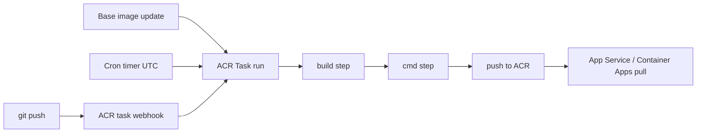

## What this covers

Azure Container Registry (ACR) Tasks run container builds and container commands inside Azure, so you don't need a local Docker engine or a separate build server. This page covers the three kinds of task: quick tasks, triggered tasks and multi-step YAML tasks. It also covers the triggers that start them automatically (source commit, base-image update, timer) and how to check what a run did.

**Exam weight:** Develop containerized solutions on Azure (20–25%)

**Skills measured**

- "Build and run images by using Azure Container Registry Tasks"
- "Build, store, version, and manage container images by using Azure Container Registry"

## Key concepts

### Quick task

`az acr build` works like `docker build` plus `docker push`, but it runs in the cloud. The CLI packs the build context (a local folder, a Git URL or a tarball), uploads it to the registry, builds it on an ACR-managed agent and pushes the result by default. Add `--no-push` to build without pushing. The default platform is `linux/amd64`. Use `--platform` for Windows or ARM, for example `--platform linux/arm64/v8`. The default run timeout is 3,600 seconds (`--timeout`).

`az acr run` is the matching quick command for a **multi-step YAML file** (`-f acr-task.yaml`) or a single container command (`--cmd`). It does not save a task resource.

### Saved task

`az acr task create` saves a task resource in the registry. Its context must be a Git repository (GitHub or Azure Repos), a remote tarball, an OCI artifact, or `/dev/null` when the task has no source. A saved task can't use a local folder as its context. You can run it on demand with `az acr task run` or start it with triggers.

### Triggers

| Trigger | Default on `az acr task create` | Notes |
|---------|---------------------------------|-------|
| Source commit | Enabled | Needs a PAT so ACR can add a webhook to the repo (GitHub private repo: `repo` scope) |
| Pull request | Disabled | `--pull-request-trigger-enabled true` |
| Base image update | Enabled (`--base-image-trigger-enabled`) | The task must run once first so ACR can discover the base image |
| Timer | None until you add `--schedule` | 5-field cron in **UTC**. You can add several timers |

Base-image tracking works for images in the same ACR, in another ACR (any region), and in public Docker Hub or MCR repos. An update to a base image in ACR starts a run **immediately**. For public base images, ACR polls at a random interval of **10–60 minutes**. Only the final (runtime) stage's base image is tracked, not intermediate build stages, and the base image must keep a stable tag such as `python:3.12-slim`.

### Multi-step YAML

A multi-step file (`version: v1.1.0`) lists `steps`. Each step is a `build`, `push` or `cmd`, with optional `id`, `when` (dependencies), `timeout` and `env`. Steps run in order unless `when` sets up parallel branches. Run variables such as `{{.Run.ID}}` and the `$Registry` alias give you unique, traceable tags.

## How it works



When you start a run manually, its log streams to your console. Triggered runs only store their logs, which you read with `az acr task logs` or in the portal under **Tasks > Runs**.

## Hands-on

### Azure portal

1. Open the registry and select **Services > Tasks**.
2. Select a task to see its triggers, then select **Run** to start it manually.
3. Open the **Runs** tab and select a run ID to read its log (each step's output, image digests, and the trigger type).
4. Under **Services > Repositories**, confirm the new tag (for example the run ID) was pushed.

### Azure CLI

Quick build and push (from the Quote API project):

```bash
az acr build --registry quoteapiacr --image quote-api:{{.Run.ID}} --image quote-api:latest .
```

Run the multi-step file once without saving a task:

```bash
az acr run --registry quoteapiacr --file acr-task.yaml .
```

Example `acr-task.yaml`:

```yaml
version: v1.1.0
steps:
  - id: build
    build: -t $Registry/quote-api:{{.Run.ID}} -t $Registry/quote-api:latest .
  - id: smoke
    cmd: $Registry/quote-api:{{.Run.ID}} python -c "import app.main"
    when: ["build"]
  - push:
      - $Registry/quote-api:{{.Run.ID}}
      - $Registry/quote-api:latest
```

Saved task triggered by commits to `main`. Base-image triggers are on by default:

```bash
az acr task create \
  --registry quoteapiacr \
  --name quote-api-build \
  --context https://github.com/<org>/<repo>.git#main \
  --file acr-task.yaml \
  --git-access-token <github-pat> \
  --commit-trigger-enabled true
```

Add a nightly timer, run the task once so base-image dependencies are recorded, then check the runs:

```bash
az acr task timer add --registry quoteapiacr --name quote-api-build \
  --timer-name nightly --schedule "0 2 * * *"
az acr task run --registry quoteapiacr --name quote-api-build
az acr task list-runs --registry quoteapiacr --name quote-api-build -o table
az acr task logs --registry quoteapiacr --run-id <run-id>
```

A scheduled task that only runs a container, with no source:

```bash
az acr task create --registry quoteapiacr --name purge-old \
  --cmd "acr purge --filter 'quote-api:.*' --ago 30d --untagged" \
  --schedule "0 3 * * Sun" --context /dev/null
```

### Python

```python
from azure.identity import DefaultAzureCredential
from azure.mgmt.containerregistry import ContainerRegistryManagementClient

client = ContainerRegistryManagementClient(DefaultAzureCredential(), "<subscription-id>")

for run in client.runs.list("<resource-group>", "quoteapiacr", top=5):
    print(run.run_id, run.status, run.trigger, run.create_time)
```

## Exam traps

| Need | Use |
|------|-----|
| One-off cloud build of a Dockerfile, no local Docker | `az acr build` |
| Run a multi-step YAML once | `az acr run -f acr-task.yaml` |
| Rebuild on every commit | `az acr task create` with a Git context and PAT |
| Rebuild when the OS/runtime base image is patched | Base-image trigger (default on) |
| Nightly or weekly job (purge, tests) | `--schedule` / `az acr task timer add` (UTC cron) |

> [!WARNING]
> **Exam trap:** `az acr build -f` points at a **Dockerfile**, not a multi-step YAML. Multi-step files run with `az acr run -f` or a saved `az acr task create -f`.

> [!WARNING]
> **Exam trap:** A base-image trigger does nothing until the task has run once, and it won't fire if the base image moves to a new version tag instead of updating a stable tag.

> [!TIP]
> Quick = `build`/`run`, saved = `task create`, automatic = commit, base image, timer.

> [!NOTE]
> Anything you pass on the command line, such as a PAT, can end up in ACR diagnostic traces. Use task credentials or a managed identity (`--assign-identity`) where you can.

## Quick review

- `az acr build` uploads the context, builds in Azure and pushes by default (`--no-push` to skip).
- The default build platform is linux/amd64. Use `--platform` for Windows or ARM.
- Commit triggers are on by default. Pull-request triggers are off.
- Base-image updates in ACR trigger immediately. Public base images are polled every 10–60 minutes.
- Timer cron has 5 fields and runs in UTC. A task can have several timers.
- Multi-step YAML steps are `build`, `push` and `cmd`, with `when` for dependencies.
- Manual runs stream logs. Triggered runs only store them (`az acr task logs`).

## Practice

- [Practice: ACR Tasks questions](/practice/acr-tasks)
- [Practice: Azure Container Registry questions](/practice/acr-images)

## Official references

- [ACR Tasks overview](https://learn.microsoft.com/azure/container-registry/container-registry-tasks-overview)
- [Base image updates for ACR Tasks](https://learn.microsoft.com/azure/container-registry/container-registry-tasks-base-images)
- [Run an ACR task on a schedule](https://learn.microsoft.com/azure/container-registry/container-registry-tasks-scheduled)
- [ACR Tasks YAML reference](https://learn.microsoft.com/azure/container-registry/container-registry-tasks-reference-yaml)
- [AI-200 study guide](https://learn.microsoft.com/credentials/certifications/resources/study-guides/ai-200)
