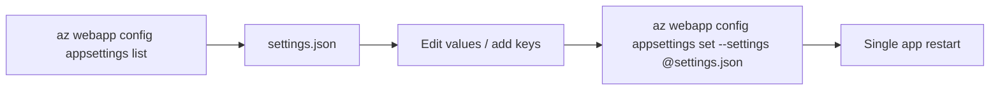

## What this covers

When a containerized app needs dozens of settings, typing one `--settings KEY=value` pair at a time is slow and easy to get wrong. App Service lets you work with the whole set as JSON: export it, edit it, and import it back. You can do this in the Azure CLI with an `@file` argument or in the portal with **Advanced edit**. This page covers the JSON shape, the merge behavior, and how the `slotSetting` flag fits in.

**Exam weight:** Develop containerized solutions on Azure (20–25%)

**Skills measured**

- "Deploy containers to Azure App Service, including configuring App Service to supply environment variables and secrets"

## Key concepts

### The JSON shape

`az webapp config appsettings list` returns an **array** of objects. Each object has three properties:

| Property | Meaning |
|----------|---------|
| `name` | Environment variable name |
| `value` | Value injected into the container |
| `slotSetting` | `true` keeps the value with the current deployment slot during a swap |

The same array shape works for import. The CLI also accepts a simple `{"KEY": "value"}` object, but that form can't set `slotSetting`.

### The `@` prefix

The Azure CLI reads an argument's value from a file when the value starts with `@`. So `--settings @settings.json` loads the file instead of parsing `KEY=value` pairs.

### Merge vs replace

- **CLI `appsettings set`** merges. Settings in the file are added or updated, and settings not in the file are left alone. To remove a setting, use `az webapp config appsettings delete --setting-names`.
- **Portal Advanced edit** shows the full list. Deleting an entry from the JSON and selecting **OK** then **Apply** removes it.

Either way, saving restarts the app once, not once per setting. That is another reason to batch changes, for example when you add twenty feature flags to an AI orchestration service in one pass.

## How it works



## Hands-on

### Azure portal

1. Open the web app and select **Settings** > **Environment variables**.
2. On the **App settings** tab, select **Advanced edit**.
3. Edit the JSON array. Add objects, change values, or set `"slotSetting": true`.
4. Select **OK**, then **Apply**, and confirm the restart.

### Azure CLI

Export the current settings:

```bash
az webapp config appsettings list \
  --resource-group myResourceGroup \
  --name myDocumentProcessor \
  --output json > settings.json
```

Exported shape:

```json
[
  {
    "name": "STORAGE_ACCOUNT_NAME",
    "value": "mystorageaccount",
    "slotSetting": false
  },
  {
    "name": "LOG_LEVEL",
    "value": "INFO",
    "slotSetting": false
  }
]
```

Import the updated file:

```bash
az webapp config appsettings set \
  --resource-group myResourceGroup \
  --name myDocumentProcessor \
  --settings @settings.json
```

Clone production settings into a staging slot:

```bash
az webapp config appsettings list -g myResourceGroup -n myDocumentProcessor -o json > prod.json
# edit prod.json: change endpoints, set slotSetting where needed
az webapp config appsettings set -g myResourceGroup -n myDocumentProcessor \
  --slot staging --settings @prod.json
```

### Python

Load a JSON file and apply it in one call. The SDK replaces the whole collection, so merge with the current values first:

```python
import json
from azure.identity import DefaultAzureCredential
from azure.mgmt.web import WebSiteManagementClient

client = WebSiteManagementClient(DefaultAzureCredential(), "<subscription-id>")
current = client.web_apps.list_application_settings("<resource-group>", "<app-name>")

with open("settings.json") as f:
    for item in json.load(f):
        current.properties[item["name"]] = item["value"]

client.web_apps.update_application_settings("<resource-group>", "<app-name>", current)
```

## Exam traps

| Task | Best option |
|------|-------------|
| Change one or two values | `az webapp config appsettings set --settings KEY=value` |
| Apply many values from a file | `--settings @settings.json` |
| Review and edit everything visually | Portal **Advanced edit** |
| Keep a value pinned to a slot | `"slotSetting": true` in JSON, or `--slot-settings` on the CLI |
| Remove a setting | `az webapp config appsettings delete --setting-names <name>` |

> [!WARNING]
> **Exam trap:** Without the `@`, `--settings settings.json` is read as a malformed `KEY=value` pair, not as a file. The `@` prefix is what tells the CLI to read the file.

> [!WARNING]
> **Exam trap:** `slotSetting` in the exported JSON is the same flag as **Deployment slot setting** in the portal. It decides whether the value stays with the slot or moves during a swap. See [Slot settings](/study/implement-container-application-hosting-on-azure/slot-settings).

> [!NOTE]
> Exported files contain values in clear text, including any secret you stored directly. Keep templates such as `settings.dev.json` free of secrets, or use Key Vault references, before checking them in.

## Quick review

- Export with `az webapp config appsettings list --output json > settings.json`.
- Import with `az webapp config appsettings set --settings @settings.json`.
- Each entry has `name`, `value` and `slotSetting`.
- The CLI merges; settings left out of the file are not deleted.
- In the portal, use **Environment variables** > **Advanced edit**.
- One bulk save means one app restart.

## Practice

[Practice: App Service container questions](/practice/app-service-containers)

## Official references

- [Deploy containers to Azure App Service: configure application settings (Learn unit)](https://learn.microsoft.com/en-us/training/modules/deploy-containers-azure-app-service/4-configure-settings)
- [Configure an App Service app: edit app settings in bulk](https://learn.microsoft.com/en-us/azure/app-service/configure-common)
- [az webapp config appsettings](https://learn.microsoft.com/en-us/cli/azure/webapp/config/appsettings)
- [AI-200 study guide](https://learn.microsoft.com/en-us/credentials/certifications/resources/study-guides/ai-200)
