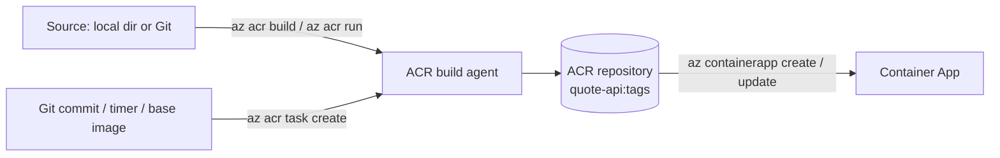

## What this covers

This is the command cheat sheet for the Quote API project. It groups the local Docker commands, the Azure Container Registry commands that build, store and version the image, the ACR Tasks commands that automate builds, and the Azure Container Apps commands that run it. Use it as a lookup while you work through the project. The exam tests which command fits which job, so the comparison table under Exam traps is the part to memorize.

**Exam weight:** Develop containerized solutions on Azure (20–25%)

**Skills measured**

- "Build, store, version, and manage container images by using Azure Container Registry"
- "Build and run images by using Azure Container Registry Tasks"

## Key concepts

### Three ways to build in ACR

| Command | Kind | Input | Saved? |
|---------|------|-------|--------|
| `az acr build` | Quick task | A `Dockerfile` plus a build context | No, runs once |
| `az acr run` | Quick multi-step run | A task YAML file (or `--cmd`) | No, runs once |
| `az acr task create` | Saved task | A Dockerfile or YAML plus a **Git or OCI context** | Yes, can run on triggers |

### Task triggers

- **Source commit** (on by default when the context is a GitHub or Azure Repos URL) and **pull request** (off by default). Both need a personal access token so ACR can create the webhook.
- **Base image update**: rebuilds the app image when its base image is updated in ACR or a public registry.
- **Timer**: one or more cron schedules in UTC (`--schedule`).

### Image versioning

Push a unique tag (a version or the run ID) for every build and treat `latest` as a convenience alias. `az acr repository show-tags` and `az acr repository show-manifests` show what is stored.

## How it works



## Hands-on

### Azure portal

1. In the registry, open **Services** > **Repositories** to browse images and tags.
2. Open **Services** > **Tasks** to see saved tasks; the **Runs** tab lists every run with its logs.
3. In the container app, open **Monitoring** > **Log stream** to watch the running API.

### Azure CLI

**Local**

| Command | Description |
|---------|-------------|
| `uvicorn app.main:app --reload --port 8000` | Run the API locally |
| `docker compose up --build` | Run with Docker Compose |
| `docker build -t quote-api:local .` | Build the image locally |
| `python -m flake8 app/` | Lint the code |

**Login and resources**

| Command | Description |
|---------|-------------|
| `az login` | Sign in to Azure |
| `az account set -s "Subscription Name"` | Select a subscription |
| `az group create -n quote-api-rg -l eastus` | Create the resource group |
| `az group delete -n quote-api-rg --yes` | Delete the resource group and everything in it |

**Container Registry**

| Command | Description |
|---------|-------------|
| `az acr create -g quote-api-rg -n quoteapiacr --sku Basic --admin-enabled true` | Create the registry (admin user on for the lab only) |
| `az acr login -n quoteapiacr` | Log the local Docker client into ACR |
| `az acr build -r quoteapiacr -t quote-api:latest .` | Quick task: cloud build and push |
| `az acr run -r quoteapiacr -f acr-task.yaml .` | Multi-step run (lint + build + push) |
| `az acr repository list -n quoteapiacr -o table` | List repositories |
| `az acr repository show-tags -n quoteapiacr --repository quote-api` | List image tags |

**ACR Tasks**

| Command | Description |
|---------|-------------|
| `az acr task create -n quote-api-build -r quoteapiacr -f acr-task.yaml --context <git-url> --git-access-token <pat>` | Create a saved task |
| `az acr task run -n quote-api-build -r quoteapiacr` | Run a task manually |
| `az acr task list -r quoteapiacr -o table` | List all tasks |
| `az acr task logs -r quoteapiacr --run-id <id>` | View a run's logs |
| `az acr task delete -n quote-api-build -r quoteapiacr --yes` | Delete a task |

GitHub-triggered task (builds on every commit to `main`):

```bash
az acr task create \
  -n quote-api-github-build \
  -r quoteapiacr \
  -f acr-task.yaml \
  --context https://github.com/YOUR-ORG/YOUR-REPO.git#main \
  --git-access-token YOUR_GITHUB_PAT \
  --commit-trigger-enabled true
```

Scheduled task (nightly at 2 AM UTC, no commit trigger):

```bash
az acr task create \
  -n quote-api-nightly \
  -r quoteapiacr \
  -f acr-task.yaml \
  --context https://github.com/YOUR-ORG/YOUR-REPO.git#main \
  --git-access-token YOUR_GITHUB_PAT \
  --commit-trigger-enabled false \
  --schedule "0 2 * * *"
```

**Container Apps**

| Command | Description |
|---------|-------------|
| `az containerapp env create -n quote-api-env -g quote-api-rg -l eastus` | Create the environment |
| `az containerapp show -n quote-api -g quote-api-rg --query properties.configuration.ingress.fqdn -o tsv` | Get the app URL |
| `az containerapp update -n quote-api -g quote-api-rg --image quoteapiacr.azurecr.io/quote-api:latest` | Deploy a new image (creates a new revision) |
| `az containerapp logs show -n quote-api -g quote-api-rg` | View app console logs (`--follow` to stream) |

**API endpoints**

| Method | Endpoint | Description |
|--------|----------|-------------|
| GET | `/` | Welcome message |
| GET | `/quotes` | List all quotes |
| GET | `/quotes/random` | Random quote |
| POST | `/quotes` | Create a quote |
| DELETE | `/quotes/{id}` | Delete a quote |
| GET | `/health` | Health check |
| GET | `/docs` | Swagger UI |

### Python

Smoke-test the deployed API after a build:

```python
import requests

base = "https://<container-app-fqdn>"
assert requests.get(f"{base}/health", timeout=10).status_code == 200
print(requests.get(f"{base}/quotes/random", timeout=10).json())
```

## Exam traps

| Requirement | Command |
|-------------|---------|
| Build a Dockerfile in Azure without local Docker | `az acr build` |
| Run a multi-step YAML once | `az acr run -f <file>.yaml` |
| Rebuild on every Git commit | `az acr task create --context <git-url> --git-access-token` |
| Rebuild nightly | `az acr task create --schedule "<cron>"` |
| Push from a local Docker build | `az acr login`, then `docker push` |

> [!WARNING]
> **Exam trap:** `az acr build -f` points at a **Dockerfile**. Passing a multi-step task YAML there fails. Use `az acr run -f acr-task.yaml` instead.

> [!WARNING]
> **Exam trap:** A saved task (`az acr task create`) cannot use a local folder as its context. It needs a Git URL, an OCI artifact (`oci://...`) or `/dev/null` with an inline command.

> [!NOTE]
> Manually started runs stream logs to your console. Triggered runs only store logs, so use `az acr task logs --run-id` or the portal **Runs** tab.

> [!TIP]
> Cron schedules in ACR Tasks are always UTC.

## Quick review

- `az acr build` = quick task from a Dockerfile; `az acr run` = one-off multi-step YAML.
- `az acr task create` saves a task with commit, base-image or timer triggers.
- Commit triggers are on by default for Git contexts and need a PAT.
- `az acr task logs --run-id` retrieves logs for triggered runs.
- `az acr repository show-tags` lists the versions you have stored.
- `az containerapp update --image` deploys a new image as a new revision.

## Practice

- [Practice: Azure Container Registry image questions](/practice/acr-images)
- [Practice: ACR Tasks questions](/practice/acr-tasks)

## Official references

- [Project repository (azure-contianers)](https://github.com/Suralmk/azure-contianers)
- [Automate container builds with ACR Tasks](https://learn.microsoft.com/en-us/azure/container-registry/container-registry-tasks-overview)
- [Run an ACR task on a schedule](https://learn.microsoft.com/en-us/azure/container-registry/container-registry-tasks-scheduled)
- [az acr task](https://learn.microsoft.com/en-us/cli/azure/acr/task)
- [az containerapp](https://learn.microsoft.com/en-us/cli/azure/containerapp)
- [AI-200 study guide](https://learn.microsoft.com/en-us/credentials/certifications/resources/study-guides/ai-200)
