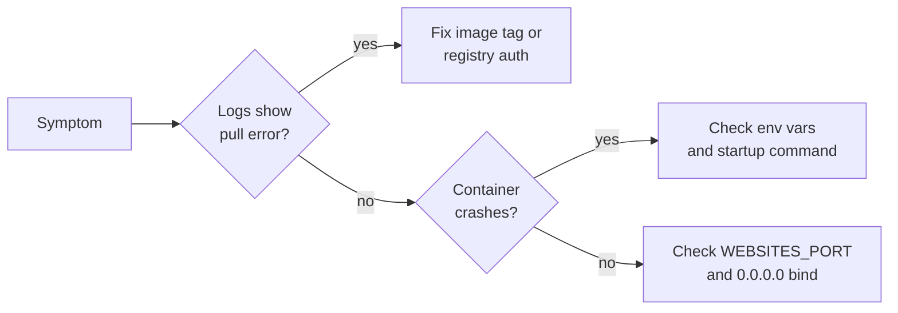

## What this covers

Most failed container deployments on App Service fall into a handful of patterns. If you know them, you troubleshoot faster in labs and answer scenario questions on the exam more easily. Use the same loop every time: **symptom → diagnose with logs and Kudu → map to a likely cause → apply the fix**. This page lists the patterns, the tool that confirms each one, and the fix.

**Exam weight:** Develop containerized solutions on Azure (20–25%)

**Skills measured**

- "Deploy containers to Azure App Service, including configuring App Service to supply environment variables and secrets"

## Key concepts

### First checks by symptom

| Issue | First checks |
|-------|--------------|
| Container won't start | Log stream, image name/tag and pull credentials, local run with the same config |
| Container runs but site fails or returns 404 | `WEBSITES_PORT`, bind to `0.0.0.0` (not localhost), routes |
| Missing env vars | Settings saved? Kudu **Environment**? Typos in names? |
| Slow cold starts | Image size, startup time in logs, **Always On** |
| Image pull fails | Tag exists, `AcrPull` role or admin credentials, network access to the registry |

### Settings to remember

- **`WEBSITES_PORT`** must match the port your container listens on (App Service assumes 80 otherwise).
- **Bind address** must be `0.0.0.0`, not `127.0.0.1` or `localhost`.
- **`WEBSITES_CONTAINER_START_TIME_LIMIT`** sets how long App Service waits for the container to answer its first HTTP ping (default 230 seconds, maximum 1800).
- **Logging**: enable filesystem container logging, use log stream, and verify settings in Kudu.

### Tools

| Tool | Answers |
|------|---------|
| [Log stream](/study/implement-container-application-hosting-on-azure/stream-container-logs) (`az webapp log tail`) | What is the container printing right now? |
| [Filesystem logs](/study/implement-container-application-hosting-on-azure/configure-container-logs) (`/home/LogFiles`) | What happened before it crashed? |
| [Kudu](/study/implement-container-application-hosting-on-azure/diagnostic-console-kudu) `/Env` | Which settings were really injected? |
| Diagnose and solve problems (portal) | Platform-detected issues such as failed pulls and restarts |

## How it works



### Container fails to start

- **Symptoms:** The URL returns an error page, and the logs show startup failures or a restart loop.
- **Diagnosis:** Read the log stream for application errors. Verify the **image exists** in the registry and that **pull credentials** work. Run the container **locally** with the same environment variables.
- **Common causes:** A required environment variable is missing at startup. `WEBSITES_PORT` doesn't match the listening port. The app crashes during init because of missing dependencies or a bad startup command.
- **Use case:** An AI document processor image deploys but crashes immediately, and the stream shows `AZURE_STORAGE_CONNECTION_STRING` is missing. Fix: add the app setting (or a Key Vault reference), let the app restart, and check the stream again.

### 404 or no response after deployment

- **Symptoms:** The container appears to start, but HTTP requests return **404 Not Found**, time out, or return an application error.
- **Diagnosis:** Verify that `WEBSITES_PORT` matches the listening port. Confirm the app binds to **`0.0.0.0`**. Confirm it serves the **root path** or the routes you're calling.
- **Common causes:** Listening on localhost only, so App Service can't reach the process. Wrong port configuration. Routing not configured for the expected paths.
- **Use case:** A Flask or FastAPI container listens on `127.0.0.1:8000`. The platform's warm-up ping can't connect, so the logs say the container didn't respond to HTTP pings, and the site fails or returns 404-style errors. Fix: listen on `0.0.0.0:8000` and set `WEBSITES_PORT=8000`.

### Missing environment variables

- **Symptoms:** Logs show errors about missing configuration or undefined values.
- **Diagnosis:** Verify the app settings were **saved** in the portal or CLI. Check the Kudu **Environment** page to confirm they were injected. If SSH output looks incomplete, trust the SCM `/Env` view, because a shell session may not inherit every variable.
- **Common causes:** Settings were edited but not saved. Typos in setting names. The app reads variables before they are available (bad startup order). A Key Vault reference that failed to resolve.
- **Use case:** The portal showed a new setting in the draft list, but **Apply** was never selected. Kudu Environment doesn't list the key. After saving and restarting, the variable appears and the app starts cleanly.

### Slow cold starts

- **Symptoms:** The first requests after an idle period take much longer than later ones.
- **Diagnosis:** Check the **image size** (`docker images`). Review **startup time** in the logs. Check the **Always On** setting.
- **Solutions:** Enable **Always On** (Basic tier or higher) to keep the app warm. Reduce the image size with smaller base images and multi-stage builds. Defer heavy initialization, such as lazy-loading models or warming up after the app is ready.
- **Use case:** An LLM wrapper container is 4 GB and takes 45 seconds to load weights on the first request after idle. Mitigation: a smaller image, Always On on a non-free plan, an optional warm-up endpoint, and a higher `WEBSITES_CONTAINER_START_TIME_LIMIT` if startup exceeds 230 seconds.

## Hands-on

### Azure portal

1. Open the web app and select **Diagnose and solve problems**. Run the container-related detectors.
2. Open **Monitoring** > **Log stream** and restart the app to watch the startup sequence.
3. Open **Development Tools** > **Advanced Tools** > **Go** (Kudu), then open **Environment** to confirm the settings.

### Azure CLI

Troubleshooting cheat sheet:

```bash
# Persist container logs
az webapp log config \
  --resource-group myResourceGroup \
  --name myDocumentProcessor \
  --docker-container-logging filesystem

# Live diagnosis
az webapp log tail \
  --resource-group myResourceGroup \
  --name myDocumentProcessor

# Fix the two most common causes
az webapp config appsettings set -g myResourceGroup -n myDocumentProcessor \
  --settings WEBSITES_PORT=8000 WEBSITES_CONTAINER_START_TIME_LIMIT=600
az webapp config set -g myResourceGroup -n myDocumentProcessor --always-on true
```

Then open Kudu and check **Environment** and `/home/LogFiles/`:

```text
https://<app-name>.scm.azurewebsites.net
```

### Python

Bind correctly in the container itself:

```python
import os
import uvicorn

if __name__ == "__main__":
    # 0.0.0.0 so App Service can reach the process; port matches WEBSITES_PORT
    uvicorn.run("app.main:app", host="0.0.0.0", port=int(os.environ.get("PORT", 8000)))
```

## Exam traps

| Symptom | Most likely fix |
|---------|-----------------|
| "Didn't respond to HTTP pings on port 80" | Set `WEBSITES_PORT` and bind `0.0.0.0` |
| Pull fails with unauthorized | Grant `AcrPull`, or enable admin user and set credentials |
| Large model image times out on start | Raise `WEBSITES_CONTAINER_START_TIME_LIMIT`, shrink the image |
| First request after idle is slow | Always On (Basic+) |
| App says a setting is missing | Save the setting; check Kudu `/Env` |

> [!WARNING]
> **Exam trap:** Binding to `localhost` is a classic distractor. The container runs fine locally but is unreachable on App Service.

> [!WARNING]
> **Exam trap:** "Container started but returns 404" and "image pull failed" are different problems. A pull failure never reaches your app code, so app logs are empty and the platform logs show the registry error.

> [!TIP]
> Map each tool to its job: **stream** = live, **filesystem logs** = persisted, **Kudu** = environment and files.

> [!NOTE]
> Always On improves cold-start latency, but it doesn't fix an oversized image or slow initialization.

## Quick review

- Port problems almost always mean `WEBSITES_PORT` or the bind address.
- Bind to `0.0.0.0`, never `localhost`, inside a container.
- The default start time limit is 230 seconds; raise it with `WEBSITES_CONTAINER_START_TIME_LIMIT` (max 1800).
- Settings must be saved, which restarts the app, before they're injected.
- Kudu `/Env` shows what was actually injected.
- Always On needs Basic tier or higher and reduces cold starts.
- Pull failures point to the image tag, `AcrPull` or admin credentials.

## Practice

[Practice: App Service container questions](/practice/app-service-containers)

## Official references

- [Observe and troubleshoot containerized apps (Learn unit)](https://learn.microsoft.com/en-us/training/modules/deploy-containers-azure-app-service/5-observe-troubleshoot)
- [Configure a custom container](https://learn.microsoft.com/en-us/azure/app-service/configure-custom-container)
- [Troubleshoot HTTP 502 and 503 errors in App Service](https://learn.microsoft.com/en-us/azure/app-service/troubleshoot-http-502-http-503)
- [Configure common settings, including Always On](https://learn.microsoft.com/en-us/azure/app-service/configure-common)
- [AI-200 study guide](https://learn.microsoft.com/en-us/credentials/certifications/resources/study-guides/ai-200)
