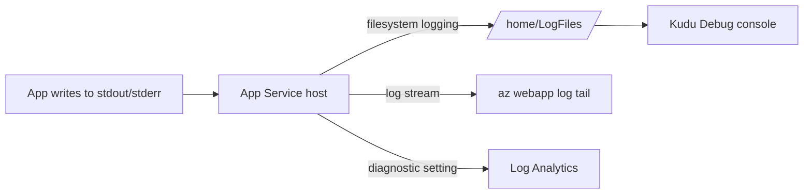

## What this covers

App Service captures everything your container writes to **stdout** and **stderr**: application logs, framework messages and error output. Turn on container logging to **persist** that output so you can read it later in the portal, the CLI or Kudu, not only while it streams. For long-term retention and KQL queries, add a diagnostic setting that sends the same output to Log Analytics. This page covers both levels.

**Exam weight:** Develop containerized solutions on Azure (20–25%)

**Skills measured**

- "Deploy containers to Azure App Service, including configuring App Service to supply environment variables and secrets"

## Key concepts

### What container logs capture

| Type | What you see |
|------|--------------|
| **Application output** | Messages your app writes to stdout |
| **Error output** | Exception traces and errors on stderr |
| **Framework logs** | Web server startup, request logs, framework diagnostics |
| **Platform messages** | App Service messages about container lifecycle events (pull, start, ping, stop) |

App Service doesn't create logs for you. If your app writes to a file inside the container, App Service won't see it. Send meaningful output to **stdout/stderr**. Most logging frameworks have a console handler that does this.

### Two levels of persistence

| Level | How | Retention | Query |
|-------|-----|-----------|-------|
| **Filesystem** | `az webapp log config --docker-container-logging filesystem` | Short term, files under `/home/LogFiles/` with a size quota | Read files, stream |
| **Azure Monitor** | Diagnostic setting to a Log Analytics workspace, storage account or Event Hubs | You set it | KQL |

Without filesystem logging enabled, you may get only limited live output. Filesystem logging is the switch the exam names.

### Log Analytics categories

| Category | Contents |
|----------|----------|
| `AppServiceConsoleLogs` | Container stdout and stderr |
| `AppServiceHTTPLogs` | HTTP requests and responses |
| `AppServicePlatformLogs` | Container lifecycle and platform events |
| `AppServiceAppLogs` | Application-level logs (when configured) |

## How it works



The `/home/LogFiles` folder persists across restarts when filesystem logging is on, even if `WEBSITES_ENABLE_APP_SERVICE_STORAGE` is off.

## Hands-on

### Azure portal

1. Open the web app and select **Monitoring** > **App Service logs**.
2. Set **Application logging** to **File System**, choose a quota (MB) and retention period (days), and select **Save**.
3. Open **Monitoring** > **Log stream** to watch live output.
4. For long-term retention, open **Monitoring** > **Diagnostic settings** > **Add diagnostic setting**. Tick `AppServiceConsoleLogs` and `AppServiceHTTPLogs` and send them to a Log Analytics workspace.

### Azure CLI

```bash
az webapp log config \
  --resource-group myResourceGroup \
  --name myDocumentProcessor \
  --docker-container-logging filesystem
```

After enabling:

- Browse persisted logs at `/home/LogFiles/` in the Kudu Debug console.
- Stream live logs with `az webapp log tail` or the portal **Log stream**.
- Download everything as a ZIP with `az webapp log download --resource-group myResourceGroup --name myDocumentProcessor`.

Send logs to Log Analytics:

```bash
resourceId=$(az webapp show -g myResourceGroup -n myDocumentProcessor --query id -o tsv)
workspaceId=$(az monitor log-analytics workspace show -g myResourceGroup \
  -n myLogAnalyticsWorkspace --query id -o tsv)

az monitor diagnostic-settings create \
  --resource "$resourceId" \
  --name myDiagnosticSettings \
  --workspace "$workspaceId" \
  --logs '[{"category":"AppServiceConsoleLogs","enabled":true},{"category":"AppServiceHTTPLogs","enabled":true}]'
```

Query recent errors:

```kql
AppServiceConsoleLogs
| where TimeGenerated > ago(1h)
| where Level == "Error"
| project TimeGenerated, ResultDescription
| order by TimeGenerated desc
```

### Python

Log to the console so App Service captures it:

```python
import logging
import sys

logging.basicConfig(
    stream=sys.stdout,
    level=logging.INFO,
    format="%(asctime)s %(levelname)s %(name)s %(message)s",
)
log = logging.getLogger("docprocessor")
log.info("model loaded")
log.error("inference failed: %s", "timeout")
```

## Exam traps

| Need | Use |
|------|-----|
| Keep crash evidence after the process died | Filesystem container logging |
| Watch startup in real time | Log stream / `az webapp log tail` |
| Query and alert on logs across days | Diagnostic setting to Log Analytics |
| Share logs with support | Kudu `/home/LogFiles/` download or `az webapp log download` |

> [!WARNING]
> **Exam trap:** Configuring logs (`az webapp log config`) is not the same as streaming them (`az webapp log tail`). Persisting is a one-time setting; streaming is a live session.

> [!WARNING]
> **Exam trap:** App Service only captures stdout and stderr. An app that writes to `/app/logs/app.log` produces nothing in the log stream.

> [!TIP]
> Remember the path `/home/LogFiles/` and the flag `--docker-container-logging filesystem`.

### Use cases

- **Persist crash evidence:** the app threw an exception overnight, and the filesystem logs are still there after the process died.
- **Startup diagnosis:** framework and platform lifecycle messages show whether the container pulled, started and began listening.
- **Shared troubleshooting:** download or browse `/home/LogFiles/` and share it with teammates or support.
- **AI workloads:** log model-load failures, missing env vars and inference errors to stdout so App Service captures them.

## Quick review

- App Service captures container stdout and stderr only.
- Enable persistence with `az webapp log config --docker-container-logging filesystem`.
- Persisted logs live under `/home/LogFiles/`.
- Stream live with `az webapp log tail` or the portal Log stream.
- `AppServiceConsoleLogs` is the Log Analytics table for container output.
- Use a diagnostic setting for long retention and KQL queries.

## Practice

[Practice: App Service container questions](/practice/app-service-containers)

## Official references

- [Observe and troubleshoot containerized apps (Learn unit)](https://learn.microsoft.com/en-us/training/modules/deploy-containers-azure-app-service/5-observe-troubleshoot)
- [Enable diagnostic logging for apps in App Service](https://learn.microsoft.com/en-us/azure/app-service/troubleshoot-diagnostic-logs)
- [Configure a custom container: access diagnostic logs](https://learn.microsoft.com/en-us/azure/app-service/configure-custom-container)
- [AI-200 study guide](https://learn.microsoft.com/en-us/credentials/certifications/resources/study-guides/ai-200)
