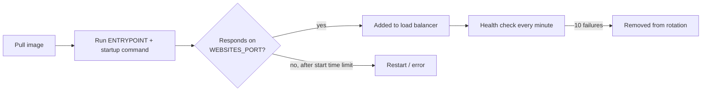

## What this covers

Runtime settings control how App Service runs your container: the startup command, the port it forwards traffic to, whether files survive a restart, whether the app is kept warm, and how unhealthy instances are detected. Getting these right means the container starts reliably and stays healthy under load. Each one is a single CLI flag or app setting, and the exam expects you to know the exact names.

**Exam weight:** Develop containerized solutions on Azure (20–25%)

**Skills measured**

- "Deploy containers to Azure App Service, including configuring App Service to supply environment variables and secrets"

## Key concepts

| Setting | Key fact |
|---------|----------|
| Startup command | `--startup-file` overrides the Dockerfile **CMD**; ENTRYPOINT is unchanged |
| Port | `WEBSITES_PORT` when the container doesn't listen on 80; TLS ends at the front end; **one** HTTP port only |
| Persistent storage | `WEBSITES_ENABLE_APP_SERVICE_STORAGE=true` makes `/home` persistent and shared across instances |
| Always On | Keeps the app warm; needs **Basic** tier or higher; avoids cold starts after about 20 minutes idle |
| Health check | Path that returns 200; pinged every minute; an instance is pulled from rotation after repeated failures (default 10) |

### Startup command

App Service normally runs the image's ENTRYPOINT and CMD. A custom startup command is useful to:

- Pass environment-specific arguments
- Run database migrations before the app starts
- Start more than one process
- Override framework defaults

The startup command **replaces CMD**. ENTRYPOINT stays as built into the image. Use `/bin/bash -c '...'` when you need shell features such as `&&`.

### Port

The Learn module says App Service routes automatically when the container listens on **80** or **8080**. The custom container docs describe **80** as the assumed default. The safe rule: if the port isn't 80, set `WEBSITES_PORT`. HTTPS is terminated by the platform front end, so the container always receives plain HTTP. Only **one** HTTP port can be exposed. Bind to **`0.0.0.0`**, not localhost.

| Framework | Default port | Setting |
|-----------|--------------|---------|
| Node.js (Express) | 3000 | `WEBSITES_PORT=3000` |
| Python (Gunicorn) | 8000 | `WEBSITES_PORT=8000` |
| Java (Spring Boot) | 8080 | `WEBSITES_PORT=8080` |
| ASP.NET Core (before .NET 8) | 80 | Usually none needed |
| ASP.NET Core (.NET 8+ official images) | 8080 | `WEBSITES_PORT=8080` to be explicit |

### Persistent storage

By default, writes to the container file system are **ephemeral**: they're lost on restart or when the app moves to another host. App Service storage at `/home` is **off by default for Linux custom containers** (on by default for Windows containers). With `WEBSITES_ENABLE_APP_SERVICE_STORAGE=true`:

- `/home` survives restarts.
- All scaled-out instances share the same `/home`.
- `/home/LogFiles` holds container and app logs.

Write persistent output under `/home` (for example `/home/output/`). The quota belongs to the **App Service plan** and is shared by every app in it. For large or high-I/O data, mount Azure Storage (Azure Files or Blob) as a path instead.

### Always On

After about **20 minutes** without traffic an app can be unloaded, and the next request triggers a **cold start** that can take seconds or minutes for large images. Always On sends periodic requests to keep it loaded. It requires **Basic** tier or higher. Use it for latency-sensitive production apps, long startups or large images, and background processes or long-lived connections.

### Health check

App Service pings a path on each instance about **every minute**. A healthy response is any **2xx**. After repeated failures (default **10**, adjustable with `WEBSITE_HEALTHCHECK_MAXPINGFAILURES` between 2 and 10), the instance is removed from the load balancer. If it stays unhealthy for an hour, it's replaced. Removal only happens when the app runs on two or more instances. Changing the health check configuration **restarts** the app.

## How it works



## Hands-on

### Azure portal

1. **Settings** > **Configuration** > **General settings**: set **Startup Command** and turn **Always on** to **On**.
2. **Settings** > **Environment variables**: add `WEBSITES_PORT` and `WEBSITES_ENABLE_APP_SERVICE_STORAGE`.
3. **Monitoring** > **Health check**: enable it, enter `/health`, and save (the app restarts).

### Azure CLI

```bash
# Startup command (replaces CMD)
az webapp config set \
  --resource-group myResourceGroup \
  --name myDocumentProcessor \
  --startup-file "gunicorn --bind=0.0.0.0:8000 --workers=4 app:application"

# Shell processing for chained commands
az webapp config set \
  --resource-group myResourceGroup \
  --name myDocumentProcessor \
  --startup-file "/bin/bash -c 'python migrate.py && gunicorn app:application'"

# Port and persistent storage
az webapp config appsettings set \
  --resource-group myResourceGroup \
  --name myDocumentProcessor \
  --settings WEBSITES_PORT=8000 WEBSITES_ENABLE_APP_SERVICE_STORAGE=true

# Always On (Basic tier or higher)
az webapp config set \
  --resource-group myResourceGroup \
  --name myDocumentProcessor \
  --always-on true

# Health check path
az webapp config set \
  --resource-group myResourceGroup \
  --name myDocumentProcessor \
  --generic-configurations '{"healthCheckPath": "/health"}'
```

### Python

A simple health endpoint:

```python
@app.route("/health")
def health_check():
    return {"status": "healthy"}, 200
```

A dependency-aware endpoint:

```python
@app.route("/health")
def health_check():
    try:
        db.execute("SELECT 1")
        storage.list_containers()
        return {"status": "healthy"}, 200
    except Exception as e:
        return {"status": "unhealthy", "error": str(e)}, 503
```

Set the same runtime options with the management SDK:

```python
from azure.identity import DefaultAzureCredential
from azure.mgmt.web import WebSiteManagementClient

client = WebSiteManagementClient(DefaultAzureCredential(), "<subscription-id>")
cfg = client.web_apps.get_configuration("<resource-group>", "<app-name>")
cfg.always_on = True
cfg.health_check_path = "/health"
cfg.app_command_line = "gunicorn --bind=0.0.0.0:8000 app:application"
client.web_apps.update_configuration("<resource-group>", "<app-name>", cfg)
```

## Exam traps

| Requirement | Setting |
|-------------|---------|
| Gunicorn listens on 8000 | `WEBSITES_PORT=8000` and bind `0.0.0.0` |
| Processed files must survive restarts and be shared | `WEBSITES_ENABLE_APP_SERVICE_STORAGE=true`, write to `/home` |
| Large or high-I/O data | Mount Azure Storage |
| No cold start after idle | Always On (Basic+) |
| Pull bad instances out of rotation | Health check path |
| Run migrations before the app | Startup command with `/bin/bash -c` |

> [!WARNING]
> **Exam trap:** The startup command replaces **CMD**, not ENTRYPOINT. If the image has an ENTRYPOINT, your command becomes its arguments.

> [!WARNING]
> **Exam trap:** The storage setting is `WEBSITES_ENABLE_APP_SERVICE_STORAGE` (with an S in WEBSITES). For Linux custom containers it defaults to off, so files written outside `/home` or a mount are lost.

> [!WARNING]
> **Exam trap:** Always On isn't available on the Free or Shared tiers.

> [!TIP]
> Health check on a single instance only reports. It can't remove the only instance from rotation, so scale out to at least two.

### Use cases

- Gunicorn on 8000: set `WEBSITES_PORT=8000` and bind `0.0.0.0`.
- A document processor writes results to `/home/output` with storage enabled.
- A production AI API enables Always On and a `/health` endpoint that checks the model loader is ready.

## Quick review

- `--startup-file` overrides CMD; ENTRYPOINT stays.
- Set `WEBSITES_PORT` when the container doesn't listen on 80; only one HTTP port.
- TLS is terminated at the front end; the container receives HTTP.
- `/home` is persistent and shared only with `WEBSITES_ENABLE_APP_SERVICE_STORAGE=true`.
- Always On needs Basic+ and prevents unloads after about 20 minutes idle.
- Health check pings every minute and removes an instance after 10 failures by default.
- Changing the health check path restarts the app.

## Practice

[Practice: App Service container questions](/practice/app-service-containers)

## Official references

- [Configure container runtime behavior (Learn unit)](https://learn.microsoft.com/en-us/training/modules/deploy-containers-azure-app-service/3-configure-runtime)
- [Configure a custom container](https://learn.microsoft.com/en-us/azure/app-service/configure-custom-container)
- [Monitor App Service instances by using Health check](https://learn.microsoft.com/en-us/azure/app-service/monitor-instances-health-check)
- [Configure common settings](https://learn.microsoft.com/en-us/azure/app-service/configure-common)
- [AI-200 study guide](https://learn.microsoft.com/en-us/credentials/certifications/resources/study-guides/ai-200)
