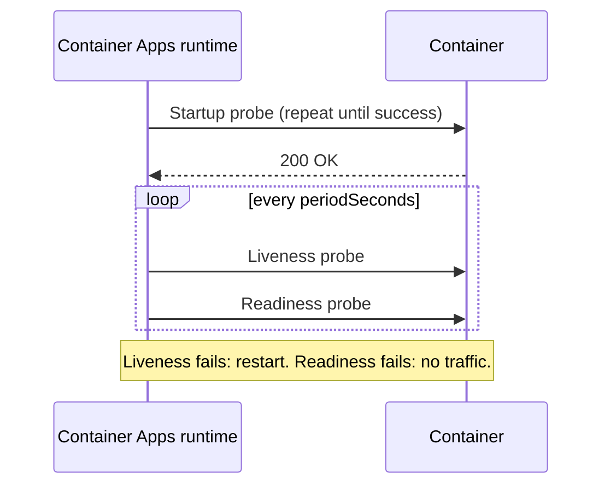

## What this covers

Azure Container Apps uses **health probes** to decide whether a replica has started, is still alive, and is ready for traffic. Badly tuned probes are a top cause of revisions that never become healthy or replicas that restart in a loop. That's especially true for AI services that load large models at startup. This page explains the three probe types, the defaults Container Apps adds, how to configure your own, and how to work out why a revision is failing.

**Exam weight:** Develop containerized solutions on Azure (20–25%)

**Skills measured**

- "Monitor and troubleshoot solutions on AKS and Container Apps by inspecting logs, events, and end-to-end connectivity"

## Key concepts

### Three probe types

| Probe | Question it answers | On failure |
|-------|---------------------|------------|
| **Startup** | Has the app finished starting? Liveness and readiness wait until it passes | Container restarted after `failureThreshold` |
| **Liveness** | Is the app still running and responsive? | Container restarted |
| **Readiness** | Can this replica take requests now? | Replica removed from ingress traffic; revision shows unhealthy |

### Transport and restrictions

- Probes use **HTTP(S)** (`httpGet`) or **TCP** (`tcpSocket`) only.
- `exec` and gRPC probes **aren't supported**. Ports must be integers (no named ports).
- Each container gets at most **one probe of each type**.
- An HTTP probe succeeds on a status code from **200 to 399**. Anything else is a failure.

### Defaults when ingress is enabled

If you enable ingress and don't define a probe type, the portal adds TCP probes on the ingress target port to the main container (not to sidecars, and not on GPU workload profiles):

| Probe | Defaults |
|-------|----------|
| Startup | TCP, timeout 3 s, period 1 s, initial delay 1 s, failure threshold 240 |
| Liveness | TCP on the target port |
| Readiness | TCP, timeout 5 s, period 5 s, initial delay 3 s, failure threshold 48 |

A TCP probe only proves the port is open. Use an HTTP probe when "healthy" depends on a database, a cache or a loaded model.

### Probe settings

`initialDelaySeconds`, `periodSeconds`, `timeoutSeconds`, `successThreshold` and `failureThreshold`. Roughly, the time a startup probe allows is `initialDelaySeconds + periodSeconds × failureThreshold`.

### Revisions and traffic

- In **single revision mode**, traffic moves to the new revision automatically once its readiness probe succeeds.
- In **multiple revision mode**, wait for readiness to succeed before you shift traffic weights.
- A revision shows **unhealthy** if any replica fails readiness, even when the others are fine.

## How it works



### Troubleshooting flow

1. **Revision status:** `az containerapp revision list` shows each revision's health and running state.
2. **Replica status:** `az containerapp replica list` shows restart counts and container state.
3. **System logs** (`--type system`) show probe failures, image pull errors and scaling events.
4. **Console logs** (`--type console`) show what the app printed: stack traces, missing settings, the port it bound to.
5. **Connectivity:** check that ingress `targetPort` matches the listening port. Then `az containerapp exec` into a replica and `curl` the dependency.

## Hands-on

### Azure portal

1. Open the container app and select **Application** > **Containers** > **Edit and deploy**.
2. Select the container, open the **Health probes** tab, and enable **Startup**, **Liveness** and **Readiness**. Choose HTTP or TCP, then enter the path, port, delay, period and failure threshold.
3. Select **Create** to deploy a new revision.
4. Open **Application** > **Revisions and replicas** to watch the revision's health. Open **Monitoring** > **Log stream** (System) to see probe failures.

### Azure CLI

Probe definition in YAML (apply with `az containerapp update --yaml app.yaml`):

```yaml
properties:
  template:
    containers:
      - name: quote-api
        image: quoteapiacr.azurecr.io/quote-api:v2
        probes:
          - type: Startup
            httpGet:
              path: /health
              port: 8000
            initialDelaySeconds: 5
            periodSeconds: 5
            failureThreshold: 60   # allows about 5 minutes to load a model
          - type: Liveness
            httpGet:
              path: /health
              port: 8000
            periodSeconds: 10
            failureThreshold: 3
          - type: Readiness
            tcpSocket:
              port: 8000
            periodSeconds: 5
            failureThreshold: 3
```

Troubleshooting commands:

```bash
az containerapp revision list -n quote-api -g quote-api-rg \
  --query "[].{name:name, health:properties.healthState, state:properties.runningState}" -o table

az containerapp replica list -n quote-api -g quote-api-rg --revision <revision-name> -o table

az containerapp logs show -n quote-api -g quote-api-rg --type system --follow
az containerapp logs show -n quote-api -g quote-api-rg --type console --tail 100

az containerapp revision restart -n quote-api -g quote-api-rg --revision <revision-name>
az containerapp exec -n quote-api -g quote-api-rg --command "/bin/sh"
```

When logs go to Log Analytics, query probe failures:

```kql
ContainerAppSystemLogs_CL
| where ContainerAppName_s == "quote-api"
| where Log_s has_any ("probe", "Unhealthy")
| project TimeGenerated, RevisionName_s, Log_s
| order by TimeGenerated desc
```

### Python

A FastAPI health endpoint for the probes, plus a script that reads revision health with the management SDK:

```python
from fastapi import FastAPI, Response

app = FastAPI()
model_ready = False  # set True after the model loads

@app.get("/health")
def health(response: Response):
    if not model_ready:
        response.status_code = 503
        return {"status": "loading"}
    return {"status": "ok"}
```

```python
from azure.identity import DefaultAzureCredential
from azure.mgmt.appcontainers import ContainerAppsAPIClient

client = ContainerAppsAPIClient(DefaultAzureCredential(), "<subscription-id>")
for rev in client.container_apps_revisions.list_revisions("<resource-group>", "quote-api"):
    print(rev.name, rev.health_state, rev.running_state, rev.replicas)
```

## Exam traps

| Situation | Fix |
|-----------|-----|
| Model takes minutes to load; container restarts in a loop | Add or lengthen a **startup** probe (raise `failureThreshold`) |
| Replica alive but its dependency is down; should get no traffic | **Readiness** probe that checks the dependency |
| Process hangs but doesn't exit | **Liveness** HTTP probe |
| Team wants an `exec` or gRPC probe | Not supported; use HTTP or TCP |
| New revision in multiple revision mode | Wait for readiness, then shift traffic |

> [!WARNING]
> **Exam trap:** A liveness probe that checks external dependencies can restart healthy containers whenever the database blips. Put dependency checks in **readiness**, and keep liveness about the process itself.

> [!WARNING]
> **Exam trap:** The probe port must be the port the container listens on. A probe on 80 while the app listens on 8000 fails every time, even though the app works.

> [!NOTE]
> App Service has a different feature, Health check (`healthCheckPath`). It removes instances from the load balancer after failed pings, but it has no startup, liveness or readiness split. See [Configure container runtime behavior](/study/implement-container-application-hosting-on-azure/configure-container-runtime-behavior).

> [!TIP]
> Startup = "give me time". Liveness = "restart me if I'm stuck". Readiness = "don't send me traffic yet".

## Quick review

- Container Apps supports startup, liveness and readiness probes, one of each per container.
- Probes are HTTP(S) or TCP only; no exec, no gRPC, numeric ports only.
- HTTP probes pass on status 200–399.
- With ingress on, default TCP probes target the ingress port (startup failure threshold 240, readiness 48).
- Failed liveness restarts the container; failed readiness stops traffic to the replica.
- `az containerapp logs show --type system` shows probe and pull failures.
- `az containerapp revision list` and `replica list` show health state and restarts.

## Practice

[Practice: Container troubleshooting questions](/practice/containers-troubleshoot)

## Official references

- [Health probes in Azure Container Apps](https://learn.microsoft.com/en-us/azure/container-apps/health-probes)
- [Troubleshoot container start failures in Azure Container Apps](https://learn.microsoft.com/en-us/azure/container-apps/troubleshoot-container-start-failures)
- [Log monitoring in Azure Container Apps](https://learn.microsoft.com/en-us/azure/container-apps/log-monitoring)
- [Revisions in Azure Container Apps](https://learn.microsoft.com/en-us/azure/container-apps/revisions)
- [AI-200 study guide](https://learn.microsoft.com/en-us/credentials/certifications/resources/study-guides/ai-200)
