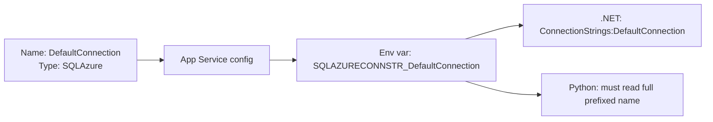

## What this covers

Connection strings are a special kind of App Service setting meant for database connectivity. They're stored and encrypted like app settings, but App Service adds a **type prefix** to the environment variable name when it injects them into the container. This page covers the prefixes, the CLI command, and the rule of thumb the exam tests: .NET apps can benefit from connection strings, while Python, Node.js and similar runtimes are simpler with plain app settings.

**Exam weight:** Develop containerized solutions on Azure (20–25%)

**Skills measured**

- "Deploy containers to Azure App Service, including configuring App Service to supply environment variables and secrets"

## Key concepts

### Type prefixes

| Type (`--connection-string-type`) | Env var prefix |
|-----------------------------------|----------------|
| SQL Server (`SQLServer`) | `SQLCONNSTR_` |
| SQL Azure (`SQLAzure`) | `SQLAZURECONNSTR_` |
| MySQL (`MySql`) | `MYSQLCONNSTR_` |
| PostgreSQL (`PostgreSQL`) | `POSTGRESQLCONNSTR_` |
| Custom (`Custom`) | `CUSTOMCONNSTR_` |

Example: name `DefaultConnection` with type `SQLAzure` becomes `SQLAZURECONNSTR_DefaultConnection`.

Other types exist for Azure services, such as `NotificationHub`, `ServiceBus`, `EventHub`, `ApiHub`, `DocDb` and `RedisCache`. The five above are the ones to memorize.

### Why .NET cares

ASP.NET Core's environment variable configuration provider recognizes these prefixes. It maps `SQLAZURECONNSTR_DefaultConnection` to `ConnectionStrings:DefaultConnection`, so `builder.Configuration.GetConnectionString("DefaultConnection")` just works. Other runtimes get no such mapping, so the prefix is only extra text to strip.

### Same security as app settings

Connection strings are encrypted at rest and shown as hidden values in the portal. They can also hold Key Vault references (`@Microsoft.KeyVault(...)`), and they can be marked as **deployment slot settings** so they don't move during a swap.

## How it works



## Hands-on

### Azure portal

1. Open the web app and select **Settings** > **Environment variables**.
2. Open the **Connection strings** tab and select **+ Add**.
3. Enter the **Name**, **Value** and **Type** (for example SQLAzure). Optionally tick **Deployment slot setting**.
4. Select **Apply** twice and confirm the restart.

### Azure CLI

```bash
az webapp config connection-string set \
  --resource-group myResourceGroup \
  --name myDocumentProcessor \
  --connection-string-type SQLAzure \
  --settings DefaultConnection="Server=myserver.database.windows.net;Database=mydb;..."

# List (values are returned, so treat output as sensitive)
az webapp config connection-string list \
  --resource-group myResourceGroup --name myDocumentProcessor

# Pin to the slot
az webapp config connection-string set -g myResourceGroup -n myDocumentProcessor \
  --connection-string-type SQLAzure --slot-settings DefaultConnection="<staging-value>"
```

The non-.NET alternative, a plain app setting:

```bash
az webapp config appsettings set -g myResourceGroup -n myDocumentProcessor \
  --settings DATABASE_URL="postgresql://<user>@<server>.postgres.database.azure.com:5432/<db>?sslmode=require"
```

### Python

Reading either form inside the container:

```python
import os

# Connection string: the type prefix is part of the name
sql = os.environ.get("SQLAZURECONNSTR_DefaultConnection")

# Plain app setting: simpler for Python apps
database_url = os.environ["DATABASE_URL"]
```

Reading connection strings with the management SDK:

```python
from azure.identity import DefaultAzureCredential
from azure.mgmt.web import WebSiteManagementClient

client = WebSiteManagementClient(DefaultAzureCredential(), "<subscription-id>")
conns = client.web_apps.list_connection_strings("<resource-group>", "<app-name>")
for name, pair in conns.properties.items():
    print(name, pair.type)  # don't print pair.value
```

## Exam traps

| Runtime | Prefer |
|---------|--------|
| .NET (expects prefixed vars, `GetConnectionString`) | Connection strings |
| Python, Node.js, similar | App settings for database URLs |
| Any runtime, secret must rotate | Key Vault reference in either one |

> [!WARNING]
> **Exam trap:** For SQL Database the prefix is `SQLAZURECONNSTR_`, not `SQLCONNSTR_`. `SQLCONNSTR_` is for the `SQLServer` type.

> [!WARNING]
> **Exam trap:** A Python app looking for `DefaultConnection` won't find it. The variable is `SQLAZURECONNSTR_DefaultConnection`. That's why non-.NET apps should use app settings.

> [!TIP]
> Better still for Azure SQL or PostgreSQL: use managed identity and Microsoft Entra auth, so the "connection string" holds no password at all.

### Use cases

- An ASP.NET app reads `SQLAZURECONNSTR_DefaultConnection` through `GetConnectionString`.
- A FastAPI AI service stores `DATABASE_URL` as a plain app setting instead.

## Quick review

- Connection strings are app settings with a type prefix added to the env var name.
- Prefixes: `SQLCONNSTR_`, `SQLAZURECONNSTR_`, `MYSQLCONNSTR_`, `POSTGRESQLCONNSTR_`, `CUSTOMCONNSTR_`.
- `DefaultConnection` of type SQLAzure becomes `SQLAZURECONNSTR_DefaultConnection`.
- CLI: `az webapp config connection-string set --connection-string-type <type>`.
- .NET maps the prefixes back to `ConnectionStrings:<name>`.
- Python and Node.js apps should use plain app settings.

## Practice

[Practice: App Service container questions](/practice/app-service-containers)

## Official references

- [Configure application settings (Learn unit)](https://learn.microsoft.com/en-us/training/modules/deploy-containers-azure-app-service/4-configure-settings)
- [Configure connection strings](https://learn.microsoft.com/en-us/azure/app-service/configure-common#configure-connection-strings)
- [az webapp config connection-string](https://learn.microsoft.com/en-us/cli/azure/webapp/config/connection-string)
- [AI-200 study guide](https://learn.microsoft.com/en-us/credentials/certifications/resources/study-guides/ai-200)
