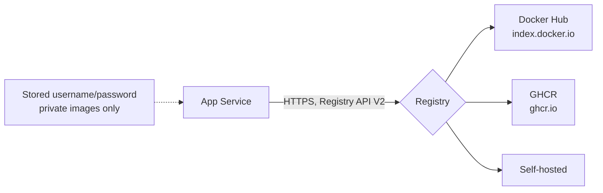

## What this covers

App Service can pull images from registries other than Azure Container Registry, as long as they speak the Docker Registry HTTP API V2 over HTTPS. That includes **Docker Hub**, **GitHub Container Registry (GHCR)** and self-hosted registries. Instead of the ACR dropdowns and managed identity, you supply a **server URL** and, for private images, a **username and password**. This page covers the URLs, CLI flags and portal fields, and what you give up compared with ACR.

**Exam weight:** Develop containerized solutions on Azure (20–25%)

**Skills measured**

- "Deploy containers to Azure App Service, including configuring App Service to supply environment variables and secrets"

## Key concepts

### Server URLs to memorize

| Registry | Server URL | Image name example |
|----------|------------|--------------------|
| Docker Hub | `https://index.docker.io/v1/` | `nginx` or `myusername/myapp:latest` |
| GitHub Container Registry | `https://ghcr.io` | `ghcr.io/<owner>/<image>:<tag>` |
| Self-hosted | `https://registry.example.com` | `registry.example.com/team/app:1.2` |

### Public vs private

- **Public image:** image name plus server URL. No username or password.
- **Private image:** also pass a username and password (for GHCR, a GitHub personal access token with `read:packages`).

App Service stores private credentials as the reserved settings `DOCKER_REGISTRY_SERVER_URL`, `DOCKER_REGISTRY_SERVER_USERNAME` and `DOCKER_REGISTRY_SERVER_PASSWORD`. These aren't exposed to your app's environment.

### What you lose compared with ACR

- No managed identity or `AcrPull`. Authentication is always a stored secret you must rotate.
- No ACR webhook. Continuous deployment works by calling the App Service webhook URL from your pipeline or registry.
- Docker Hub rate-limits anonymous pulls, which can slow cold starts and scale-outs.

### CLI flag names

The current `az webapp create` flags are `--container-image-name`, `--container-registry-url`, `--container-registry-user` and `--container-registry-password`. The Learn module shows the older `--docker-registry-server-*` names, which are deprecated in current CLI releases. Recognize both on the exam.

## How it works



## Hands-on

### Azure portal

1. Create a **Web App**, set **Publish** to **Container** and **Operating System** to **Linux**.
2. On the **Container** tab, set **Image Source** to **Other container registries**.
3. Choose **Public** or **Private** access. For private, enter the **Server URL**, **Username** and **Password**.
4. Enter the **Full image name and tag** (for example `nginx:latest` or `myuser/myapp:v1`) and create the app.

### Azure CLI

Public image from Docker Hub (Learn module form):

```bash
az webapp create \
  --resource-group myResourceGroup \
  --plan myAppServicePlan \
  --name myWebApp \
  --container-image-name nginx \
  --docker-registry-server-url https://index.docker.io/v1/
```

Private image (Learn module form):

```bash
az webapp create \
  --resource-group myResourceGroup \
  --plan myAppServicePlan \
  --name myWebApp \
  --container-image-name myusername/myapp:latest \
  --docker-registry-server-url https://index.docker.io/v1/ \
  --docker-registry-server-user myusername \
  --docker-registry-server-password <password>
```

Private GHCR image with the current flag names. When `--container-registry-url` is set, the image name leaves out the registry host:

```bash
az webapp create \
  --resource-group <resource-group> \
  --plan <plan-name> \
  --name <app-name> \
  --container-image-name <owner>/<image>:<tag> \
  --container-registry-url https://ghcr.io \
  --container-registry-user <github-user> \
  --container-registry-password <github-pat>
```

Switch an existing app to another registry or image:

```bash
az webapp config container set \
  --resource-group <resource-group> --name <app-name> \
  --container-image-name <owner>/<image>:<tag> \
  --container-registry-url https://ghcr.io \
  --container-registry-user <github-user> \
  --container-registry-password <github-pat>
```

### Python

Read back which image and registry an app is using:

```python
from azure.identity import DefaultAzureCredential
from azure.mgmt.web import WebSiteManagementClient

client = WebSiteManagementClient(DefaultAzureCredential(), "<subscription-id>")
cfg = client.web_apps.get_configuration("<resource-group>", "<app-name>")
print(cfg.linux_fx_version)  # e.g. DOCKER|ghcr.io/<owner>/<image>:<tag>
```

## Exam traps

| Scenario | Configuration |
|----------|---------------|
| Quick smoke test with public `nginx` | Image name + Docker Hub URL, no credentials |
| Partner's private Docker Hub image | Docker Hub URL + username + password/token |
| CI pushes to GitHub Packages | `https://ghcr.io` + GitHub user + PAT |
| Production, no stored secrets | Move the image to ACR and use managed identity |

> [!WARNING]
> **Exam trap:** "Other container registries" can't use managed identity or `AcrPull`. Those only apply to Azure Container Registry.

> [!WARNING]
> **Exam trap:** The Docker Hub server URL is `https://index.docker.io/v1/`, not `https://hub.docker.com`. The latter is the website, not the registry API.

> [!TIP]
> Public vs private comes down to one question: do you need the username and password flags?

### Use cases

- Smoke-test with a public `nginx` image before switching to your ACR AI image.
- Pull a partner's private Docker Hub image during an integration.
- Deploy from GHCR when CI builds images into GitHub Packages.

## Quick review

- Docker Hub URL: `https://index.docker.io/v1/`. GHCR URL: `https://ghcr.io`.
- Public images need only the image name and server URL.
- Private images also need a username and password or token.
- Current flags are `--container-registry-url/-user/-password`; `--docker-registry-server-*` is the older form.
- Portal path: **Container** tab > **Image Source** > **Other container registries**.
- Registry credentials are stored as reserved `DOCKER_REGISTRY_SERVER_*` settings that aren't exposed to the app.

## Practice

[Practice: App Service container questions](/practice/app-service-containers)

## Official references

- [Deploy containers to Azure App Service (Learn unit)](https://learn.microsoft.com/en-us/training/modules/deploy-containers-azure-app-service/2-deploy-containers)
- [Configure a custom container: use an image from a private registry](https://learn.microsoft.com/en-us/azure/app-service/configure-custom-container)
- [az webapp create](https://learn.microsoft.com/en-us/cli/azure/webapp#az-webapp-create)
- [Docker Hub](https://hub.docker.com/)
- [Working with the GitHub Container registry](https://docs.github.com/en/packages/working-with-a-github-packages-registry/working-with-the-container-registry)
- [AI-200 study guide](https://learn.microsoft.com/en-us/credentials/certifications/resources/study-guides/ai-200)
