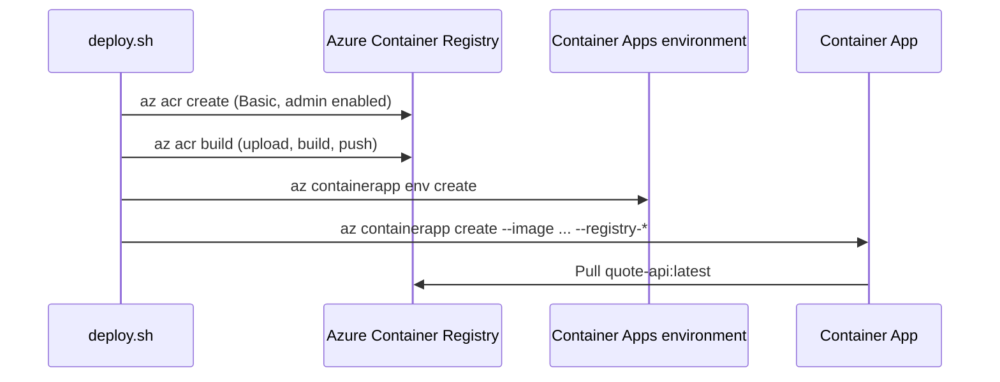

## What this covers

This page walks through what `deploy.sh` and `deploy.ps1` run, one step at a time, from an empty subscription to a live Container App. Each step maps to an exam skill: creating a registry, building and pushing an image with an ACR quick task, and pulling it into a container platform with registry credentials. The page also shows how to swap the script's admin-credential pull for a managed identity, which is the production pattern.

**Exam weight:** Develop containerized solutions on Azure (20–25%)

**Skills measured**

- "Build, store, version, and manage container images by using Azure Container Registry"
- "Build and run images by using Azure Container Registry Tasks"

## Key concepts

### Five steps, in order

1. **Resource group:** keeps ACR and Container Apps together for billing, RBAC and cleanup (`az group delete`).
2. **Registry:** a private registry close to where you deploy the Quote API image.
3. **Build and push:** `az acr build` is a **quick task**. It uploads the source, builds in Azure and pushes to ACR, with no local Docker needed.
4. **Environment:** Container Apps must live in an environment, which provides shared networking and logging. One environment can host many apps.
5. **App:** pulls the image, exposes port 8000 through HTTPS ingress, and scales between the min and max replica counts.

### ACR SKUs

| SKU | Use |
|-----|-----|
| **Basic** | Lowest cost, for learning and small workloads (used here) |
| **Standard** | More storage and throughput for most production use |
| **Premium** | Geo-replication, private endpoints, content trust, highest throughput |

### Tags and versions

The script pushes `:latest`, which is easy for a lab. For real releases, tag each build uniquely (for example `:v1.2.0` or the run ID). Then `az containerapp update --image` creates a revision you can trace and roll back.

## How it works



## Hands-on

### Azure portal

1. After the script finishes, open the resource group to see the registry, the Container Apps environment, the app and the Log Analytics workspace that the environment created.
2. In the registry, select **Services** > **Repositories** > **quote-api** to confirm the tag.
3. In the container app, select **Overview** and open the **Application Url**.

### Azure CLI

**Step 1: Create the resource group**

```bash
az group create --name "$RESOURCE_GROUP" --location "$LOCATION" --output none
```

| Flag | Meaning |
|------|---------|
| `--name` | Resource group (default `quote-api-rg`) |
| `--location` | Azure region (default `eastus`) |
| `--output none` | Quiet output |

**Step 2: Create Azure Container Registry**

```bash
az acr create \
  --resource-group "$RESOURCE_GROUP" \
  --name "$ACR_NAME" \
  --sku Basic \
  --admin-enabled true \
  --output none
```

| Flag | Meaning |
|------|---------|
| `--sku Basic` | Lowest-cost SKU, for learning |
| `--admin-enabled true` | Username and password so Container Apps can pull |

**Step 3: Build and push (`az acr build`)**

```bash
az acr build \
  --registry "$ACR_NAME" \
  --image "${IMAGE_NAME}:latest" \
  --file "$PROJECT_DIR/Dockerfile" \
  "$PROJECT_DIR"
```

**Step 4: Create the Container Apps environment**

```bash
az containerapp env create \
  --name "$CONTAINERAPPS_ENV" \
  --resource-group "$RESOURCE_GROUP" \
  --location "$LOCATION" \
  --output none
```

**Step 5: Deploy the Container App**

Fetch the ACR credentials:

```bash
ACR_LOGIN=$(az acr show --name "$ACR_NAME" --query loginServer -o tsv)
ACR_USER=$(az acr credential show --name "$ACR_NAME" --query username -o tsv)
ACR_PASS=$(az acr credential show --name "$ACR_NAME" --query "passwords[0].value" -o tsv)
```

Create the app:

```bash
az containerapp create \
  --name "$CONTAINER_APP" \
  --resource-group "$RESOURCE_GROUP" \
  --environment "$CONTAINERAPPS_ENV" \
  --image "${ACR_LOGIN}/${IMAGE_NAME}:latest" \
  --registry-server "$ACR_LOGIN" \
  --registry-username "$ACR_USER" \
  --registry-password "$ACR_PASS" \
  --target-port 8000 \
  --ingress external \
  --min-replicas 1 \
  --max-replicas 3 \
  --cpu 0.5 \
  --memory 1.0Gi \
  --env-vars APP_NAME="Quote API" ENVIRONMENT=production LOG_LEVEL=INFO \
  --output none
```

| Flag | Meaning |
|------|---------|
| `--target-port 8000` | Matches Uvicorn in the Dockerfile |
| `--ingress external` | Public HTTPS endpoint |
| `--min-replicas` / `--max-replicas` | Scale bounds (min 1 avoids scale-to-zero cold starts) |
| `--cpu` / `--memory` | Per-replica resources (0.5 vCPU pairs with 1.0Gi on Consumption) |
| `--env-vars` | Runtime configuration |

**Result:** the Quote API runs on Azure with managed HTTPS, scaling and automatic restarts.

**Production variant: pull with a managed identity instead of admin credentials**

```bash
az containerapp create \
  --name "$CONTAINER_APP" --resource-group "$RESOURCE_GROUP" \
  --environment "$CONTAINERAPPS_ENV" \
  --image "${ACR_LOGIN}/${IMAGE_NAME}:v1" \
  --registry-server "$ACR_LOGIN" \
  --registry-identity system \
  --target-port 8000 --ingress external
```

With `--registry-identity system`, the CLI enables the system-assigned identity and grants it `AcrPull` on the registry for you. After that you can turn off the admin user with `az acr update --admin-enabled false`.

### Python

The same quick-task build can be triggered from a CI job that runs the CLI. To verify the result from Python, list the tags with Entra auth:

```python
from azure.identity import DefaultAzureCredential
from azure.containerregistry import ContainerRegistryClient

client = ContainerRegistryClient(
    "https://<acr-name>.azurecr.io",
    DefaultAzureCredential(),
    audience="https://containerregistry.azure.net",
)
print([t.name for t in client.list_tag_properties("quote-api")])
```

## Exam traps

| Choice | Lab (this script) | Production |
|--------|-------------------|------------|
| Registry auth | Admin user + `--registry-username/--registry-password` | `--registry-identity` + `AcrPull` |
| Image tag | `latest` | Unique version or run ID |
| Build | `az acr build` by hand | ACR Task on commit, or CI pipeline |
| SKU | Basic | Standard or Premium |

> [!WARNING]
> **Exam trap:** The environment must exist before the app. `az containerapp create` needs `--environment`.

> [!WARNING]
> **Exam trap:** `--target-port` must match the port the container listens on. Here that's 8000.

> [!TIP]
> `az acr build` = quick task = "docker build + docker push, in Azure". No local Docker engine required.

> [!NOTE]
> Passing passwords on the command line can leave them in shell history and CI logs. That's another reason to prefer a managed identity.

## Quick review

- Order: resource group, registry, build, environment, app.
- `az acr build` uploads the context, builds in Azure and pushes to ACR.
- `--admin-enabled true` plus `az acr credential show` supplies a lab-only pull credential.
- `--registry-identity system` is the managed identity alternative.
- `--target-port 8000` and `--ingress external` expose the API over HTTPS.
- `--min-replicas 1` keeps one replica warm.

## Practice

- [Practice: Azure Container Registry image questions](/practice/acr-images)
- [Practice: ACR Tasks questions](/practice/acr-tasks)

## Official references

- [Project repository (azure-contianers)](https://github.com/Suralmk/azure-contianers)
- [Quickstart: build and run an image with ACR Tasks](https://learn.microsoft.com/en-us/azure/container-registry/container-registry-quickstart-task-cli)
- [ACR service tiers](https://learn.microsoft.com/en-us/azure/container-registry/container-registry-skus)
- [az containerapp create](https://learn.microsoft.com/en-us/cli/azure/containerapp#az-containerapp-create)
- [Managed identity image pull in Azure Container Apps](https://learn.microsoft.com/en-us/azure/container-apps/managed-identity-image-pull)
- [AI-200 study guide](https://learn.microsoft.com/en-us/credentials/certifications/resources/study-guides/ai-200)
