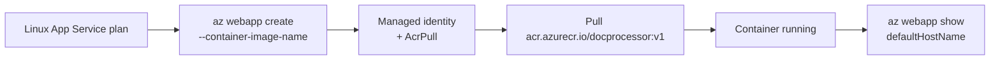

## What this covers

The Azure CLI gives you a **repeatable** way to deploy a container to App Service that you can paste into a script or CI pipeline. The core is a single `az webapp create` command with `--container-image-name`. It assumes the image already exists in Azure Container Registry and that App Service has permission to pull it, usually through a managed identity with `AcrPull` granted by a platform team. This page shows the full sequence, from a Linux plan through to updating the tag, plus the prerequisites the exam checks.

**Exam weight:** Develop containerized solutions on Azure (20–25%)

**Skills measured**

- "Deploy containers to Azure App Service, including configuring App Service to supply environment variables and secrets"

## Key concepts

### One command creates the app and sets the image

`az webapp create --container-image-name <registry>.azurecr.io/<image>:<tag>` creates the web app **and** configures its container in one step. Use the full ACR login server plus an explicit tag (for example `docprocessor:v1`), not a floating `latest`, so every deployment is deterministic and reproducible.

### Prerequisites

| Requirement | Why it matters |
|-------------|----------------|
| Image already in ACR | `az webapp create` pulls an existing tag; it doesn't build anything |
| Pull permission | Managed identity with `AcrPull` (or admin credentials) must already work |
| Resource group and **Linux** App Service plan | The example assumes `--plan` exists; custom Linux containers need a plan created with `--is-linux` |

### Useful flags on `az webapp create`

| Flag | Purpose |
|------|---------|
| `--container-image-name` (`-c`) | Image and tag to run |
| `--acr-use-identity` | Pull from ACR with a managed identity |
| `--acr-identity` | `[system]` or a user-assigned identity resource ID |
| `--assign-identity` | Identities to attach to the app |
| `--container-registry-url/-user/-password` | Credentials for non-ACR or admin-credential pulls |

`--deployment-container-image-name` (`-i`) is the older, deprecated name for `--container-image-name`.

### After creation

- Update the image: `az webapp config container set --container-image-name ...:v2`. App Service restarts and pulls the new tag.
- Pushing a new image to the **same** tag isn't detected. Restart the app or enable continuous deployment.
- Verify: `az webapp show --query defaultHostName -o tsv`, then browse or `curl` the URL.

## How it works



## Hands-on

### Azure portal

The portal equivalent is described in [Deploy using the Azure portal](/study/implement-container-application-hosting-on-azure/deploy-using-the-azure-portal). To check a CLI deployment in the portal:

1. Open the web app and select **Deployment Center** to confirm the registry, image, tag and authentication method.
2. Open **Monitoring** > **Log stream** to watch the pull and container start.

### Azure CLI

Minimal create (from the Learn module):

```bash
az webapp create \
  --resource-group myResourceGroup \
  --plan myAppServicePlan \
  --name myDocumentProcessor \
  --container-image-name myregistry.azurecr.io/docprocessor:v1
```

End to end, with a managed identity pull:

```bash
az appservice plan create -g <resource-group> -n <plan-name> --is-linux --sku B1

az webapp create -g <resource-group> -p <plan-name> -n <app-name> \
  --container-image-name <registry>.azurecr.io/docprocessor:v1 \
  --assign-identity [system] \
  --acr-use-identity --acr-identity [system]

# Grant AcrPull to the new identity (skip if a platform team already did)
principalId=$(az webapp identity show -g <resource-group> -n <app-name> --query principalId -o tsv)
az role assignment create --assignee "$principalId" --role AcrPull \
  --scope $(az acr show -n <registry> --query id -o tsv)

# Configure port and settings, then verify
az webapp config appsettings set -g <resource-group> -n <app-name> --settings WEBSITES_PORT=8000
az webapp show -g <resource-group> -n <app-name> --query defaultHostName -o tsv

# Release v2
az webapp config container set -g <resource-group> -n <app-name> \
  --container-image-name <registry>.azurecr.io/docprocessor:v2
```

### Python

Change the running tag from a release script:

```python
from azure.identity import DefaultAzureCredential
from azure.mgmt.web import WebSiteManagementClient

client = WebSiteManagementClient(DefaultAzureCredential(), "<subscription-id>")
cfg = client.web_apps.get_configuration("<resource-group>", "<app-name>")
cfg.linux_fx_version = "DOCKER|<registry>.azurecr.io/docprocessor:v2"
client.web_apps.update_configuration("<resource-group>", "<app-name>", cfg)
client.web_apps.restart("<resource-group>", "<app-name>")
```

## Exam traps

| Need | Command |
|------|---------|
| Create app + set image in one step | `az webapp create --container-image-name` |
| Change the image or tag later | `az webapp config container set --container-image-name` |
| Same tag, new content | `az webapp restart`, or enable CD |
| Find the app URL | `az webapp show --query defaultHostName` |
| Deploy to Container Apps instead | `az containerapp create` (a different service) |

> [!WARNING]
> **Exam trap:** `az webapp create` doesn't build images. If the tag isn't in the registry yet, run `az acr build` first.

> [!WARNING]
> **Exam trap:** Don't confuse App Service (`az webapp ...`) with Azure Container Apps (`az containerapp ...`, YAML, revisions). The skill named on this page is App Service.

> [!TIP]
> Pin a specific tag such as `:v1` for deterministic deployments and easy rollbacks. `latest` hides which build is actually running.

### Use cases

- Paste the same create command into a release pipeline for an AI document processor API.
- Redeploy a known good tag (`docprocessor:v1`) without using the portal.
- Hand off a scripted deploy while platform owners manage identities and role assignments.

## Quick review

- `az webapp create --container-image-name <acr>.azurecr.io/<image>:<tag>` creates the app and sets the image.
- The resource group, Linux plan and image must already exist.
- Pull permission (managed identity + `AcrPull`) must be in place.
- `--acr-use-identity --acr-identity [system]` sets up identity-based pulls at creation.
- `az webapp config container set` changes the tag and restarts the app.
- Pushing over an existing tag needs a restart or continuous deployment.

## Practice

[Practice: App Service container questions](/practice/app-service-containers)

## Official references

- [Deploy containers to Azure App Service (Learn unit)](https://learn.microsoft.com/en-us/training/modules/deploy-containers-azure-app-service/2-deploy-containers)
- [az webapp create](https://learn.microsoft.com/en-us/cli/azure/webapp#az-webapp-create)
- [Tutorial: deploy a custom container](https://learn.microsoft.com/en-us/azure/app-service/tutorial-custom-container)
- [Configure a custom container](https://learn.microsoft.com/en-us/azure/app-service/configure-custom-container)
- [AI-200 study guide](https://learn.microsoft.com/en-us/credentials/certifications/resources/study-guides/ai-200)
