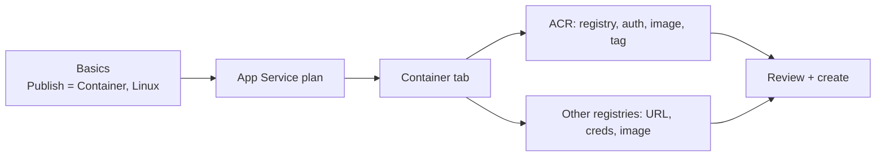

## What this covers

The Azure portal gives you a guided way to create a **Web App for Containers**. You set each option visually and can check your choices before anything is deployed. That makes it the easiest way to see how registry, image, tag and authentication fit together. This page covers the create flow, the **Container** tab for both Azure Container Registry and other registries, and the settings to check after creation.

**Exam weight:** Develop containerized solutions on Azure (20–25%)

**Skills measured**

- "Deploy containers to Azure App Service, including configuring App Service to supply environment variables and secrets"

## Key concepts

### The create pattern

- **Create a resource** → search **Web App** → **Create**.
- **Basics:** subscription, resource group, app name, region.
- **Publish = Container** and **Operating System = Linux** is the usual pattern for custom containers.
- Choose or create an **App Service plan**. Use Basic or higher if you need Always On.
- The **Container** tab sets the image source.

### Image sources

| Source | When | What you enter |
|--------|------|----------------|
| **Azure Container Registry** | Recommended for production: Entra auth, managed identity, geo-replication, image scanning, private networking | Registry, authentication, image, tag |
| **Other container registries** | Docker Hub, GHCR, self-hosted (any HTTPS registry that supports the Docker Registry HTTP API V2) | Access type, server URL, credentials if private, full image name and tag |

Registries in the **same subscription** appear in the ACR dropdown automatically.

### ACR authentication in the wizard

- **Managed Identity:** pick an existing user-assigned identity or use the system-assigned one. Either way, the identity needs **`AcrPull`** on the registry. See [ACR authentication options](/study/implement-container-application-hosting-on-azure/acr-authentication-options).
- **Admin credentials:** uses the registry's admin username and password. The **admin user must be enabled** on the registry first.

## How it works



After creation, **Deployment Center** shows (and lets you change) the same registry, image, tag and authentication. It's also where you turn on continuous deployment.

## Hands-on

### Azure portal

**Create the web app**

1. In the Azure portal, select **Create a resource** and search for **Web App**.
2. Select **Create** and choose **Web App**.
3. On the **Basics** tab, set the subscription, resource group, app name and region.
4. For **Publish**, select **Container**.
5. For **Operating System**, select **Linux**.
6. Select an App Service plan or create a new one.
7. Open the **Container** tab to configure the image source.

**Azure Container Registry**

1. **Image Source** → **Azure Container Registry**.
2. Select your **Registry** (same-subscription registries appear automatically).
3. Choose an **Authentication** method:
   - **Managed Identity** (user-assigned or system-assigned). The identity must have **`AcrPull`** on the registry.
   - **Admin credentials** (registry admin username and password). The admin user must be enabled on ACR.
4. Select the **Image** and **Tag** to deploy.

**Other registries**

1. **Image Source** → **Other container registries**.
2. For private images, provide the **Server URL** (Docker Hub: `https://index.docker.io/v1/`).
3. Enter the **Username** and **Password** for private registries.
4. Enter the **Full Image Name and Tag** (for example `nginx:latest` or `myuser/myapp:v1`).

**After creation**

1. **Settings** > **Environment variables**: add `WEBSITES_PORT` if the container doesn't listen on 80, plus your app settings.
2. **Monitoring** > **Log stream**: watch the image pull and container start.
3. **Overview** > **Default domain**: browse to the app.

### Azure CLI

The scripted equivalent of the wizard (see [Deploy to App Service using CLI](/study/implement-container-application-hosting-on-azure/deploy-to-app-service-using-cli)):

```bash
az webapp create \
  --resource-group <resource-group> \
  --plan <linux-plan> \
  --name <app-name> \
  --container-image-name <registry>.azurecr.io/<image>:<tag> \
  --acr-use-identity --acr-identity [system]
```

### Python

Confirm what the portal configured:

```python
from azure.identity import DefaultAzureCredential
from azure.mgmt.web import WebSiteManagementClient

client = WebSiteManagementClient(DefaultAzureCredential(), "<subscription-id>")
cfg = client.web_apps.get_configuration("<resource-group>", "<app-name>")
print(cfg.linux_fx_version)                 # DOCKER|<registry>.azurecr.io/<image>:<tag>
print(cfg.acr_use_managed_identity_creds)   # True when Managed Identity was chosen
```

## Exam traps

| Requirement in the question | Portal choice |
|-----------------------------|---------------|
| Custom image on Linux | Publish = **Container**, OS = **Linux** |
| Image in ACR, no stored secrets | ACR + **Managed Identity** (needs `AcrPull`) |
| Image in ACR, quickest dev setup | ACR + **Admin credentials** (admin user enabled) |
| Image on Docker Hub or GHCR | **Other container registries** |
| Change image or tag later | **Deployment Center** |

> [!WARNING]
> **Exam trap:** Choosing **Managed Identity** in the wizard doesn't make the pull work by itself. The identity still needs `AcrPull` on the registry.

> [!WARNING]
> **Exam trap:** **Admin credentials** fails if the registry's admin user is disabled, which is the default.

> [!TIP]
> "Publish: Container + Linux" is the core portal pattern for custom images. Docker Hub and GHCR both live under **Other container registries**.

### Use cases

- A first-time AI container deploy where you want to see every dropdown (registry, tag, auth) before committing.
- Comparing ACR managed identity and admin credentials side by side in the UI.
- Pulling a public Docker Hub sample image for a quick smoke test app.

## Quick review

- Create path: Create a resource → Web App → Publish = Container, OS = Linux.
- The **Container** tab picks ACR or other registries.
- Same-subscription registries appear in the dropdown automatically.
- Managed identity needs `AcrPull`; admin credentials need the admin user enabled.
- Other registries need a server URL, plus credentials when private.
- Deployment Center changes the image and turns on continuous deployment later.

## Practice

[Practice: App Service container questions](/practice/app-service-containers)

## Official references

- [Deploy containers to Azure App Service (Learn unit)](https://learn.microsoft.com/en-us/training/modules/deploy-containers-azure-app-service/2-deploy-containers)
- [Configure a custom container on Azure App Service](https://learn.microsoft.com/en-us/azure/app-service/configure-custom-container)
- [Quickstart: run a custom container on App Service](https://learn.microsoft.com/en-us/azure/app-service/quickstart-custom-container)
- [Getting started with App Service](https://learn.microsoft.com/en-us/azure/app-service/getting-started)
- [AI-200 study guide](https://learn.microsoft.com/en-us/credentials/certifications/resources/study-guides/ai-200)
