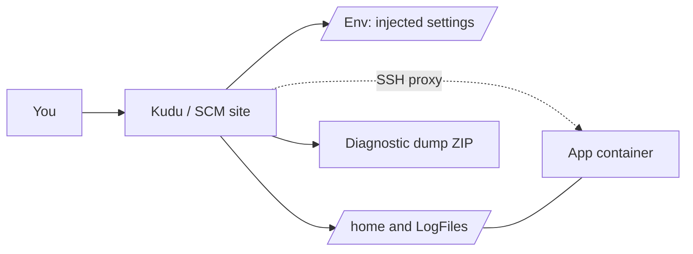

## What this covers

**Kudu**, also called the **SCM site**, is App Service's advanced diagnostic console. For containerized apps, it's where you confirm which environment variables were really injected, browse persisted log files under `/home`, pull Docker logs through an API, and download a diagnostic dump. It is **not** your app container, though. This page explains what Kudu can and can't show, and when to switch to SSH.

**Exam weight:** Develop containerized solutions on Azure (20–25%)

**Skills measured**

- "Deploy containers to Azure App Service, including configuring App Service to supply environment variables and secrets"

## Key concepts

### Address and access

```text
https://<app-name>.scm.azurewebsites.net
```

The SCM site runs as a **separate site** next to your app. Signing in requires an identity that can manage the web app, such as a Microsoft Entra account with Contributor rights or publishing credentials. Apps created with a unique default hostname use the pattern `<app-name>-<hash>.scm.<region>.azurewebsites.net`. In the portal: **Development Tools** > **Advanced Tools** > **Go**.

### Features for container troubleshooting

| Feature | URL / location | Use |
|---------|----------------|-----|
| **Environment** | `/Env` | Lists every environment variable available to the container: your app settings, connection strings and system variables |
| **Debug console / file browser** | `/DebugConsole` or the file manager, `/home` | Browse `/home/LogFiles/` and anything the app writes to `/home` |
| **Docker log API** | `/api/logs/docker`, `/api/logs/docker/zip` | List or download container logs |
| **Diagnostic dump** | `/api/dump` | ZIP of logs, configuration and diagnostics for offline analysis or Microsoft Support |
| **SSH / browser terminal** | `/webssh/host` | Shell **inside** the running container (Linux) |

### Limits (exam favourite)

| You can do in Kudu | You cannot do in Kudu alone |
|--------------------|-----------------------------|
| View environment variables | Browse the full app container file system |
| Browse `/home` mounted storage | Inspect processes inside the running app container |
| Download a diagnostic dump | Replace SSH for deep in-container debugging |

Files under `/app` or `/usr` in your image won't appear in the Kudu file browser, because Kudu only sees the shared `/home` storage.

### SSH vs Kudu

- **Kudu** = SCM-side diagnostics: environment, files in `/home`, logs.
- **SSH** = a shell inside your container. The newer browser terminal and `az webapp exec` (preview) proxy through Kudu and don't need an SSH server in the image. Legacy WebSSH and `az webapp ssh` need `openssh-server` listening on port **2222** with root password `Docker!`.
- `env` in an SSH session may show only a few variables. Trust the SCM `/Env` view when shell output looks incomplete.

## How it works



Kudu and your container share only the `/home` mount. Everything else in the container is invisible to Kudu unless you open an SSH session.

## Hands-on

### Azure portal

1. Open the web app and select **Development Tools** > **Advanced Tools** > **Go**.
2. Select **Environment** and search for `WEBSITES_PORT` or your setting names.
3. Open the file browser or **Debug console** and go to `/home/LogFiles/`. Download the folder if needed.
4. For an in-container shell, select **Development Tools** > **SSH** > **Go**.

### Azure CLI

```bash
# Kudu URL for this app
az webapp show -g <resource-group> -n <app-name> \
  --query "enabledHostNames[?contains(@, 'scm')]" -o tsv

# Download all logs (same content as /home/LogFiles)
az webapp log download -g <resource-group> -n <app-name> --log-file logs.zip

# Shell inside the container (needs an SSH-capable image for this command)
az webapp ssh -g <resource-group> -n <app-name>
```

### Python

Call the Kudu Docker log API with a Microsoft Entra token instead of publishing credentials:

```python
import requests
from azure.identity import DefaultAzureCredential

token = DefaultAzureCredential().get_token("https://management.azure.com/.default").token
scm = "https://<app-name>.scm.azurewebsites.net"

logs = requests.get(f"{scm}/api/logs/docker",
                    headers={"Authorization": f"Bearer {token}"}, timeout=30)
for entry in logs.json():
    print(entry["machineName"], entry["lastUpdated"], entry["href"])
```

## Exam traps

| Question asks... | Answer |
|------------------|--------|
| Was the app setting actually injected? | Kudu **Environment** (`/Env`) |
| Where are persisted container logs? | `/home/LogFiles/` via Kudu or `az webapp log download` |
| Inspect a running process or `/app` files | SSH into the container |
| Bundle diagnostics for Microsoft Support | Kudu diagnostic dump |
| Watch output live | Log stream, not Kudu |

> [!WARNING]
> **Exam trap:** Kudu verifies **injected** settings, but you're not inside the app container. Missing `/app` files in Kudu doesn't mean the image is broken.

> [!WARNING]
> **Exam trap:** The SCM hostname adds `.scm` before `azurewebsites.net`. `https://<app-name>.azurewebsites.net/scm` isn't the Kudu URL.

> [!TIP]
> Pair Kudu with log stream (live output) and filesystem logging (persistence). Together they cover what, when and why.

### Use cases

- **Suspected missing app setting:** open Environment and confirm `WEBSITES_PORT`, connection strings and custom keys are present.
- **Persisted crash logs:** Debug console → `/home/LogFiles/` after enabling filesystem logging.
- **Support escalation:** generate a diagnostic dump ZIP and attach it to the ticket.
- **Config vs container confusion:** remember SCM ≠ app container when files under `/app` or `/usr` are missing from Kudu.

## Quick review

- Kudu URL: `https://<app-name>.scm.azurewebsites.net`.
- `/Env` shows every injected environment variable.
- The Debug console browses `/home`; logs are in `/home/LogFiles/`.
- The diagnostic dump is a ZIP of logs and config for offline analysis.
- Kudu can't see the full container file system or its processes.
- Use SSH for in-container inspection; legacy SSH needs port 2222 and root password `Docker!`.
- `/api/logs/docker/zip` downloads all Docker logs in one file.

## Practice

[Practice: App Service container questions](/practice/app-service-containers)

## Official references

- [Observe and troubleshoot containerized apps (Learn unit)](https://learn.microsoft.com/en-us/training/modules/deploy-containers-azure-app-service/5-observe-troubleshoot)
- [Kudu service overview](https://learn.microsoft.com/en-us/azure/app-service/resources-kudu)
- [Configure a custom container: access diagnostic logs and SSH](https://learn.microsoft.com/en-us/azure/app-service/configure-custom-container)
- [Enable diagnostic logging](https://learn.microsoft.com/en-us/azure/app-service/troubleshoot-diagnostic-logs)
- [Kudu wiki](https://github.com/projectkudu/kudu/wiki)
- [AI-200 study guide](https://learn.microsoft.com/en-us/credentials/certifications/resources/study-guides/ai-200)
