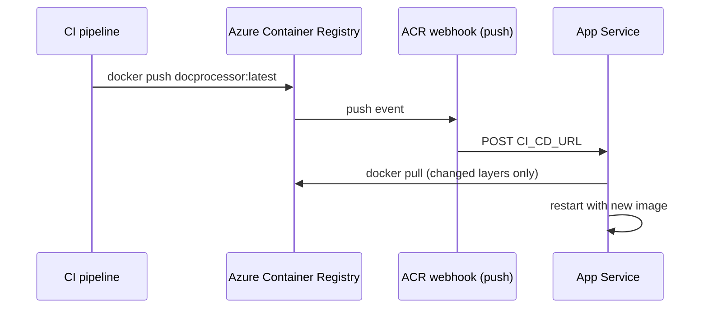

## What this covers

You can set up App Service so it pulls a new container image by itself each time one is pushed to the registry. You turn on continuous deployment (CD) on the web app, which gives you a webhook URL. The registry calls that URL on every **push**, and the call makes App Service restart and run `docker pull`. This fixes the "same tag not detected" problem and fits well behind a CI/CD pipeline that builds and pushes images.

**Exam weight:** Develop containerized solutions on Azure (20–25%)

**Skills measured**

- "Deploy containers to Azure App Service, including configuring App Service to supply environment variables and secrets"
- "Build, store, version, and manage container images by using Azure Container Registry"

## Key concepts

### The CD webhook

- Turn it on with `az webapp deployment container config --enable-cd true`.
- The command returns a **webhook URL** in the `CI_CD_URL` property. The URL points at the app's SCM (Kudu) site and contains the publishing credentials.
- When the registry posts to that URL, the app **restarts**, and the restart pulls the image named in the current configuration again.

### Who creates the registry webhook?

| Method | Registry webhook |
|--------|------------------|
| Portal **Deployment Center**, Continuous deployment **On**, source ACR or Docker Hub | Created **for you** |
| CLI `--enable-cd true` | **You** create it (`az acr webhook create --actions push`) |
| Other private registry | Copy the webhook URL and POST to it from your pipeline |
| GitHub Actions source in Deployment Center | No webhook. The workflow builds, pushes, then calls `azure/webapps-deploy` |

### Prerequisite that catches people out

The webhook authenticates with basic publishing credentials. If **SCM Basic Auth Publishing Credentials** is turned off for the app (common in locked-down subscriptions), the webhook call fails with **401 Unauthorized** and nothing redeploys.

## How it works



1. CI builds and pushes `myregistry.azurecr.io/docprocessor:latest` (or a new tag).
2. The ACR webhook fires on the **push** event.
3. App Service restarts and pulls the updated image.
4. The new image version of the container runs.

Scope the webhook to `<repo>:<tag>`. If you leave the scope empty, a push to **any** repository in the registry restarts the app.

## Hands-on

### Azure portal

1. Open the web app and select **Deployment > Deployment Center > Settings**.
2. Set **Source** to **Container Registry** and **Registry source** to **Azure Container Registry**, then pick the registry, image and tag.
3. Set **Continuous deployment** to **On** and select **Save**. The ACR webhook is created for you.
4. Under **Configuration > General settings**, check that **SCM Basic Auth Publishing Credentials** is **On**.
5. In the registry, open **Services > Webhooks** to see the webhook and its recent deliveries.

### Azure CLI

```bash
az webapp deployment container config \
  --resource-group myResourceGroup \
  --name myDocumentProcessor \
  --enable-cd true
```

Capture the URL and create the ACR webhook that fires on **push**:

```bash
CI_CD_URL=$(az webapp deployment container config \
  --resource-group myResourceGroup --name myDocumentProcessor \
  --enable-cd true --query CI_CD_URL --output tsv)

az acr webhook create \
  --registry myregistry \
  --name docprocessorcd \
  --actions push \
  --uri "$CI_CD_URL" \
  --scope "docprocessor:latest"
```

Test it and check delivery:

```bash
az acr webhook ping --registry myregistry --name docprocessorcd
az acr webhook list-events --registry myregistry --name docprocessorcd -o table
az webapp deployment container show-cd-url -g myResourceGroup -n myDocumentProcessor
```

### Python

Fire the webhook from a pipeline step when the registry can't do it itself (another private registry):

```python
import requests

cd_url = "<ci-cd-url-from-az-webapp-deployment-container-config>"
resp = requests.post(cd_url, timeout=30)
resp.raise_for_status()  # 401 => basic auth publishing credentials disabled
print("Redeploy triggered:", resp.status_code)
```

## Exam traps

| Scenario | Best answer |
|----------|-------------|
| Pipeline overwrites `:latest`, and the app must pick it up automatically | Enable CD plus an ACR **push** webhook |
| New tag `v2` released by a script | `az webapp config container set` (restarts automatically, no CD needed) |
| Rebuild the image when source changes | ACR Task (commit trigger). CD then deploys it |
| Code lives in GitHub, you want build plus deploy in one place | Deployment Center **GitHub Actions** source |

> [!WARNING]
> **Exam trap:** The CLI `--enable-cd true` only **returns** the webhook URL. It doesn't create the registry webhook. The portal toggle does create it for ACR and Docker Hub.

> [!WARNING]
> **Exam trap:** The ACR webhook action is **push**, not delete or quarantine. Webhook calls failing with 401 means SCM basic auth publishing is disabled.

> [!TIP]
> CD is the automated answer whenever a question asks how App Service learns about a **same-tag** update without a manual restart.

> [!NOTE]
> Docker Hub has no registry-wide webhooks, so for Docker Hub you add the webhook to each repository.

## Quick review

- `az webapp deployment container config --enable-cd true` turns on CD and outputs `CI_CD_URL`.
- Configure the registry to call that URL on **push**.
- The portal Deployment Center creates the ACR or Docker Hub webhook for you. The CLI doesn't.
- A webhook call restarts the app, which pulls only the changed layers.
- Scope the ACR webhook to `repo:tag` so pushes to other repos don't restart the app.
- The webhook needs SCM basic auth publishing credentials, otherwise you get 401.
- Use cases: GitHub Actions pushes a new model-serving image, or a non-prod slot that tracks `latest`.

## Practice

- [Practice: App Service container questions](/practice/app-service-containers)
- [Practice: Azure Container Registry questions](/practice/acr-images)

## Official references

- [Continuous deployment for custom containers](https://learn.microsoft.com/azure/app-service/deploy-ci-cd-custom-container)
- [ACR webhooks](https://learn.microsoft.com/azure/container-registry/container-registry-webhook)
- [az webapp deployment container](https://learn.microsoft.com/cli/azure/webapp/deployment/container)
- [AI-200 study guide](https://learn.microsoft.com/credentials/certifications/resources/study-guides/ai-200)
