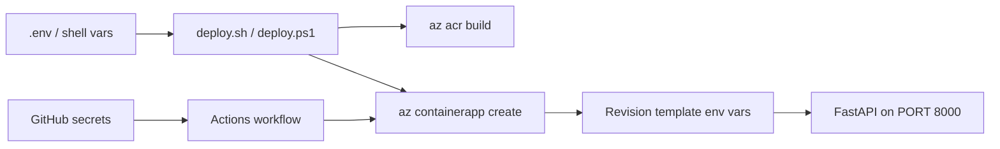

## What this covers

This is the reference for every environment variable the **Quote API** sample uses. Some configure the FastAPI app itself, some drive the `deploy.sh` / `deploy.ps1` scripts, and two are GitHub Actions secrets. The page also shows how those values reach a running container in Azure Container Apps, as plain env vars or as secret references, because getting configuration into a container safely is a core exam skill.

**Exam weight:** Develop containerized solutions on Azure (20–25%)

**Skills measured**

- "Deploy applications to Azure Container Apps, including environment configuration and revision management"
- "Build and run images by using Azure Container Registry Tasks"

## Key concepts

### Local `.env` file

Copy the template and edit the values:

```bash
cp .env.example .env
```

The app loads `.env` locally. In Azure the same names are set on the container instead, so the code never changes.

### Application

| Variable | Default | Description |
|----------|---------|-------------|
| `APP_NAME` | `Quote API` | Application name |
| `APP_VERSION` | `1.0.0` | Version string |
| `ENVIRONMENT` | `development` | Environment label (`development`, `production`) |
| `LOG_LEVEL` | `INFO` | Log level (`DEBUG`, `INFO`, `WARNING`, `ERROR`) |
| `HOST` | `0.0.0.0` | Server bind address |
| `PORT` | `8000` | Server port |

### Azure deploy (`deploy.sh` / `deploy.ps1`)

| Variable | Default | Description |
|----------|---------|-------------|
| `RESOURCE_GROUP` | `quote-api-rg` | Azure resource group |
| `LOCATION` | `eastus` | Azure region |
| `ACR_NAME` | `quoteapiacr` | Container registry name (must be globally unique) |
| `CONTAINERAPPS_ENV` | `quote-api-env` | Container Apps environment |
| `CONTAINER_APP` | `quote-api` | Container App name |
| `IMAGE_NAME` | `quote-api` | Docker image name |

### GitHub Actions (repository secrets)

| Variable | Description |
|----------|-------------|
| `AZURE_CREDENTIALS` | Service principal JSON for `azure/login@v2` |
| `AZURE_RESOURCE_GROUP` | Resource group used in the workflow |

### Plain values vs secrets in Container Apps

- **Plain env vars** (`--env-vars KEY=value`) are stored in the revision template and anyone with read access can see them.
- **Secrets** live at the app level (`--secrets name=value`, or a Key Vault reference with `keyvaultref:<uri>,identityref:<id>`). Env vars point at them with `secretref:<name>`.
- Changing an env var creates a **new revision**. Changing only a secret does **not**. Restart the revision, or deploy a new one, so the containers pick up the new secret value.

## How it works



The deploy script reads `RESOURCE_GROUP`, `ACR_NAME` and the other deploy variables from your shell, falling back to the defaults. The app variables (`ENVIRONMENT`, `LOG_LEVEL`) are passed to the container as env vars on the revision. `PORT` must equal the ingress `--target-port`.

## Hands-on

### Azure portal

1. Open the container app and select **Application > Containers**, then **Edit and deploy**.
2. Select the container, then **Environment variables**, and add `ENVIRONMENT=production` and `LOG_LEVEL=INFO`.
3. For a secret, add it first under **Settings > Secrets**, then add an env var with the source **Reference a secret**.
4. Select **Create**. A new revision is deployed with the values.

### Azure CLI

Override a deploy variable when the default ACR name is taken:

```bash
ACR_NAME=myuniqueacr123 ./deploy.sh
```

Set app env vars and a secret-backed variable on the running app:

```bash
az containerapp secret set -n quote-api -g quote-api-rg \
  --secrets "api-key=<value>"

az containerapp update -n quote-api -g quote-api-rg \
  --set-env-vars ENVIRONMENT=production LOG_LEVEL=INFO API_KEY=secretref:api-key
```

Check what the current revision received:

```bash
az containerapp show -n quote-api -g quote-api-rg \
  --query "properties.template.containers[0].env" -o table
```

### Python

How the app reads its settings, with the same defaults as the table:

```python
import os

APP_NAME = os.getenv("APP_NAME", "Quote API")
ENVIRONMENT = os.getenv("ENVIRONMENT", "development")
LOG_LEVEL = os.getenv("LOG_LEVEL", "INFO")
HOST = os.getenv("HOST", "0.0.0.0")
PORT = int(os.getenv("PORT", "8000"))
```

## Exam traps

| Value | Put it in |
|-------|-----------|
| Log level, environment label | Plain env var |
| API key, connection string | Container Apps secret or Key Vault reference, exposed with `secretref:` |
| Deploy-time names (RG, ACR) | Shell / pipeline variables, not the image |
| Azure login for CI | GitHub secret `AZURE_CREDENTIALS` (or OIDC federated credentials) |

> [!WARNING]
> **Exam trap:** Binding to `127.0.0.1` makes the app unreachable from the ingress. Bind `HOST=0.0.0.0` so Azure can reach the process.

> [!WARNING]
> **Exam trap:** Updating a secret value doesn't create a new revision. Running replicas keep the old value until you restart the revision or deploy a new one.

> [!TIP]
> `PORT=8000` must match Container Apps `--target-port 8000`. A mismatch shows up as a degraded revision with failing health probes.

## Quick review

- Bind `HOST=0.0.0.0` so Azure can reach the process.
- `PORT=8000` must match the Container Apps `--target-port`.
- Override `ACR_NAME` when the default name is already taken (ACR names are globally unique).
- `--set-env-vars` creates a new revision. `secret set` alone doesn't.
- Use `secretref:<name>` to expose a secret as an env var.
- `AZURE_CREDENTIALS` holds the service principal JSON for `azure/login@v2`.

## Practice

- [Practice: Container Apps deployment questions](/practice/aca-deploy)
- [Practice: ACR Tasks questions](/practice/acr-tasks)

## Official references

- [Repository: Suralmk/azure-contianers](https://github.com/Suralmk/azure-contianers)
- [Manage secrets in Azure Container Apps](https://learn.microsoft.com/azure/container-apps/manage-secrets)
- [Environment variables in Azure Container Apps](https://learn.microsoft.com/azure/container-apps/environment-variables)
- [AI-200 study guide](https://learn.microsoft.com/credentials/certifications/resources/study-guides/ai-200)
