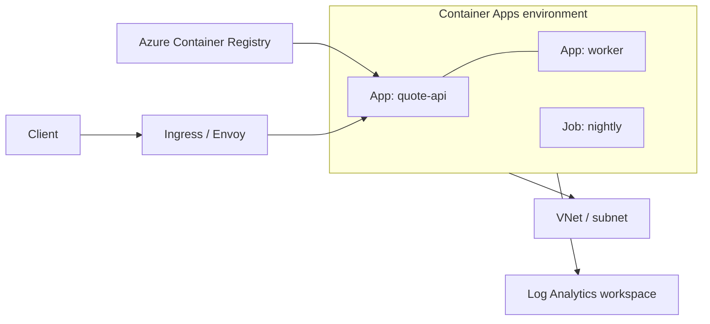

## What this covers

A Container Apps **environment** is the secure boundary that one or more container apps and jobs run inside. Everything in an environment shares a virtual network and a logging destination, and Azure runs the underlying infrastructure (OS patching, scaling, failover). Choosing the environment type, the network and the log destination is the first step of any Container Apps deployment. It also decides where you'll look when something breaks.

**Exam weight:** Develop containerized solutions on Azure (20–25%)

**Skills measured**

- "Deploy applications to Azure Container Apps, including environment configuration and revision management"
- "Monitor and troubleshoot solutions on AKS and Container Apps by inspecting logs, events, and end-to-end connectivity"

## Key concepts

### Environment types

| Type | Plans | Billing |
|------|-------|---------|
| **Workload profiles** (default) | Consumption profile plus optional **Dedicated** profiles (for example D4, E8, GPU profiles) | Consumption: pay per use, scale to zero. Dedicated: fixed management fee plus per-instance cost |
| **Consumption only** (legacy) | Consumption only | Per-app usage only. No environment charge |

Pick Dedicated profiles for predictable cost, larger CPU and memory, or GPUs (for example a model-inference container). Keep bursty APIs on the Consumption profile.

### Networking

- Each environment runs on a VNet. By default Azure creates a managed one with limited features. To control routing, NSGs and private endpoints, bring your own subnet (`--infrastructure-subnet-resource-id`). Workload profiles environments need a subnet of at least **/27**, delegated to `Microsoft.App/environments`.
- **External** environments get a public IP. **Internal** environments (`--internal-only`) have only a private IP, which suits back-end AI APIs.

### Logging

By default, every app in the environment sends logs to one **Log Analytics workspace** (`appLogsConfiguration`): container stdout/stderr, system events (scaling, image pulls, probe failures) and Dapr sidecar logs. You can also send logs to Azure Monitor diagnostic settings, or turn logs off with `--logs-destination none`.

### One environment or several?

| Use one environment when apps... | Use separate environments when apps... |
|----------------------------------|----------------------------------------|
| Are related microservices | Must never share compute |
| Must share a VNet | Need test/prod isolation |
| Call each other through Dapr service invocation | Belong to different teams or security boundaries |
| Should log to the same workspace | Need different networking or regions |

> [!NOTE]
> An environment is **deleted automatically** if it stays idle (no apps or jobs) or in a failed state for more than 90 days.

## How it works



Apps in the same environment can reach each other by app name over internal ingress. The environment's Envoy-based ingress terminates TLS and routes requests to revisions. Logs from every app go to the same workspace, so a single KQL query can follow a request across services.

## Hands-on

### Azure portal

1. Search for **Container Apps Environments** and select **Create**.
2. On **Basics**, choose the resource group, name and region, and select **Workload profiles** as the environment type.
3. On **Monitoring**, choose **Azure Log Analytics** and select or create a workspace.
4. On **Networking**, choose your own VNet and subnet, and select **Internal** or **External** accessibility.
5. After it's created, open **Workload profiles** to add a Dedicated profile if needed.

### Azure CLI

```bash
az extension add --name containerapp --upgrade

az containerapp env create \
  --name quote-api-env \
  --resource-group quote-api-rg \
  --location eastus \
  --logs-workspace-id <workspace-customer-id> \
  --logs-workspace-key <workspace-shared-key>

az containerapp env workload-profile add \
  --name quote-api-env --resource-group quote-api-rg \
  --workload-profile-name d4 --workload-profile-type D4 \
  --min-nodes 1 --max-nodes 3

az containerapp env show -n quote-api-env -g quote-api-rg \
  --query "{state:properties.provisioningState, ip:properties.staticIp}"
```

### Python

```python
from azure.identity import DefaultAzureCredential
from azure.mgmt.appcontainers import ContainerAppsAPIClient

client = ContainerAppsAPIClient(DefaultAzureCredential(), "<subscription-id>")

env = client.managed_environments.get("<resource-group>", "quote-api-env")
print(env.provisioning_state, env.static_ip, env.default_domain)
for profile in env.workload_profiles or []:
    print(profile.name, profile.workload_profile_type)
```

## Exam traps

| Requirement | Choice |
|-------------|--------|
| Scale to zero, pay per request | Consumption profile |
| GPU or guaranteed cores for inference | Dedicated workload profile |
| Private-only API | Internal environment in a custom VNet |
| Strict prod/test separation | Separate environments |
| Central log queries across apps | Shared environment, one Log Analytics workspace |

> [!WARNING]
> **Exam trap:** The environment, not the individual app, owns the VNet and the log destination. To change the subnet you have to create a new environment.

> [!WARNING]
> **Exam trap:** Despite the module name, this is **Container Apps**, not App Service. App Service uses plans and slots. Container Apps uses environments and revisions.

> [!TIP]
> Environment = boundary + network + logs. Workload profile = the hardware your apps run on.

## Quick review

- An environment is the secure boundary around container apps and jobs.
- Workload profiles is the default type (Consumption plus Dedicated). Consumption-only is legacy.
- Apps in one environment share a VNet and a log destination.
- A custom VNet for a workload profiles environment needs a /27 or larger subnet.
- Use separate environments for isolation and no shared compute.
- Idle or failed environments are deleted after 90 days.

## Practice

- [Practice: Container Apps deployment questions](/practice/aca-deploy)
- [Practice: Container troubleshooting questions](/practice/containers-troubleshoot)

## Official references

- [Azure Container Apps environments](https://learn.microsoft.com/azure/container-apps/environment)
- [Workload profiles](https://learn.microsoft.com/azure/container-apps/workload-profiles-overview)
- [Networking in Container Apps](https://learn.microsoft.com/azure/container-apps/networking)
- [AI-200 study guide](https://learn.microsoft.com/credentials/certifications/resources/study-guides/ai-200)
