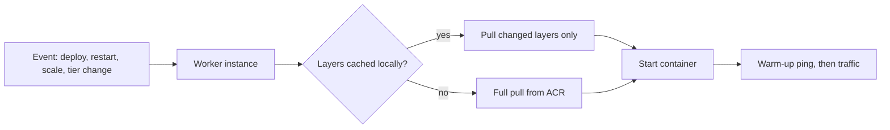

## What this covers

App Service pulls a container image at specific moments, and knowing **when** helps you plan deployments and explain slow starts or unexpected pull activity. A full pull of a multi-GB AI image can add minutes to startup. A cached restart pulls only what changed. This page covers the four pull scenarios, how the layer cache works, and how App Service authenticates to Azure Container Registry when it pulls.

**Exam weight:** Develop containerized solutions on Azure (20–25%)

**Skills measured**

- "Deploy containers to Azure App Service, including configuring App Service to supply environment variables and secrets"
- "Build, store, version, and manage container images by using Azure Container Registry"

## Key concepts

### The four pull scenarios

| Scenario | Pull behavior |
|----------|----------------|
| **Initial deploy / image reference change** | Pulls all image layers |
| **App restart** | Checks for changes. Pulls **only modified** layers, and uses the cache if nothing changed |
| **Scale out** | Each new instance pulls. It may need a **full** pull if the layers aren't cached on the new hosts |
| **Pricing tier change** | May move the app to new infrastructure, which means a **fresh** pull and a longer startup |

### Initial deployment

App Service pulls all image layers when you first deploy the container or change the image reference (a new registry path or tag). Layers are stored on the worker's local disk, as they would be with Docker on your own machine.

### App restart

On every restart, App Service runs `docker pull`. If the tag now points at a new digest, only the changed layers are downloaded. If the image hasn't changed, the cached layers are reused, so a restart is the cheap way to pick up a same-tag update.

### Scale out

When App Service adds instances, each instance has to get the image. New VMs or hosts might not have the layers cached, so a full pull is possible. Watch the cold-scale latency for large AI images. In rare cases, instances also move without any scale operation, which causes the same full pull.

### Pricing tier changes

Moving to another plan or tier can put the app on new infrastructure, which forces a fresh pull and a slower first start after the change.

### Pull authentication

| Method | Setting |
|--------|---------|
| System-assigned managed identity | `acrUseManagedIdentityCreds: true` plus **AcrPull** on the registry |
| User-assigned managed identity | Also set `acrUserManagedIdentityID` to the identity's **client ID** |
| Admin user / service principal | `DOCKER_REGISTRY_SERVER_USERNAME` / `_PASSWORD` app settings (hidden from the app) |

For managed identity pulls, the registry must accept ARM-audience tokens (`az acr config authentication-as-arm`). Otherwise pulls fail with `UNAUTHORIZED: token validation failed`. A registry behind a private endpoint also needs VNet integration plus `vnetImagePullEnabled=true`.

## How it works



While a new container is being pulled and started, App Service keeps sending traffic to the old container. It switches only after the new one starts and answers the warm-up request.

## Hands-on

### Azure portal

1. Open the web app and go to **Deployment Center > Logs** (or **Log stream**) to see the `Pulling image` and `Pull complete` messages.
2. Select **Scale out** and raise the instance count. Watch the log stream: each new instance logs its own pull.
3. In **Deployment Center > Settings**, set **Authentication** to **Managed identity** for ACR pulls.

### Azure CLI

Switch to managed identity pulls:

```bash
principal=$(az webapp identity assign -g <resource-group> -n <app-name> --query principalId -o tsv)
acr_id=$(az acr show -n <registry-name> --query id -o tsv)
az role assignment create --assignee "$principal" --scope "$acr_id" --role AcrPull
az webapp config set -g <resource-group> -n <app-name> \
  --generic-configurations '{"acrUseManagedIdentityCreds": true}'
```

Trigger a restart (changed layers only) and a scale out (possible full pull):

```bash
az webapp restart -g <resource-group> -n <app-name>
az appservice plan update -g <resource-group> -n <plan-name> --number-of-workers 3
```

Allow longer start for big images (Linux, default 230 seconds, max 1800):

```bash
az webapp config appsettings set -g <resource-group> -n <app-name> \
  --settings WEBSITES_CONTAINER_START_TIME_LIMIT=900
```

### Python

Check the image size in ACR to estimate the cost of a cold pull:

```python
from azure.identity import DefaultAzureCredential
from azure.containerregistry import ContainerRegistryClient

client = ContainerRegistryClient("https://<registry-name>.azurecr.io", DefaultAzureCredential())
props = client.get_manifest_properties("docprocessor", "v2")
print(props.digest, props.size_in_bytes)
```

## Exam traps

| Symptom | Likely cause |
|---------|--------------|
| First request after SKU change is slow | Tier change moved the app, so a fresh pull |
| New instances take minutes to serve | Scale out, with a full pull on uncached hosts |
| Restart was fast | Image unchanged, cached layers reused |
| `UNAUTHORIZED` with managed identity | Missing AcrPull, or ARM-audience tokens disabled on the registry |

> [!WARNING]
> **Exam trap:** A restart is **not** always a full pull. It pulls only the changed layers when the image is already cached.

> [!WARNING]
> **Exam trap:** Scale out and SKU change are the classic answers to "why did the pull happen again?"

> [!TIP]
> Keep images small (slim bases, multi-stage builds) and put rarely changing layers first so restarts download less.

## Quick review

- First deploy or a new image reference pulls all layers.
- A restart runs `docker pull` and fetches only the changed layers.
- Each new instance on scale out may need a full pull.
- A pricing tier change can move hosts and force a fresh pull.
- The old container keeps serving until the new one is ready.
- Managed identity pulls need AcrPull plus `acrUseManagedIdentityCreds`.
- Use cases: large model images, slow first request after a SKU bump, capacity planning.

## Practice

- [Practice: App Service container questions](/practice/app-service-containers)
- [Practice: Azure Container Registry questions](/practice/acr-images)

## Official references

- [Configure a custom container (image storage, managed identity pulls)](https://learn.microsoft.com/azure/app-service/configure-custom-container)
- [Scale up an app in App Service](https://learn.microsoft.com/azure/app-service/manage-scale-up)
- [AI-200 study guide](https://learn.microsoft.com/credentials/certifications/resources/study-guides/ai-200)
